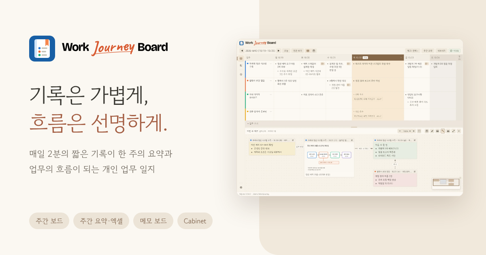
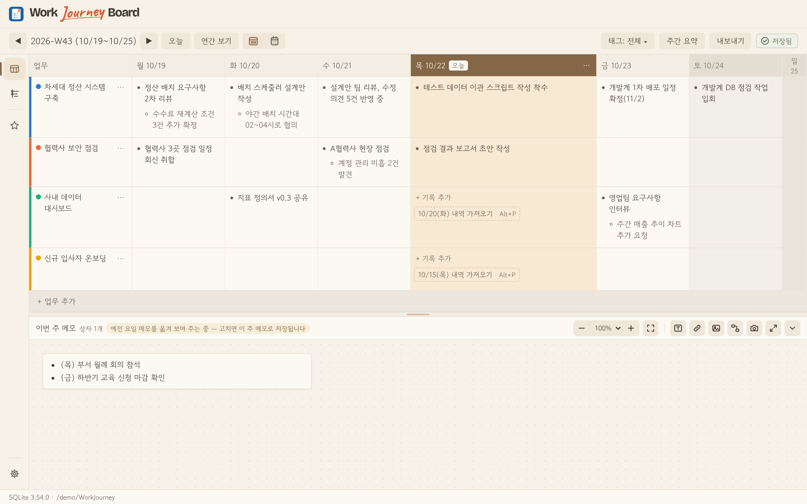
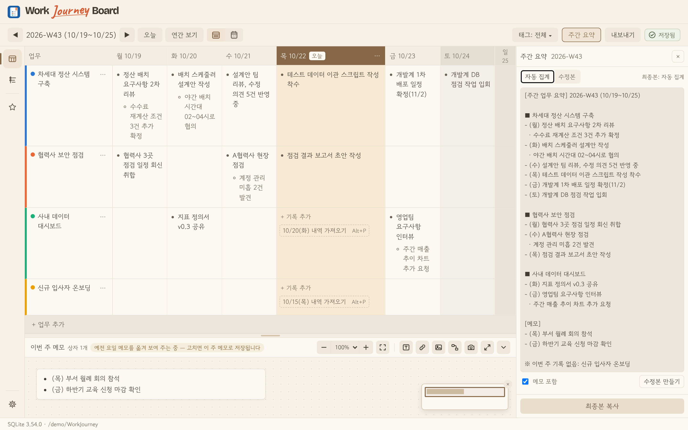
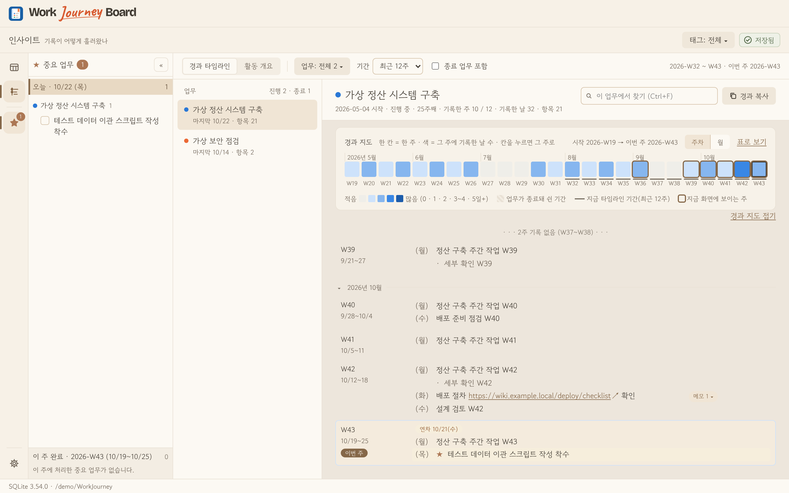
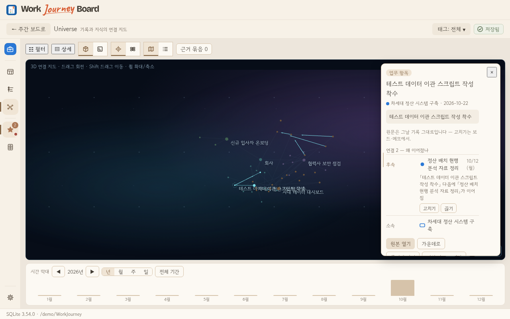
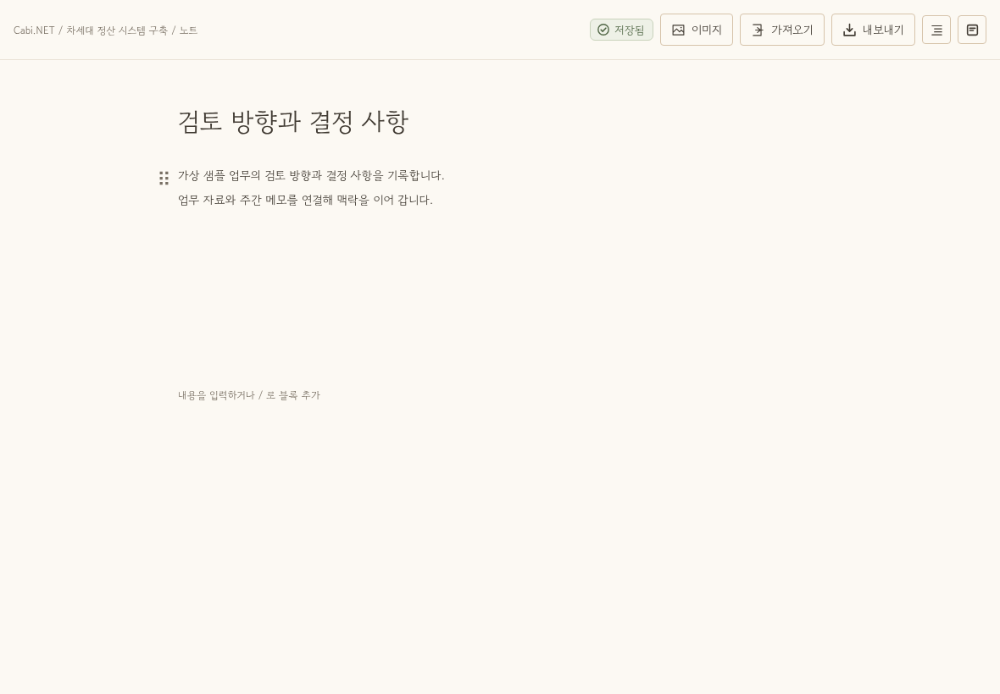
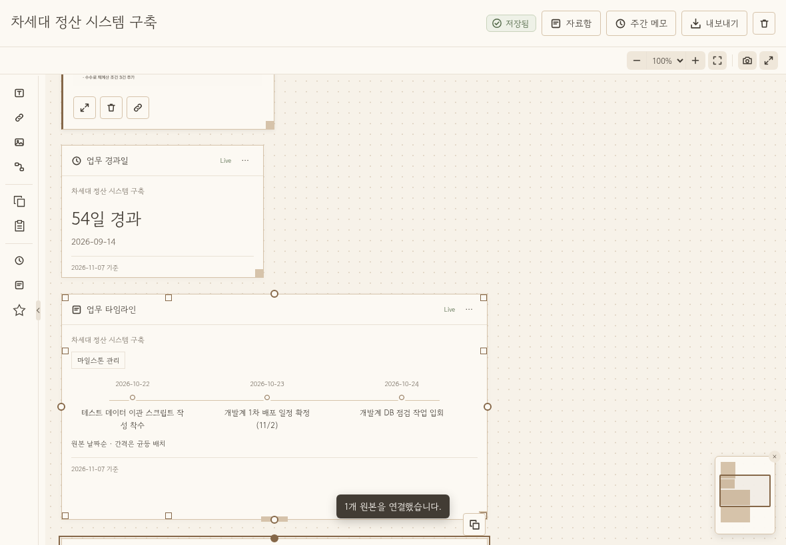
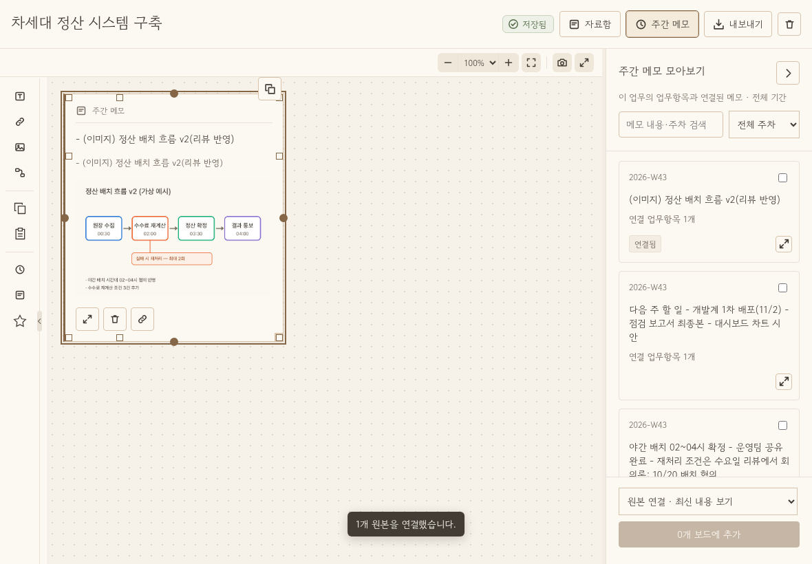

<div align="center">

<p align="center"></p>

<p align="center">
  <picture>
    <source media="(prefers-color-scheme: dark)" srcset="docs/brand/wordmark-dark.svg">
    
  </picture>
</p>

**오늘 한 일을, 한 줄씩.** 주간 보고부터 업무별 작업 공간, 기록을 잇는 Universe까지.

[최신 판 내려받기](https://github.com/chs2147/work-journey-board/releases/latest) · [소개 사이트](https://chs2147.github.io/work-journey-board/) · [Version History](#version-history)

</div>





<p align="center"><sub>주간 보드 · 이번 주 메모(업무 연결 메모·이미지 메모·관계선) · 시그니처 테마 · 화면 속 기록은 모두 가상 예시</sub></p>

## 핵심 기능
- **매일 2분, 키보드만으로** — 주간·데일리 뷰에서 개조식 기록, 업무·태그 간편 추가, 마감일 컬러칩·중요 표시·완료/완료 취소·매주 반복. 날짜 지정 복제와 이전 기록 가져오기에서도 메모·자료 연결을 함께 유지
- **쓰기만 하면 주간 보고** — 업무별·요일별 자동 집계, 수정본, 사내 AI 도구용 다듬기 지시문, 여러 주 엑셀 2시트 · 메모 보드 그림 내보내기
- **지나온 일이 한눈에** — 년월→주차→업무 내역으로 이어지는 업무 타임라인, 유연한 열 너비의 활동 히트맵·habit tracker, 연간 보기
- **메모 보드로 맥락까지** — 업무항목에 연결한 글·이미지·링크 카드와 관계선, 다중 선택·그룹 이동·글자색·Markdown 파일 드롭, PNG·Markdown 내보내기
- **Universe — 기록이 살아 있는 연결 지도로** — 독립된 다크 우주에서 3D 회전·이동·확대/축소, 줌에 따라 이어지는 은하↔초점 탐색, 정적 2D·목록 보기. 접고 폭을 조절하는 필터·상세 패널, 시간 탐색·주를 넘는 직접 연결, 지식 카드·외부 AI에 붙여 넣을 근거 묶음 (`Alt+5`)
- **Cabi.NET — 업무별 자료·노트·메모보드** — 기존 Cabinet의 폴더·링크 관리를 확장한 업무 작업 공간. **1.20.0**부터 업무별 복수 블록 노트와 업무당 하나의 자유 보드를 별도 모달리스 창으로 제공. 누적 주간 메모 연결, 주간↔업무 보드 객체·이미지 복제, 목록·카드·보드 보기, Markdown 가져오기와 Markdown·한글 PDF 내보내기. 블록 이끌이로 순서를 옮기고, 선택한 글 가까이에서 서식·링크·글자색 편집 ([실제 화면](docs/mockups/cabinet-v2/implemented/README.md))
- **Live Widget — 업무의 현재 상태** — Cabi.NET 업무 보드에 시작일/마지막 기록일 기준 경과일, 업무 타임라인, 미완료 중요 업무를 배치. 타임라인은 기록 목록·가로 마일스톤·주차 요약으로 전환하고, 위젯에서 완료한 항목은 메인 업무에도 반영
- **워크스페이스로 회사·개인 따로** — 공간마다 독립 일지 파일, 레일의 공간 아이콘과 `Ctrl+Alt+1~9`로 전환. 업무·메모·자료·지식의 맥락을 공간별로 보관
- **찾고 맞추기** — 업무·메모·자료 통합 검색(`Ctrl+Shift+F`), Cabi.NET 노트·업무 보드 검색, 대한민국 공휴일·회사 휴일·기타 휴가, 업무·요일 열 폭 조절
- **빠른 이용 가이드** — 장면별 사용법을 [소개 사이트](https://chs2147.github.io/work-journey-board/guide/)에서 보거나 PDF로 내려받기. 최신 정식판은 Releases에서 확인

### 주요 기능 화면

| 주간 요약 — 기록을 보고서로 | 인사이트 — 업무 타임라인과 활동 |
|---|---|
|  |  |

| Universe — 기록과 지식의 연결 지도 | Cabi.NET — 업무 노트와 자료 연결 |
|---|---|
|  |  |

| Live Widget — 업무의 현재 상태와 가로 마일스톤 | 업무 메모보드 — 누적 주간 메모와 자료 연결 |
|---|---|
|  |  |

화면은 가상 샘플입니다. [장면별 이용 가이드](https://chs2147.github.io/work-journey-board/guide/)에서 사용 흐름을 확인하세요.

## 설치
[Releases](https://github.com/chs2147/work-journey-board/releases/latest)에서 내려받습니다 — **Windows 10·11 · macOS 13 이상**(1.6.0부터, 같은 판·같은 기능).

| 파일 | 용도 |
|---|---|
| `WorkJourneyBoard_<버전>_setup.exe` | **Windows 기본판**(약 10MB) — WebView2가 없으면 설치 중 자동으로 받음 |
| `WorkJourneyBoard_<버전>_setup_offline.exe` | **Windows 오프라인 설치판**(약 220MB, 올라와 있는 판만) — 인터넷이 막힌 PC용, WebView2 포함 |
| `WorkJourneyBoard_<버전>_mac.dmg` | **macOS**(인텔·애플 실리콘 공용) — 열어서 앱을 응용 프로그램 폴더로 끌어 놓기 |

- Windows: 관리자 권한 없이 **현재 사용자에게만** 설치됩니다.
- macOS: 처음 열면 "'Work Journey Board'을(를) 열지 않음" 창이 뜹니다(애플 개발자 서명이 없는 앱이라 macOS가 막는 것 — 창에는 [휴지통으로 이동]·[완료]만 있음). **[완료]**를 누른 뒤 **시스템 설정 › 개인정보 보호 및 보안**을 열고 맨 아래 **보안** 칸의 "'Work Journey Board'이(가) 차단되었습니다" 옆 **[그래도 열기]** → 암호(또는 Touch ID) → 앱을 다시 열고 한 번 더 뜨는 창에서 **[그래도 열기]**. 처음 한 번만 하면 됩니다(앱 안에서 받은 새 판은 다시 묻지 않음). 단축키는 `Ctrl` 대신 `⌘`, `Alt` 대신 `⌥`.
- 처음 켜면 시그니처 테마(설정 › 화면 › 테마에서 라이트·다크·시스템 설정으로 바꿀 수 있음).
- 새 판이 나오면 앱이 켤 때 알려 주고, 설정 › 업데이트에서 내려받아 설치합니다(SHA256 확인 · 설치 전 일지 자동 백업).

## 기록과 개인정보
- 기록은 **사용자가 고른 폴더의 SQLite 파일 1개**에만 저장하고, 기록·메모는 어디에도 보내지 않습니다(인터넷은 새 판 확인·내려받기에만 — 이 저장소의 GitHub Releases).
- 자동 백업: 매일·매월 · 켜 둔 동안 2시간마다 · 보조 백업 위치(선택). 백업 당시 앱·DB 구조 버전을 이력에 남기고, 보관 일수·용량 규칙으로 백업 파일을 정리합니다. 문제가 생기면 **앱 안에서 백업으로 복원**(지금 파일은 `_before-restore`로 보관, 되돌리기 가능) — 앱을 열 수 없을 때의 수동 절차는 [docs/restore-guide.md](docs/restore-guide.md).

## 문서
| 문서 | 내용 |
|---|---|
| [docs/overview.md](docs/overview.md) | 요구사항 · 설계 결정 이력 · **화면 구성(10절)** · 단축키(10-3절) · 인계 명세(12절) |
| [docs/data-spec.md](docs/data-spec.md) | ISO 주차 · 스키마 SQL · 카테고리 활성/무기록 규칙 · 삭제 · 백업 · 저장소 인터페이스 |
| [docs/output-spec.md](docs/output-spec.md) | 주간 자동 집계 · 엑셀 2시트 양식 · 내보내기 · AI 클립보드 지시문 |
| [docs/viz-spec.md](docs/viz-spec.md) | 업무 타임라인 · 활동 히트맵 · 기간 막대 · 주별 비중 · 업무 색 팔레트 |
| [docs/brand-spec.md](docs/brand-spec.md) | 앱 아이콘 · 워드마크 규칙 · 만드는 방법 |
| [docs/release-phase2-spec.md](docs/release-phase2-spec.md) | 정식 릴리스 준비 — 시그니처 기본값 · 설치 프로그램 그림 · 정식 판/오프라인판 배포 · 만든 이 표시 |
| [docs/optimize-1031-plan.md](docs/optimize-1031-plan.md) | 최적화 · 백업 보강 · 앱 안 복원(v0.4.0) |
| [docs/restore-guide.md](docs/restore-guide.md) | 앱을 열 수 없을 때 백업에서 수동으로 복원하기 |
| [docs/project-plan.md](docs/project-plan.md) | 마일스톤 I-M0~M5 · 관문 G1/G2 |
| [docs/m1-check.md](docs/m1-check.md) | 회사 PC 확인표(판마다) |
| 기능별 상세 설계 | [스플래시](docs/splash-spec.md) · [중요·반복](docs/important-repeat-spec.md) · [주간 메모](docs/weekly-note-spec.md) · [관계선](docs/note-relation-spec.md) · [다중 연결](docs/multi-link-spec.md) · [인사이트 S1](docs/m3-s1-spec.md) · [S2](docs/m3-s2-spec.md) · 개선 [1026](docs/improve-1026-spec.md) · [1026v2](docs/improve-1026v2-spec.md) · [1027v3](docs/improve-1027v3-spec.md) · [1027v4](docs/improve-1027v4-spec.md) · [1027v5](docs/improve-1027v5-spec.md) · [디자인 리뉴얼](docs/renewal/) |
| [docs/wireframes/](docs/wireframes/) · [docs/samples/](docs/samples/) | 와이어프레임 · 엑셀 샘플(가상 데이터) |
| [CLAUDE.md](CLAUDE.md) | 구현 규칙(외부 통신 0 · 실데이터 금지 · 데이터 파일 안전 · 기술 스택) |

## 기술 스택
Tauri v2(NSIS per-user) · React 18 + Vite + TypeScript · SQLite(실앱 tauri-plugin-sql / 개발·테스트 sql.js) · ExcelJS · Three.js(Universe) · Tiptap(블록 편집) · pdf-lib(노트 PDF) · SVG + d3-scale · date-fns · Vitest + Playwright · GitHub Actions(ubuntu CI·macos Rust 검사 + windows-latest NSIS·macos-latest 유니버설 DMG 빌드)

## 사용한 글꼴
- [Pretendard](https://github.com/orioncactus/pretendard) — 라이트·다크 테마 본문. SIL Open Font License 1.1, 공식 배포 파일을 수정 없이 포함 ([라이선스 전문](public/licenses/Pretendard-OFL-1.1.txt))
- [고운돋움](https://github.com/yangheeryu/Gowun-Dodum) — 시그니처 테마 본문. SIL Open Font License 1.1 ([라이선스 전문](public/licenses/GowunDodum-OFL-1.1.txt))

## 개발
```bash
npm ci
npm run dev          # 브라우저 모드(sql.js 메모리) — http://localhost:1420
npm test             # 단위 테스트(Vitest)
npm run e2e          # E2E(Playwright, 브라우저 모드)
npm run perf:mem     # 주 전환 메모리·조회 수 측정(가상 1년치 일지)
npm run lint && npm run format:check && npm run typecheck
npm run tauri dev    # 실앱 모드(윈도우·맥 / 리눅스는 webkit2gtk-4.1 필요)
```
- 브라우저 모드 주소 옵션(E2E·시연): `?today=YYYY-MM-DD` 오늘 고정 · `?empty=1` 빈 일지 · `?fresh=1` 첫 실행 화면 · `?existing=/경로` 그 폴더에 샘플 일지 준비 · `?config=/경로` 설정 폴더 지정 · `?sample=year`(`year-img`) 가상 1년치 일지 · `?sample=showcase` README·소개 사이트 화면용 메모 보드 예시 · `?corrupt=1` 파손 일지
- 설치 파일: `main`에 반영되면 *Build desktop installers*가 윈도우(NSIS)·맥(유니버설 DMG)을 나란히 만들고, **둘 다 성공해야** [Releases](https://github.com/chs2147/work-journey-board/releases)에 `v<버전>`으로 함께 올린다 — 0.x·`-rc`는 사전 릴리스, 1.0.0 이상 정식 판은 정식 릴리스. 윈도우 오프라인 설치판은 요청할 때만 Actions → *Build desktop installers* → Run workflow(main) → `offline`으로 그 판 릴리스에 더한다. 하나의 원본으로 두 플랫폼을 같은 판으로 운영한다([docs/macos-spec.md](docs/macos-spec.md)).

현재 상세 기능과 도입 버전: [Feature List 운영 문서](docs/features/README.md) · [현재 목록](docs/features/CURRENT.md) · [검토용 Excel](docs/features/exports/work-journey-board/Work-Journey-Board-Feature-List-v1.22.0.xlsx)

## Version History

최근 5개 버전(정식·RC)을 표시합니다. [더 보기 — 전체 버전 히스토리](VERSION_HISTORY.md)

### v1.22.0 (2026-11-07) — Cabi.NET 편집·메모 팔레트·Universe 개선

- 명칭 없는 1열 아이콘 팔레트·미니멀 접기 손잡이, 보기 도구는 기존 상단 오른쪽에 유지.
- 업무 노트 표 행/열 메뉴·계층 번호·가져오기/목차 아이콘, 모든 메모 객체의 가로/세로 프레임과 실행 취소 개선.
- Universe 성운·별빛 배경, 정적 모드·모션 감소 지원. DB v18, 전진 마이그레이션 직전 자동 백업.
- RC CI·Windows/macOS 빌드 및 사용자 배포 확인 후 main 반영 승인. 이전 main은 `release/v1.21.0`에 보존.

### v1.22.0-rc.1 (2026-11-07) — 접이식 세로 팔레트·표 편집·객체 크기 개선

- C안 접이식 세로 도구 팔레트와 위젯 그룹·복사/붙여넣기 아이콘. 불필요한 고정 문구·보드 미리보기 제거.
- 업무 노트의 표 행/열 메뉴·계층 번호·명확한 이미지/가져오기·목차 아이콘.
- 모든 보드 객체의 가로/세로 프레임 크기 저장·실행 취소, Universe 성운/별빛 배경. DB v18.
- improve-v18 작업 브랜치 검증판. 정식 버전·main 반영은 별도 승인.

### v1.21.0 (2026-11-07) — Cabi.NET Live Widget·노트 편집 개선

- 업무 경과일·타임라인·중요 업무 Live Widget과 기록 목록·가로 마일스톤·주차 요약의 세 표현 제공.
- 노트 블록 이끌이·이동·선택 서식·글자색, 저장 표시·연결점·내보내기·삭제 확인과 창 종료 개선.
- CI 회귀 수정 후 전체 E2E 594개·단위 519개와 Windows/macOS 빌드 통과. DB v17.
- 이전 main 1.20.0은 `release/v1.20.0`에 보존. Windows 기본 설치판·macOS 유니버설 DMG 동시 제공.

### v1.21.0-rc.1 (2026-11-07) — Cabi.NET Live Widget·노트 편집 검증판

- 업무 경과일·업무 타임라인·중요 업무 라이브 위젯. 타임라인은 기록 목록·가로 마일스톤·가로 주차 요약의 세 가지 표현 제공.
- 노트 블록 이끌이·드래그 이동·선택 서식/글자색, 공통 저장 표시, 자료 카드 연결점과 삭제 확인/창 종료 개선.
- DB v17. `improve-v17` 작업 브랜치 검증판이며 정식 main 반영·배포 전.

### v1.20.0 (2026-11-07) — Cabi.NET 업무 작업 공간·Universe 소개 개편
- 업무별 복수 블록 노트와 단일 전용 메모보드, 별도 모달리스 창·자료 원본 카드·누적 주간 메모 연동.
- 주간↔업무 보드 객체·이미지·관계선 복제, Markdown 가져오기 및 Markdown·한글 PDF 내보내기, 전역 검색·저장 안정성 보강.
- README 기능 소개와 티저의 Universe·Cabi.NET 전용 모션 섹션 갱신. main 게시 시 Cabi.NET RC 표시 제거.
- DB v16, 이전 직전 백업. 기존 main 1.19.0은 `release/v1.19.0`에 보존. Windows 기본 설치판·macOS 유니버설 DMG 동시 제공.

[더 보기 — 전체 버전 히스토리](VERSION_HISTORY.md)

---

<div align="center">

<sub>Made by</sub>

<picture>
  <source media="(prefers-color-scheme: dark)" srcset="docs/brand/m1-en-reverse.svg">
  
</picture>

Copyright 2026 sanbonjini · [브랜드 사이트](https://sanbonjini.vercel.app)

<sub>sanbonjini 로고는 브랜드 자산 사용 정책을 따르며 이 저장소의 코드 라이선스와 별개입니다.</sub>

</div>
