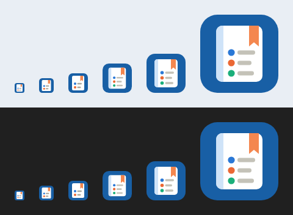

# 앱 아이콘·워드마크 (2026-10-23 확정)

> 시안 비교(A 대문자 포인트 / B 저널 손글씨 / C 여정 라인)에서 **B안 + 그로테스크 글꼴** 채택.
> 만드는 방법: [scripts/brand/README.md](../scripts/brand/README.md)

## 1. 아이콘 — 책갈피가 꽂힌 노트
- 파란 둥근 사각형(`#185fa5`) 위에 흰 노트를 놓았다. 노트에는 개조식 세 줄(업무 색 점 c1·c2·c3 + 회색 줄)과 주황 책갈피(오늘 강조색 계열 `#f4874f`)가 있다. "매일 적는 업무 기록"을 나타낸다.
- 두 가지 판을 쓴다:
  - **기본판** `src/shared/brand/icon.svg`(64 격자): 48px 이상, 설치 파일, 화면 안 아이콘.
  - **작은 판** `icon-small.svg`(32 격자): 16·24·32px(작업 표시줄·창 제목·바로가기). 노트·책갈피·두 줄만 남기고 굵게 그렸다.
  - `icon.ico`에는 크기마다 따로 그린 그림이 들어 있다(16·24·32 = 작은 판, 48·64·256 = 기본판). 작은 크기를 큰 그림에서 줄이지 않는다.
- 화면에 나오는 곳: 스플래시 창(60px), 메인 창 상단 바(24px), 첫 실행 환영 화면(48px), 설치 파일·작업 표시줄·창 제목(Windows).

## 2. 워드마크(타이틀) — `src/shared/brand/wordmark.svg`
| 부분 | 글꼴(SIL OFL 1.1) | 처리 | 색 |
|---|---|---|---|
| Work · Board | **Bricolage Grotesque** 700, opsz 96 | 자간 −0.03em | `currentColor` → `--text-1` |
| Journey | **Caveat** 700(손글씨) | 1.36배, 3.5° 기울임(오른쪽이 올라감), 기준선 0.04em 내림 | `--today-mark`(라이트 `#d85a30` / 다크 `#ef7a4d`) |
| 밑줄 | — | Journey 아래 손으로 그은 곡선, 굵기 0.045em, Journey와 같은 기울기 | `--today-mark` |

- **글꼴 파일은 앱에 넣지 않는다.** 글자 윤곽을 SVG 도형으로 바꿔 넣는다. OFL은 글꼴로 만든 그림·로고에 제약을 두지 않는다. 그래서 외부 통신 0 원칙과 설치 크기에 영향이 없고, 앱 본문 글꼴은 Pretendard 그대로다.
- **겹침 방지**: 손글씨 Journey는 기울임·J 꼬리·밑줄까지 포함한 실제 외곽으로 SVG 영역(viewBox)을 잡는다.
  - 그래서 워드마크 상자 높이 ≈ 대문자 높이 × 1.9다. 화면에서는 이 상자 높이로 크기를 정하고, 위아래 요소는 상자 밖에 둔다.
  - Journey 앞뒤 간격(0.20em·0.24em)도 기울인 외곽 기준이라 Work·Board 글자와 닿지 않는다.
- 크기(상자 높이): 스플래시 40px · 첫 실행 38px · 상단 바 27px(대문자 약 14px).
- 접근성: SVG에 `role="img"`, `aria-label="Work Journey Board"`. 화면 낭독기는 앱 이름으로 읽는다.
- 테마 색은 CSS가 바꾼다: `.wm-j { fill }`, `.wm-u { stroke }`. 앱은 `src/ui/common/Brand.module.css`, 스플래시는 `splash.html`.

## 3. 코드 위치
| 파일 | 역할 |
|---|---|
| `src/shared/brand/icon.svg` · `icon-small.svg` · `wordmark.svg` | 그림의 단일 출처 |
| `src/ui/common/Brand.tsx` | `<BrandLockup size="bar" \| "hero">` — 상단 바·첫 실행 |
| `splash.html` `.logo` · `.name` | 같은 SVG를 직접 품음(스크립트 전에 그려야 함). `tests/unit/brand.test.ts`가 원본과 대조 |
| `src-tauri/icons/*` | 설치·창 아이콘(`scripts/brand`로 생성) |
| `scripts/brand/*` | 생성 도구(디자인 시점, 앱과 무관) |
