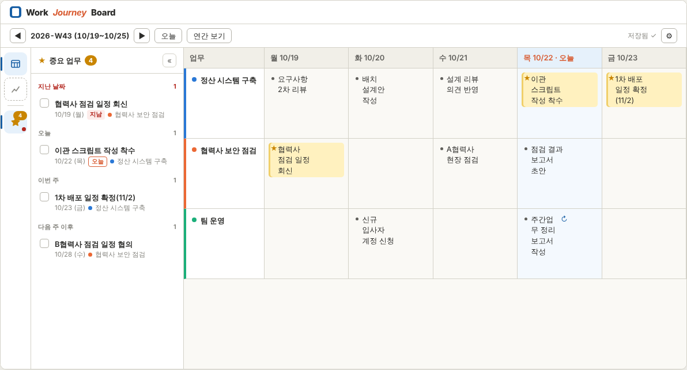
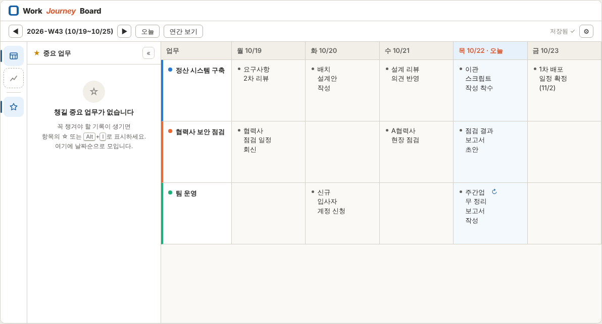
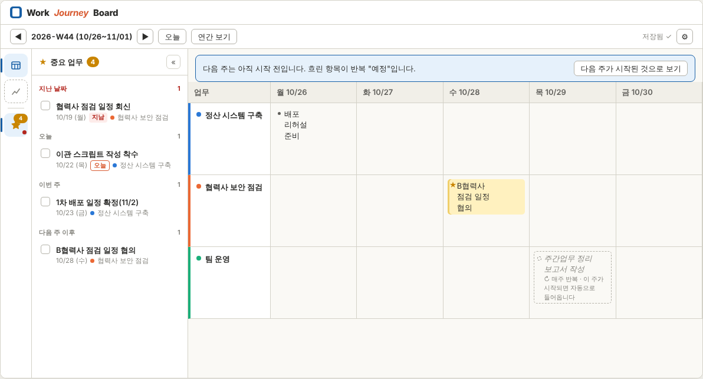

# 중요 표시 · 매주 반복 · 왼쪽 메뉴 — 상세 설계 (2026-10-24 확정)

> 상태(2026-10-24): **전부 확정** — 중요 표시 B안(형광펜 + 별), 매주 반복 R1(항목에서 ↻), 왼쪽 메뉴 M1(아이콘 레일 + 패널), 단축키·최근 완료 7일·반복 생성 규칙(9절) 추천대로.
> 구현: **F1(중요 표시 + 레일·패널)·F2(매주 반복) 완료** — 구현하며 바뀐 점은 10절.
> 후속: 패널의 날짜 묶음 머리 = 색 띠(지난 날짜·오늘·이번 주·다음 주 이후, 오늘·이번 주는 날짜) — [improve-1027v3-spec.md](improve-1027v3-spec.md) 6절(`0.2.16`).
> 후속: **"최근 완료 7일" 폐기 → 완료 기록 영구 보관 + 패널 "이 주 완료"(보고 있는 주에 처리한 것만)**, 보드·메모·타임라인에 완료 뱃지 ✓ — [improve-1027v4-spec.md](improve-1027v4-spec.md) 2~4절(`0.2.18`).
> 시안 목업은 사용자 개인 미리보기(클로드 아티팩트)로 비교했다. 아래 그림은 그 목업 화면이고, 기록은 가상 예시다.



## 0. 목표와 원칙
- **중요 표시**: 요일 칸에 적은 기록 중 꼭 챙겨야 할 것을 표시해서 놓치지 않게 한다. "중요 = 아직 챙겨야 하는 일"이라는 한 가지 뜻만 갖는다. 처리하면(체크) 강조가 풀린다.
- **매주 반복**: 매주 같은 요일에 하는 일(예: 목요일 "주간업무 정리 보고서 작성")을 한 번 정해 두면 새 주에 자동으로 들어온다. 들어온 항목은 평소 기록과 똑같이 고친다.
- **입력 UX 우선**(CLAUDE.md 4-6): 두 기능 모두 키보드만으로 켜고 끌 수 있고, 입력 중 포커스를 빼앗지 않는다. 패널이 저절로 열리지도 않는다.
- **만들지 않은 기능의 메뉴는 넣지 않는다**(i-m1-plan 0-2와 같은 원칙). 메뉴 구조는 미래 자리만 정해 둔다.

## 1. 왼쪽 메뉴 구조 — M1 아이콘 레일 + 패널 (추천)

### 1-1. 기능 분류
| 종류 | 뜻 | 기능(지금 / 예정) |
|---|---|---|
| **보기** | 가운데 화면 자체를 바꾼다 | 주간 보드 / 인사이트(M3) |
| **곁 패널** | 보드를 보면서 옆에 띄운다 | 중요 업무(왼쪽, 이번) / 주간 요약(오른쪽, M2 — 기존 10-7 유지) |
| **대화상자·설정** | 잠깐 열고 닫는다 | 설정(⚙, 2줄 오른쪽 유지) · 내보내기(M2, 2줄 오른쪽) · 반복 항목 관리(설정 안) |

### 1-2. 시안 비교
| 안 | 구성 | 판단 |
|---|---|---|
| **M1 ✅ 추천** | 왼쪽 **52px 아이콘 레일**: 위쪽 = 보기, 구분선 아래 = 패널. 패널은 레일 옆에 열고 닫는다 | 보드 폭을 가장 적게 쓴다(닫으면 52px). 기능이 늘면 아이콘 한 칸씩. 배지로 "챙길 일 N개"가 늘 보인다 |
| M2 | 236px 섹션형 사이드바(보기 / 중요 업무 / 관리) | 한눈에 다 보이지만 보드 7열 폭을 늘 236px 잃는다 |
| M3 | 보기는 2줄 상단 [주간 보드 \| 인사이트] 탭, 왼쪽은 중요 업무 패널만 | 지금 설계와 가장 가깝지만, 패널이 늘면 왼쪽 자리 규칙을 다시 정해야 한다 |

### 1-3. M1 상세 (확정)
- **레일**(폭 52px, `--surface-card`, 오른쪽 경계선). 위에서부터:
  1. **주간 보드**(보기, `Alt+1`) — 지금 보기이면 강조 배경 + 왼쪽 막대
  2. (M3) **인사이트**(보기, `Alt+3`) — M3에서 추가. **지금은 넣지 않는다**
  3. 구분선
  4. **중요 업무**(패널, `Alt+2`) — 별 아이콘 + 개수 배지(2-5)
- **패널**(폭 264px): 레일 오른쪽에 열린다. 머리줄 = "★ 중요 업무 [N]" + [«] 닫기. 같은 레일 버튼을 다시 누르거나 `Alt+2` 또는 `Esc`(패널 안에 포커스가 있을 때)로 닫는다.
- **좁은 창**: 창 폭이 1180px 미만이면 패널은 보드 위에 겹쳐 뜬다(오버레이, 그림자). 보드 칸을 누르면 닫힌다. 1180px 이상이면 보드를 밀어낸다.
- 상단 2줄(타이틀 / 주 이동·저장 상태·⚙)은 10-1 그대로다. 주간 요약·내보내기 버튼(M2)은 2줄 오른쪽에 들어간다.
- 레일과 패널은 **보드가 열린 상태(일지 준비 완료)**에서만 보인다. 첫 실행·오류 화면에는 없다.

## 2. 중요 표시 (B안)

### 2-1. 보드 표시
- 중요 항목: **옅은 형광펜 띠**(배경 `--mark`, 왼쪽 3px 선 `--mark-line`) + 개조 부호가 **★**(`--star`)로 바뀐다. 세부 항목도 같다(★가 조금 작음).
- 토큰(tokens.css 추가):

| 토큰 | 라이트 | 다크 |
|---|---|---|
| `--star` | `#c98500` | `#e0a83a` |
| `--mark` | `#fff1bf` | `#3a3116` |
| `--mark-line` | `#f0cf6a` | `#7a6222` |

- 입력칸 포커스 테두리는 형광펜 띠 위에도 그대로 보인다.
- 매주 반복 항목에는 글 끝에 작은 **↻**(`--accent`)이 붙는다(3절).

### 2-2. 켜고 끄기
| 어디서 | 방법 |
|---|---|
| 보드 항목 | **개조 부호(점)가 곧 단추**다. 마우스를 올리면 점이 **☆**로 바뀌고, 누르면 켜고 끈다(켜지면 ★). 칸 폭을 따로 쓰지 않는다(10절) |
| 키보드 | 항목 입력 중 **`Alt+I`** — 켜고 끄기. 커서·포커스는 그대로다 |
| 중요 업무 목록 | 체크 = **처리 완료**(강조 해제, 2-4) |

- 빈 항목(글자 없음)은 표시할 수 없다. 버튼을 숨기고, `Alt+I`는 무시한다(저장 규칙상 빈 항목은 저장되지 않음).
- `Enter`로 중요 항목을 나누면 새 항목은 중요가 아니다(원래 항목만 유지).
- 보드에서 켜고 끄는 것은 그 칸의 **실행 취소(Ctrl+Z) 기록에 들어간다**. 목록에서 처리 완료하는 것은 토스트 [되돌리기]로 되돌린다(2-4).
- 켜고 끌 때 토스트는 띄우지 않는다. 배지 숫자가 바뀌는 것으로 충분하다(입력 흐름 방해 최소).

### 2-3. 중요 업무 목록(패널)
- 대상: **모든 주**의 중요 항목. 보고 있는 주와 상관없다.
- 묶음(이 순서, 빈 묶음은 머리째 숨김):
  1. **지난 날짜**: 오늘보다 앞선 날짜. 머리·"지남" 꼬리표를 `--danger`로 표시 — 놓칠 위험
  2. **오늘**: 묶음 머리가 "오늘"이라 줄마다 꼬리표·날짜를 붙이지 않는다(v0.2.9)
  3. **이번 주**: 오늘 이후 ~ 이번 주 일요일
  4. **다음 주 이후**
- 묶음 안은 **업무명으로 한 번 더 묶는다**(v0.2.9, [improve-1026v2-spec.md](improve-1026v2-spec.md) 8절): 업무 머리 = 업무 색 점 · 업무 이름 · 수(종료된 업무면 "종료됨"), 접지 않는다. 업무 순서 = 보드 순서, 업무 안은 날짜 → 칸 안 순서.
- 한 줄 구성(업무 머리 아래 들여씀):
  - 체크 상자
  - 항목 글(최대 2줄, 넘치면 …). 세부 항목이면 앞에 "본 항목 글 ›"을 흐리게 붙인다
  - 아랫줄: `10/22 (목)` · [지남]. 업무 이름은 머리에 있으니 빼고, "오늘" 묶음에서는 날짜도 뺀다(아랫줄 없음)
- 항목 누르기 → 그 주로 이동 + 그 요일 열 포커스 + 그 항목 입력칸 포커스(글 끝). 1초간 강조 테두리.
- 키보드: `Alt+2`로 패널을 열면 목록 첫 항목에 포커스. `↑`/`↓` 이동(업무 머리는 건너뛰고 항목만), `Enter` = 그 항목으로 이동, `Space` = 처리 완료, `Esc` = 보드로 돌아감.
- 목록은 기록이 저장되면 바로 다시 그린다. 같은 저장소 조회 1회이고, 중요 항목에만 걸리는 부분 색인을 쓴다.

### 2-4. 처리 완료와 되돌리기
- 체크 → 그 항목 `flagged = 0`, `flag_done_at = 지금` → 보드 강조도 풀린다.
- 토스트 "처리 완료 — 강조를 해제했습니다 [되돌리기]"(5초).
- **최근 완료**: 패널 아래 접이식 영역(기본 접힘). `flag_done_at`이 **7일 이내**인 항목을 최근 순으로 보여 주고, 줄마다 [되돌리기]가 있다(`flagged = 1`, `flag_done_at = NULL`).
- 7일이 지나면 목록에서만 사라진다. 기록 자체는 그대로다.

### 2-5. 레일 배지 · 빈 상태 (중요 업무 0건)
| 상황 | 표시 |
|---|---|
| 0건 | 레일 별을 **빈 별·회색**으로, 배지 숨김("0"을 띄우지 않음) |
| 1건 이상 | 채운 별(`--star`) + 주황 배지에 개수(99 초과는 "99+") |
| 지난 날짜 항목이 있음 | 배지 아래 작은 빨간 점(`--danger`) |
| 패널을 연 채 0건 — 처음부터 없음 | 가운데 안내: 빈 별 아이콘 · **"챙길 중요 업무가 없습니다"** · "꼭 챙겨야 할 기록이 생기면 항목의 ☆ 또는 Alt+I로 표시하세요. 여기에 날짜순으로 모입니다." |
| 패널을 연 채 0건 — 방금 모두 처리함 | 체크 아이콘(`--ok`) · **"모두 챙겼습니다"** · "처리한 항목은 아래 '최근 완료'에 7일 동안 남습니다." |

- **패널 열림 상태**: 사용자가 열고 닫은 상태를 설정에 기억한다(`settings.ui.importantPanelOpen`).
  - 단 **앱을 켤 때 0건이면 닫힌 채로 시작**한다(보드 폭 확보).
  - 새로 ★를 표시해도 패널을 저절로 열지 않는다. 배지만 바뀐다.



## 3. 매주 반복 (R1)



### 3-1. 켜고 끄기
| 어디서 | 방법 |
|---|---|
| 보드 항목 | 항목 오른쪽 끝 **↻** 버튼(☆ 옆) |
| 키보드 | 항목 입력 중 **`Alt+R`** |
| 설정 > 반복 항목 | 목록에서 중지·다시 시작·삭제·문구 수정(3-5) |

- 반복 단위는 **본 항목 + 딸린 세부 항목 묶음**이다. 세부 항목에서 켜면 그 본 항목 묶음에 적용된다.
- **켜기**:
  1. 그 묶음의 지금 글을 그대로 복사해 규칙을 만든다(업무·요일 = 그 칸).
  2. 시작 주 = **그 항목이 있는 주의 다음 주**다.
  3. 원래 항목에는 `recurrence_id`를 달고, 그 주는 "이미 만든 주"로 기록한다(중복 방지).
  4. 토스트: "↻ 매주 반복 — 다음 주부터 목요일에 들어옵니다".
- **끄기**(반복 항목에서 ↻ 다시 누르기):
  - 그 항목의 주까지만 반복하고 멈춘다(`end_week` = 그 주).
  - 이미 들어온 기록은 지우지 않는다.
  - 아직 한 번도 새로 만들지 않은 규칙(켠 그 주에 바로 끔)은 규칙째 지운다.
  - 토스트에 [되돌리기]가 뜬다.
- **매주 중요로 시작**: 켤 때 원래 항목이 ★이면 규칙도 "중요로 시작"이 된다. 설정에서 바꿀 수 있다. 그러면 새 주에 들어올 때부터 ★다.

### 3-2. 새 주에 들어오는 때 (생성)
- 보드가 어떤 주 W를 **처음 보여 줄 때** 아래 조건을 모두 만족하는 규칙마다 묶음을 만든다:
  - W가 **이번 주**다(오늘 날짜 기준 — 앱이 꺼져 있던 주를 나중에 열어도 그때 들어온다)
  - `start_week ≤ W` 이고 (`end_week`가 없거나 `W ≤ end_week`)
  - 그 업무가 W에 **활성**이다(data-spec 4절 활성 규칙). 종료된 업무면 만들지 않는다
  - `(규칙, W)`가 "이미 만든 주"에 없다
- 만든 항목은 그 칸 **맨 아래**에 붙는다. 칸에 다른 기록이 있어도 지우거나 섞지 않는다.
- 한 주의 생성은 **한 트랜잭션**(`SqlDriver.batch`)으로 한다: 항목 넣기 + "이미 만든 주" 기록. 실패하면 아무것도 바뀌지 않고, 다음에 그 주를 열 때 다시 시도한다.
- **지난 주는 채우지 않는다.** 일지는 실제로 한 일의 기록이라, 건너뛴 주를 나중에 열어도 소급하지 않는다.
- **다음 주 이후(미래 주) 보기**:
  - 저장하지 않은 **흐린 "예정" 항목**(점선 테두리, 기울임, "↻ 매주 반복 · 이 주가 시작되면 자동으로 들어옵니다")으로 보여 준다.
  - 예정 항목을 누르면 그 주 묶음을 **지금 만들고** 입력칸에 포커스한다(미리 적어 두고 싶을 때).
- 연도 경계: 주는 ISO 주(`domain/week.ts`)로만 계산한다. W52/W53 → 다음 해 W01도 같은 규칙이다.

### 3-3. 들어온 항목 다루기
| 하고 싶은 것 | 방법 |
|---|---|
| 그 주 내용만 고치기 | 평소처럼 글을 고친다. 규칙은 그대로 |
| **그 주만 빼기**(휴가 등) | 들어온 항목을 지운다. "이미 만든 주" 기록이 남아 다시 생기지 않는다 |
| 앞으로 문구 바꾸기 | 설정 > 반복 항목에서 문구 수정(다음 생성부터) |
| 반복 그만두기 | 그 주 항목에서 ↻ 끄기, 또는 설정에서 중지 |
| 다른 요일로 바꾸기 | 이번 버전에서는 끄고 원하는 요일 항목에서 다시 켠다(요일 변경 UI는 사용 후 판단) |

### 3-4. 표시
- 반복으로 들어온 항목과 원래 항목 모두 글 끝에 **↻**를 붙인다(`title="매주 반복 — 목요일"`).
- 중요 표시와 겹치면 형광펜 띠 + ★ + ↻가 함께 보인다.

### 3-5. 설정 > 반복 항목
- 설정 화면에 섹션 추가. 표 열: 요일 · 업무(색 점) · 문구(세부 항목 수) · 시작 주 · 상태(반복 중 / 중지됨 W44) · [중요로 시작] 토글 · [중지]/[다시 시작] · [삭제].
- 문구 수정은 그 줄에서 바로 편집한다(본 항목만, 세부 항목은 원래 항목에서 다시 켜는 방식).
- 삭제는 규칙만 지운다. 이미 들어온 기록은 남고 ↻ 표시만 사라진다(`recurrence_id`는 NULL로).

## 4. 데이터

### 4-1. 마이그레이션 `0002_important_repeat.sql` (전진 전용, 직전 자동 백업 `_pre-migration-v2`)
```sql
CREATE TABLE recurrence (
  id             TEXT PRIMARY KEY,
  category_id    TEXT NOT NULL REFERENCES category(id) ON DELETE CASCADE,
  weekday        INTEGER NOT NULL CHECK (weekday BETWEEN 1 AND 7),        -- ISO 요일 1=월
  start_week     TEXT NOT NULL CHECK (start_week GLOB '[0-9][0-9][0-9][0-9]-W[0-9][0-9]'),
  end_week       TEXT CHECK (end_week IS NULL OR end_week GLOB '[0-9][0-9][0-9][0-9]-W[0-9][0-9]'),
  flag_on_create INTEGER NOT NULL DEFAULT 0 CHECK (flag_on_create IN (0, 1)),
  created_at     TEXT NOT NULL,
  updated_at     TEXT NOT NULL
);

CREATE TABLE recurrence_line (            -- 반복 묶음(본 항목 + 세부 항목)
  recurrence_id TEXT NOT NULL REFERENCES recurrence(id) ON DELETE CASCADE,
  seq           INTEGER NOT NULL CHECK (seq >= 1),
  depth         INTEGER NOT NULL CHECK (depth IN (0, 1)),
  text          TEXT NOT NULL CHECK (length(text) BETWEEN 1 AND 2000),
  PRIMARY KEY (recurrence_id, seq)
);

CREATE TABLE recurrence_week (            -- 이미 만든 주(지운 주 = 건너뛴 주도 남음)
  recurrence_id TEXT NOT NULL REFERENCES recurrence(id) ON DELETE CASCADE,
  week_id       TEXT NOT NULL CHECK (week_id GLOB '[0-9][0-9][0-9][0-9]-W[0-9][0-9]'),
  created_at    TEXT NOT NULL,
  PRIMARY KEY (recurrence_id, week_id)
);

ALTER TABLE entry_item ADD COLUMN flagged INTEGER NOT NULL DEFAULT 0 CHECK (flagged IN (0, 1));
ALTER TABLE entry_item ADD COLUMN flag_done_at TEXT;
ALTER TABLE entry_item ADD COLUMN recurrence_id TEXT REFERENCES recurrence(id) ON DELETE SET NULL;

CREATE INDEX ix_item_flagged ON entry_item(date) WHERE flagged = 1;
CREATE INDEX ix_item_flag_done ON entry_item(flag_done_at) WHERE flag_done_at IS NOT NULL;
CREATE INDEX ix_item_recurrence ON entry_item(recurrence_id) WHERE recurrence_id IS NOT NULL;
```
- 주 비교는 `YYYY-Www` 문자열 비교로 순서가 맞는다(두 자리 주). 계산은 `domain/week.ts`만 쓴다(SQL `strftime('%W')` 금지 — CLAUDE.md 4-4).
- 기존 기록은 모두 `flagged = 0`, 반복 없음으로 시작한다. fixture DB 왕복 테스트로 확인한다.

### 4-2. 칸 저장과의 관계 (주의)
- 지금 `saveCell`은 칸 항목을 id로 upsert하고, 목록에 없는 항목을 지운다.
- `ItemDraft`에 **`flagged`·`flagDoneAt`·`recurrenceId`를 함께 싣는다.** 그래야 실행 취소로 지웠던 중요 항목이 되살아날 때 표시가 그대로 돌아온다. upsert의 UPDATE에도 세 칸을 넣는다.
- 반복 생성으로 들어온 항목도 같은 `saveCell` 경로가 아니라 생성 트랜잭션으로 넣는다. 이후 편집은 `saveCell`이다.

### 4-3. 코드 배치
| 위치 | 내용 |
|---|---|
| `src/domain/important.ts` | `groupImportant(items, today)` — 묶음·정렬·지남 판정(순수 함수) |
| `src/domain/recurrence.ts` | `rulesToCreate(rules, weekId, today, isActive, madeWeeks)` · `ruleFromGroup(items, index)` — 생성 대상 판단(순수 함수) |
| `src/data/repository.ts` | `listImportant()` · `listRecentDone(since)` · `setFlag(id, on)` · `completeFlag(id)` · `undoComplete(id)` · `enableRepeat(itemId)` · `disableRepeat(itemId)` · `listRecurrences()` · `updateRecurrence(…)` · `materializeWeek(weekId)` |
| `src/ui/common/Rail.tsx` | 레일(보기 버튼·패널 버튼·배지) |
| `src/ui/important/ImportantPanel.tsx` | 목록·빈 상태·최근 완료 |
| `src/ui/board/CellEditor.tsx` | ☆·↻ 버튼, `Alt+I`·`Alt+R`, 형광펜·★·↻ 표시, 예정 항목 |
| `src/ui/settings/SettingsPanel.tsx` | 반복 항목 섹션 |
| `src/shared/strings.ts` · `tokens.css` | 문구, `--star`·`--mark`·`--mark-line` |

## 5. 단축키 (overview 10-2·10-3 표에 추가 + 화면 도움말)
| 키 | 동작 |
|---|---|
| `Alt+I` | 입력 중 항목 중요 켜기/끄기 |
| `Alt+R` | 입력 중 항목(묶음) 매주 반복 켜기/끄기 |
| `Alt+1` | 주간 보드 보기 |
| `Alt+2` | 중요 업무 패널 열기(목록에 포커스)/닫기 |
| 목록 안 `↑` `↓` `Enter` `Space` `Esc` | 이동 · 그 항목으로 가기 · 처리 완료 · 보드로 |

기존 키(Alt+←/→·Alt+T·Alt+Y·Alt+↑/↓·Ctrl+←/→·Ctrl+Z/Y)와 겹치지 않는다. 한글 조합 중에는 처리하지 않는다(`isComposingKey`).

## 6. 다른 기능과의 관계
- **주간 자동 집계·엑셀(M2)**: 중요 항목을 ★로 표시할지, 원장 시트에 "중요" 열을 둘지는 M2에서 정한다. 반복 항목은 일반 기록과 같이 집계한다.
- **무기록 종료 제안**(data-spec 5절): 반복으로 자동 생성된 항목만 있는 주도 "기록 있음"으로 보면 제안이 영영 안 나올 수 있다. 그래서 **사용자가 한 번도 고치지 않은 자동 생성 항목**(`created_at = updated_at`이고 `recurrence_id`가 있음)은 무기록 판정에서 기록으로 세지 않는다.
- **백업·복원**: 새 표도 같은 DB 파일 안에 있으므로 기존 백업·복원 절차 그대로다.

## 7. 테스트
- **단위(domain)**:
  - 묶음·정렬(오늘 경계, 일요일·월요일 경계)
  - 반복 생성 판단: 시작 주·끝난 주, 업무 비활성, 이미 만든 주, W53→W01
  - 묶음 복사(세부 항목 포함)
  - 무기록 판정 예외
- **단위(repository, sql.js)**:
  - 마이그레이션 0002 + 직전 백업 + fixture 왕복
  - `saveCell`이 표시를 지우지 않음(실행 취소로 되살린 항목 포함)
  - `materializeWeek`는 두 번 불러도 한 번만 만듦
  - 지운 주는 다시 안 생김
  - 끄기·삭제 뒤 `recurrence_id` 처리
- **E2E**:
  - ☆ 버튼·`Alt+I`로 표시 → 형광펜·★·배지
  - 목록 묶음·지남 꼬리표
  - 목록에서 항목 누르기 → 그 주·칸 포커스
  - 처리 완료 → 보드 강조 해제 + 토스트 되돌리기 + 최근 완료
  - 0건 빈 상태 두 가지와 배지 숨김
  - 앱 시작 시 0건이면 패널 닫힘
  - ↻ 켜기 → 다음 주 "예정" → 새 주가 되면 생성(`?today=` 바꿔 재시작) → 지우면 그 주만 빠짐 → 끄기
  - 좁은 창(1100px)에서 패널 오버레이
  - S5에서 추가하는 WebKit 실행에도 포함

## 8. 구현 순서 (S5 전에, I-M1 확장)
| 세션 | 내용 | 버전 |
|---|---|---|
| **F1** ✅ | 마이그레이션 0002 · `ItemDraft` 확장 · 레일 + 중요 업무 패널 · 중요 표시(B안) · 빈 상태 · 단축키 | `0.0.11` |
| **F2** ✅ | 매주 반복(R1): 켜기/끄기 · 생성 · 예정 항목 · 설정 > 반복 항목 · 무기록 판정 예외 | `0.0.12` |
| 이후 | S5(통합 검증 · WebKit E2E · 회사 PC 확인표에 두 기능 추가) → `v0.1.0` → ◆G2 | |

- 두 기능 모두 G2(2주 실사용) 전에 넣어 실사용으로 검증받는다.
- **스키마가 바뀌는 첫 업데이트**다. 회사 PC에서 0.0.10 → 0.0.11로 올릴 때 `backups/`에 `_pre-migration-v2` 백업이 생기는지 확인표에 넣는다.

## 9. 확정 사항 (2026-10-24 사용자 확인)
1. 왼쪽 메뉴 **M1**
2. 단축키 `Alt+I`(중요) · `Alt+R`(반복) · `Alt+1`(보드) · `Alt+2`(중요 업무)
3. 처리한 중요 항목을 "최근 완료"에 **7일** 보관
4. 반복 생성은 **이번 주가 될 때만**(지난 주 소급 없음, 미래 주는 "예정" 미리 보기)

## 10. 구현하며 정한 점 (F1·F2, 2026-10-24)
- **☆ 단추 위치**: 처음 설계는 "항목 오른쪽 끝"이었다. 그런데 그 자리에 단추를 두면 입력칸 오른쪽을 늘 비워야 하고, 마우스를 올릴 때만 비우면 글 폭이 바뀌어 줄바꿈이 흔들린다. 그래서 **개조 부호 자리(왼쪽 14px)를 단추로** 썼다. 평소엔 점, 마우스를 올리면 ☆, 켜지면 ★. 칸 폭은 그대로다. Tab 순서에서는 빠지고 키보드는 `Alt+I`.
- 패널 빈 상태의 두 문구는 "최근 완료(7일)가 있으면 '모두 챙겼습니다', 없으면 '챙길 중요 업무가 없습니다'"로 가른다.
- `Alt+1`은 지금 보기가 보드 하나뿐이라 "보드 시작 칸으로 커서 돌려보내기"로 동작한다(M3에서 인사이트가 생기면 보기 전환).
- 목록 갱신: 중요 표시가 걸린 칸을 저장할 때·주를 불러올 때·처리 완료/되돌리기 때 다시 읽는다.
- **↻ 단추 위치(F2)**: 반복 중인 본 항목은 글 끝(오른쪽)에 ↻를 늘 보이고, 그 자리만큼(18px) 입력칸 오른쪽을 비운다. 반복이 아닌 항목은 마우스를 올릴 때만 ↻가 겹쳐 떠서 글 폭이 바뀌지 않는다. ↻는 본 항목에만 보이고(세부 항목은 묶음에 딸림), Tab 순서에서는 빠진다 — 키보드는 `Alt+R`.
- **이번 주가 되어 항목이 들어오면** 토스트 "↻ 반복 항목 n개가 이번 주에 들어왔습니다"로 알린다.
- **"예정" 항목이 있는 칸**에는 `+ 기록 추가` 자리표시자를 숨긴다(예정을 누르면 그 주에 바로 만들고 커서가 들어간다).
- **설정 > 반복 항목의 [중지]**는 `end_week` = **이번 주**(오늘 기준)로 한다. 이번 주에 이미 들어온 기록은 남고 다음 주부터 멈춘다. [다시 시작]은 `end_week`를 비운다. [삭제]는 확인 창을 거친다.
- **규칙 삭제**는 외래 키 연쇄 삭제에 기대지 않고 항목 연결 해제(`recurrence_id = NULL`) → `recurrence_line` → `recurrence_week` → `recurrence` 순으로 한 batch에서 직접 지운다(브라우저 모드 sql.js와 실앱의 외래 키 설정 차이와 무관하게 같은 결과).
- **무기록 판정 예외**는 `created_at = updated_at`이고 그 규칙의 `start_week` 이후 주에 생성된 항목으로 판정한다(켜기 전의 원래 항목은 사용자가 쓴 기록이므로 그대로 센다).
