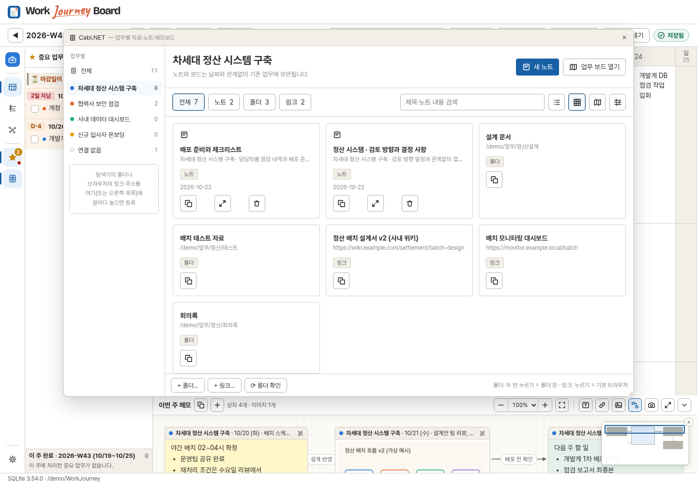
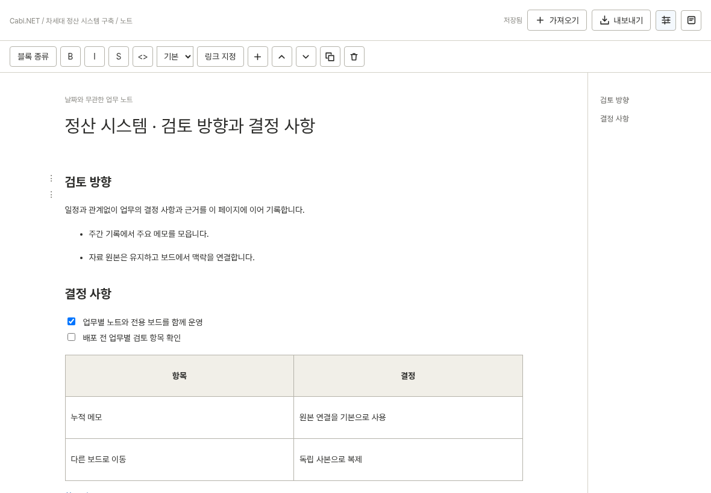
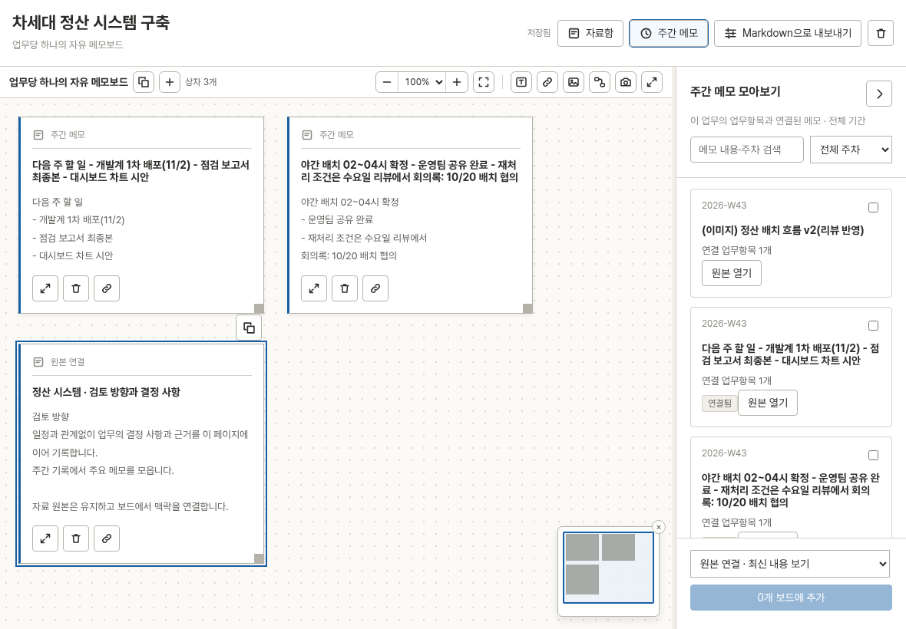

# Cabi.NET 구현 화면 — 1.20.0-rc.1

`cabinet-v2` 브랜치 · 가상 샘플 데이터 · Chromium 브라우저 모드 실제 화면입니다. 별도 팝업은 실제 노트/보드 코드를 사용하지만, Windows/macOS의 창 장식이나 WebView 간 실제 OS 드래그를 캡처한 것은 아닙니다.

## 업무 허브

업무별 폴더·링크·복수 노트를 목록/카드로 탐색하고 노트와 단일 업무 보드를 엽니다. 보드 보기와 원본 미리보기도 제공합니다.

## 업무 노트

별도 모달리스 창에서 블록을 작성합니다. 가져온 Markdown의 제목·체크 목록·표·링크를 유지하며 목차를 접거나 본문 폭을 넓힐 수 있습니다.

## 업무 메모보드

기존 자유 보드 엔진을 사용합니다. 누적 주간 메모를 오른쪽에서 찾아 연결하고, 노트·폴더·링크를 원본 카드로 붙입니다. 패널은 접기/폭 조절을 지원합니다.

[구현·검증 기록 및 남은 네이티브 검사](../../../cabinet-v2-spec.md#10-승인안-구현-및-검증-기록--1200-rc1) · [이용 가이드](../../../guide/11-cabinet.md)
