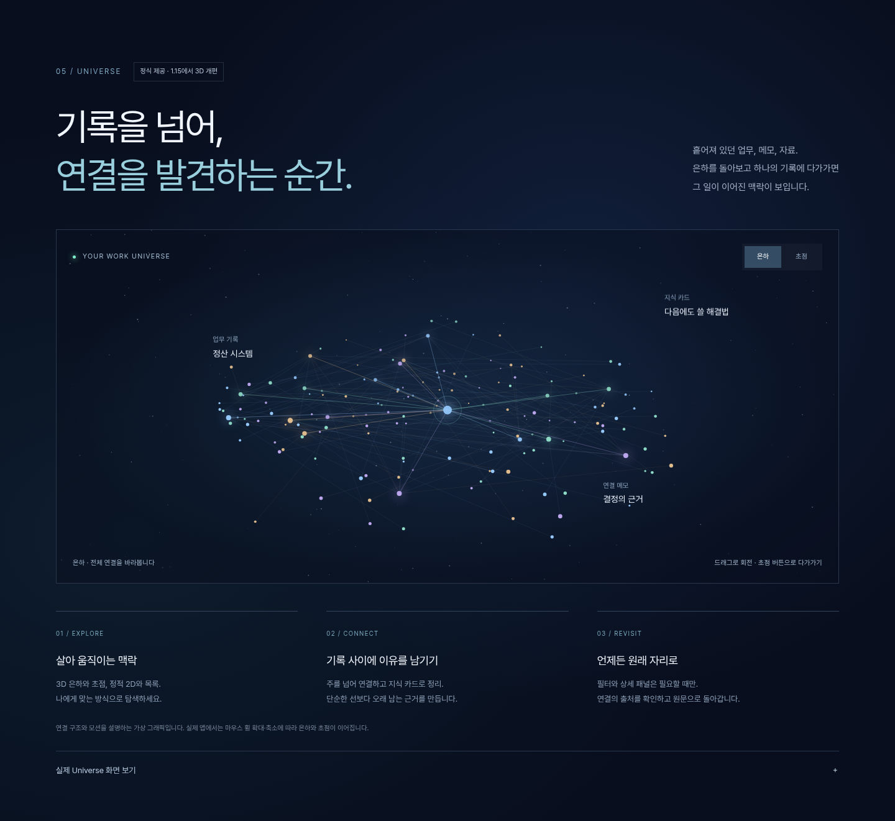
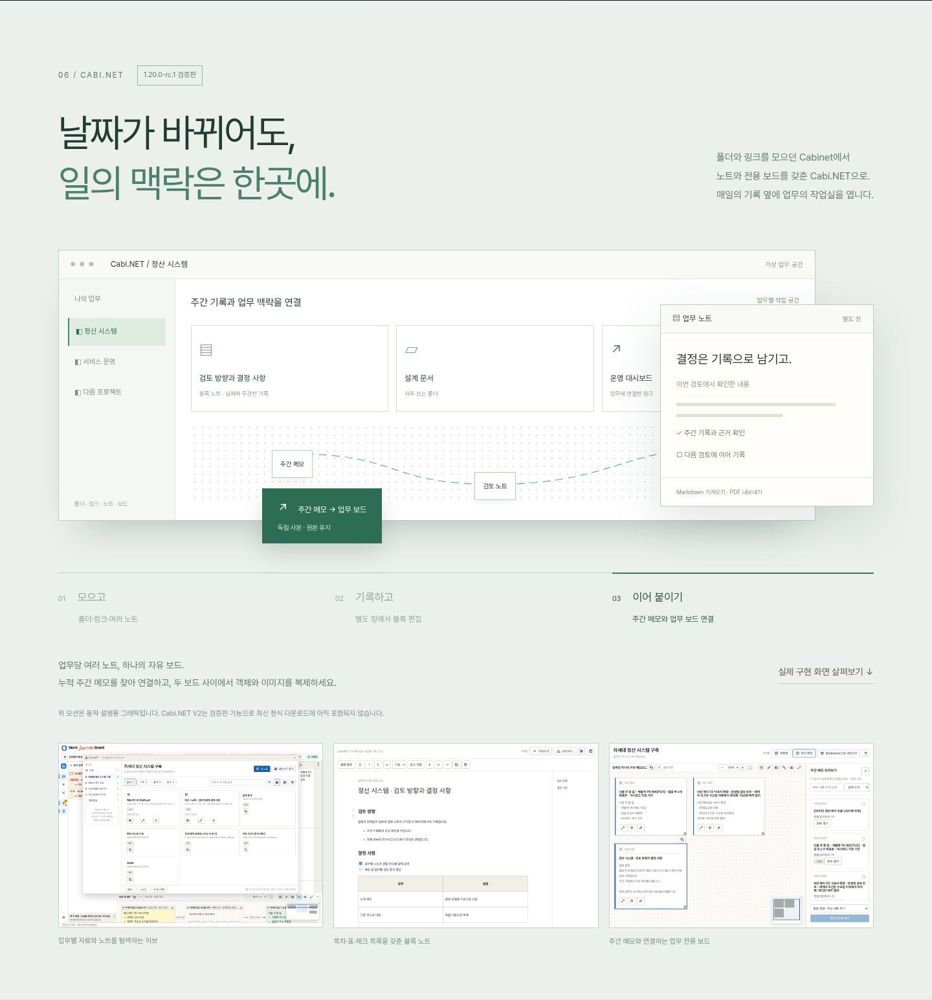

# 티저 리뉴얼 시안 A — 기록에서 업무 우주로

2026-11-07 (한국 시간) · `cabinet-v2` · **검토 시안 보존본 · 사용자 승인 후 실제 `site/` 반영 완료**

[전체 페이지 / 인터랙티브 시안](index.html) · [모션 영상 WebM](motion.webm) · [모션 미리보기 GIF](motion.gif)

로컬 정적 서버 주소: `http://127.0.0.1:1423/docs/mockups/teaser-v2/` (저장소 루트에서 HTTP로 제공). HTML 파일을 직접 열어도 기본 시안을 볼 수 있습니다. 아래 파일은 검토 당시 시안을 보존한 것입니다. 승인된 실제 사이트 파일은 `site/`이며, 검토 바를 제거하고 자산을 자체 상대 경로로 정리했습니다.

## 추천 구성

기존의 따뜻한 기록·보고 소개를 유지하고 **Universe의 어두운 공간 → Cabi.NET의 밝은 업무 작업실**로 대비를 줍니다. 첫 화면에도 두 기능의 진입 링크와 새 소개 문구를 배치하여 아래 기능이 묻히지 않게 했습니다.

기존 기록 → 주간 요약 → 타임라인 → 기존 핵심 화면/메모 → **05 Universe → 06 Cabi.NET → 07 기록 보관** → 다운로드 순서입니다. 상단 내비게이션과 오른쪽 페이지 이동에도 두 신규 섹션을 추가했습니다.

### Universe — 연결을 발견하는 순간

- 전체 폭의 독립 다크 섹션, 캔버스의 3차원 투영 연결망·별·빛의 이동.
- 은하가 천천히 회전하며 연결 위의 빛이 흐릅니다. 직접 드래그해 회전하거나 은하/초점 버튼으로 부드럽게 확대 전환합니다.
- 3D/2D·목록, 직접 연결·지식 카드, 접이식 패널과 원문 이동의 실제 제공 기능을 세 열로 소개합니다.
- 그래픽은 가상 예시임을 표시하고 실제 앱 화면도 펼쳐 볼 수 있게 했습니다. 소개용 그래픽을 실제 앱의 UI로 오해시키지 않습니다.

### Cabi.NET — 날짜가 바뀌어도 일의 맥락은 한곳에

- 옅은 녹색의 작업 공간 섹션으로 전환하고, 폴더/링크 중심 Cabinet에서 노트·업무 보드로 확장한 목적을 소개합니다.
- **모으기 → 기록하기 → 이어 붙이기** 세 장면: 자료 허브의 깊이감 있는 창, 앞으로 나오는 노트 창, 주간 메모에서 보드로 이어지는 복제 안내와 연결선 모션.
- 5초마다 장면 전환. 장면 버튼을 직접 누르면 그 장면에 머물러 내용을 검토할 수 있습니다.
- 하단에 실제 허브·블록 노트·업무 보드 화면을 함께 제시합니다.
- **1.20.0-rc.1 검증판**임을 표시합니다. 최신 정식 다운로드에 포함되어 있다는 주장을 하지 않습니다.

## 모션 규칙과 검토 기준

- 강한 인상은 배경/규모 전환과 움직이는 연결망, 창의 깊이로 만듭니다. 본문 텍스트는 계속 읽을 수 있게 고정합니다.
- 휠 스크롤을 가로채지 않습니다. 은하/초점 전환은 소개 시안에서는 버튼으로 체험하고, 앱 자체의 휠 전환은 설명 문구로 구분합니다.
- 하단 검토 바에서 모션 정지/재생. OS의 모션 줄이기 설정이면 기본 정지, 페이지가 숨겨지거나 그래픽이 화면 밖이면 연속 렌더링을 중단합니다.
- 모바일에서는 한 열로 재배치합니다. 모션을 꺼도 내용과 버튼은 사용 가능합니다.
- 검토할 항목: 어두운 Universe와 밝은 Cabi.NET의 대비, 현재 섹션 순서, 5초 장면 전환 속도, 두 기능에 배정한 분량입니다. 승인 후에 실제 `site/index.html`·스타일·모션·이미지 경로를 반영합니다.

## 확인 결과

- Chromium: 스크립트 오류 0, 실패 리소스 요청 0.
- 은하 실제 애니메이션, 초점 버튼/상태 안내, 일시정지 후 캔버스 유지, Cabi.NET 장면 선택 확인.
- 폭 1440 / 1024 / 768 / 390px에서 문서 가로 넘침 없음. [모바일 화면](mobile.png).
- `prefers-reduced-motion: reduce`에서 기본 모션 정지 확인.
- README는 기존 제목/표/단락 구성을 유지하고 핵심 기능·소개 문구·백업 안내·기술 스택 내용만 갱신했습니다. Version History는 수정하지 않았습니다.
- 초기 검토에서는 `site/`를 변경하지 않았습니다. 후속 사용자 승인으로 실제 `site/`에 반영했습니다. 게시 워크플로는 변경하지 않았으며 현재 작업 브랜치 푸시만으로 게시되지 않습니다.

## 파일과 자산

`index.html`은 현재 사이트 전체 흐름에 제안 섹션을 배치한 시안입니다. 기존 정적 스타일·이미지는 저장소의 `site/`를 참조합니다. 새 요소의 `preview.css`·`preview.js`와 신규 섹션 조각 `sections.html`은 이 폴더에 있습니다. 실제 제품 화면은 Cabi.NET 구현 검토 자료와 기존 Universe 가이드 캡처를 사용합니다. 기록은 가상 데이터입니다.

새 섹션에는 Pretendard Regular 공식 WOFF2를 수정 없이 사용합니다. `pretendard.woff2`와 [SIL OFL 1.1 전문](font-license.txt)을 함께 보관합니다. CDN·분석 스크립트·외부 폰트 요청은 추가하지 않았습니다. 화면 이미지에는 검토 편의를 위해 고정 메뉴/검토 바를 숨겼으며, WebM/GIF는 실제 동작 시안을 녹화했습니다.
