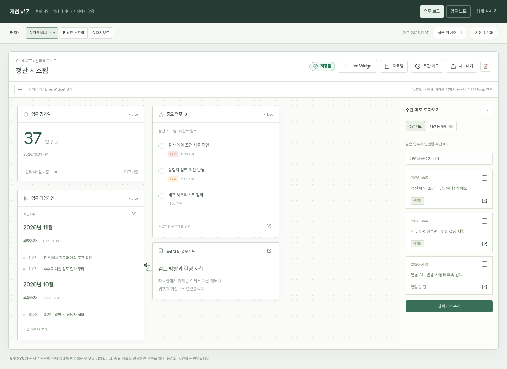
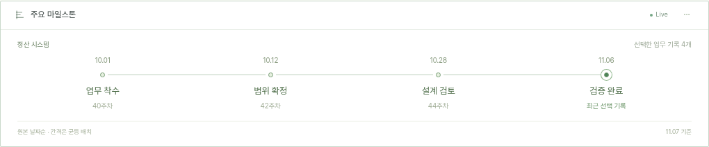

# 개선 v17 · Cabi.NET Live Widget & 노트 편집 시안

2026-11-07 (한국 시간) · `improve-v17` · main `58c19d0` / 앱 1.20.0 기준

**설계 검토용입니다. 앱 기능 구현·DB 변경·버전 변경·배포 결과가 아닙니다.**

[조작 가능한 시안](index.html) · [상세 설계와 요구사항 대응표](../../improve-v17-spec.md)

## 배치안 비교

| 안 | 화면 | 구조·검토점 |
|---|---|---|
| **A · 자유 배치 (추천)** | [보드 A](board-A.png) | 현재 자유 보드에 위젯 3종과 자료 카드를 놓음. 머리를 잡아 이동하고 네 방향으로 연결 |
| B · 상단 스트립 | [보드 B](board-B.png) | 상태 위젯을 상단에 모음. 빠른 확인, 위젯 영역이 계속 높이를 사용 |
| C · 대시보드 | [보드 C](board-C.png) | 큰 경과일 요약과 타임라인·중요 업무의 구역 배치. 기존 보드보다 레이아웃 변화가 큼 |

시안 상단 `A/B/C` 버튼으로 같은 데이터를 비교할 수 있습니다. 레이아웃 대안은 같은 기능과 위젯을 배치만 다르게 제시한 것입니다. 시안은 라이트 계열 화면으로 작성했으며 제품 적용 시에는 기존 테마 토큰을 유지합니다.

## 주요 화면

- [중요 업무 완료 → 메인 동기화 시연](widget-sync.png)
- [본문 롤오버 이끌이와 블록 메뉴](note-menu.png)
- [선택 텍스트 가까운 서식·색상 팝오버](note-style.png)
- [보드 삭제 최종 확인 입력](delete-confirm.png)
- [모바일 노트 화면](note-mobile.png)

## 직접 검토할 동작

1. `하루 뒤 시연 +1`을 눌러 경과일·기준일·마감 칩 변경을 확인합니다. 기본 날짜는 2026.11.07, 시작일은 2026.10.01입니다. 보드 정지 화면은 기본 상태를, 동기화 화면은 완료 시연을 보여 줍니다.
2. 경과일 기준을 업무 시작일/마지막 기록일로 바꿉니다. `+ Live Widget`에서 같은 종류를 추가한 뒤 각 위젯의 기준을 다르게 설정할 수도 있습니다.
3. 중요 항목의 원형 완료 버튼을 누르면 목록에서 빠지고 오른쪽 `메인 동기화`에 완료·취소선으로 표시됩니다. 토스트의 `되돌리기` 또는 완료 항목 버튼으로 복원합니다. 다른 업무의 항목은 메인 시연에만 표시합니다.
4. A안에서 위젯·자료 카드의 머리를 잡아 이동합니다. 카드에 롤오버하면 네 방향 연결점이 보입니다. 한 연결점을 다른 카드의 연결점으로 드래그하거나 차례로 눌러 화살표를 이을 수 있습니다. Esc는 연결 대기를 취소합니다.
5. `내보내기`에서 기존 Markdown/PNG 메뉴와 위젯의 기준 시각 고정 정책을 확인합니다. 이 시안에서는 파일을 실제 저장하지 않습니다.
6. 삭제 아이콘을 누르고 확인 입력을 비워 두거나 다른 글자를 넣어 봅니다. `삭제`를 입력해야 최종 버튼이 활성화됩니다. 취소 시 유지, 확인 시 가상 보드 창 닫힘 상태를 표시합니다.
7. 오른쪽 주간 메모 항목의 `연결됨` 라벨과 독립된 원본 열기 아이콘, 체크박스의 오른쪽 축 정렬을 확인합니다.
8. `업무 노트`에서 본문에 마우스를 올리면 6점 이끌이가 나타납니다. 클릭은 블록 종류/순서/복제/삭제 메뉴, 드래그는 블록 순서 이동입니다.
9. 문장 일부를 선택하면 가까운 서식 도구가 표시됩니다. 굵게·기울임·취소선·글자색·링크를 시험할 수 있습니다. 링크는 http/https만 허용합니다. 색상 세트는 주간 메모와 같은 기본+회색/주황/파랑/초록/빨강입니다.
10. `기존 간격과 비교`로 본문 간격 차이를 확인합니다. 노트 우측 삭제 아이콘은 실제 삭제 요청이 아니라 ‘삭제 이벤트 도착 후 해당 창 종료’ 상태의 시연입니다. 다시 열기로 복귀합니다.

모든 데이터와 동기화는 **브라우저 메모리의 가상 상태**입니다. 실제 앱 저장소·메인 창·Tauri RPC에 연결하지 않습니다. 새로고침/시안 초기화 시 초기 상태로 돌아갑니다. 여기의 contenteditable/DOM 정렬은 검토용 구현이며 제품에는 기존 ProseMirror transaction·보드 엔진을 사용합니다. 중첩 목록·표·이미지·Undo·실제 OS 창 닫기는 상세 설계의 구현 후 검증 범위입니다.

## 검토할 결정

- 추천 **A 자유 배치형**을 기준으로 할지.
- ‘업무 진행일로부터’의 기본 기준을 **최초 업무 시작일**로 할지. 업무의 등록된 활동 기간 시작일과 마지막 기록일은 서로 다른 기준입니다.
- 다른 업무 보드로 복제 시 목적지 업무에 연결하고, 주간 보드로는 기준 시각의 일반 객체 사본을 만드는 정책.
- 삭제 확인은 **`삭제` 직접 입력**, 노트 본문은 **행간 1.65·문단 간격 6px**로 할지.

## 검증 기록

- Chromium의 스크립트 오류 0, 실패 리소스 요청 0.
- 경과일 날짜 이동/기준 전환, 같은 종류 위젯의 독립 설정, 완료·취소·되돌리기 및 메인 가상 상태 일치 확인.
- 객체 드래그, 실제 HTML 블록 드래그, 블록 종류 변경, 네 방향 핸들·화살표 추가, 확인 전 삭제 비활성/확인 후 가상 닫기 확인.
- 선택 텍스트 서식·주간 메모와 같은 파랑 값 `#1f5fa8`, http/https 링크 검증, 간격 비교, 노트 삭제 후 가상 창 종료/다시 열기 확인.
- 주간 메모 체크박스와 원본 열기 아이콘의 중심 x좌표 차이 **0px**.
- 문서 폭 1440 / 1024 / 768 / 390px에서 노트 가로 넘침 없음. 보드도 1024 / 768 / 390px에서 문서 가로 넘침 없음. 좁은 보드에서는 캔버스 내부를 가로 스크롤합니다.
- JavaScript 문법·ESLint 검사. 제품 소스·마이그레이션·버전·Feature List는 변경하지 않습니다.

로컬 예시: 저장소 루트에서 정적 HTTP 서버로 제공한 뒤 `http://127.0.0.1:1427/docs/mockups/v17/`을 엽니다. 공개 배포 URL이 아닙니다. 글꼴과 아이콘은 저장소의 `site/` 자산을 참조하며 CDN 호출이 없습니다. 비교용 정지 화면 일부에서는 토스트를 숨겨 레이아웃을 확인하기 쉽게 했습니다.

## 추가 요청 · 타임라인 위젯 유형

[타임라인 유형 조작 시안](index.html#timeline) · [상세 설계 4.2.1](../../improve-v17-spec.md#421-타임라인-표현-유형--추가-요청-반영)

| 유형 | 시안 | 용도 |
|---|---|---|
| T1 · 기록 목록형 | [목록 화면](timeline-records.png) | 원본 업무 내역을 자세히 확인 |
| **T2 · 가로 마일스톤형 (추천)** | [전체 화면](timeline-milestones.png) · [위젯만 보기](timeline-horizontal-widget.png) | 직접 고른 주요 시점을 날짜·점·짧은 제목으로 한 줄 표현 |
| T3 · 가로 주차 요약형 | [주차 요약 화면](timeline-weeks.png) | 주차별 실제 기록 수·가장 최근 기록을 자동 요약 |

- 상단 `타임라인 유형` 또는 기존 보드의 `기록 목록형 ▾` 버튼으로 비교 화면을 엽니다. 보드 A/B/C 배치 선택과 T1/T2/T3 표현 선택은 별개입니다.
- T2의 `⋯`에서 [마일스톤 관리](timeline-manage.png)를 엽니다. 원본 기록 선택을 적용하거나 취소할 수 있고, 0개면 선택 안내가 표시됩니다.
- 마일스톤은 업무의 중요 별표·완료 상태와 독립된 표시 선택입니다. 점 클릭은 원본 확인이며 완료 처리 동작이 아닙니다. 최신 점의 강조도 ‘최근 선택 기록’을 뜻합니다.
- `원본 제목 변경 시연`으로 선택 원본 변경의 반영을 확인합니다. 실제 DB를 수정하지 않습니다. 선택한 원본이 아닌 새 기록이 생겨도 마일스톤으로 자동 지정하지 않는 정책입니다.
- 날짜순 **균등 간격**이며, 선 길이가 실제 기간에 비례하지 않습니다. `좁은 위젯으로 보기`에서 내부 가로 스크롤을 확인할 수 있습니다. [모바일 화면](timeline-mobile.png).
- 유형 전환·선택 적용/취소·0개·원본 제목 갱신/미리보기·좁은 폭 스크롤 확인. Chromium 스크립트 오류/실패 리소스 0, 1440/1024/768/390px 문서 가로 넘침 없음.
- 상세 설계에는 위젯별 표현 설정 저장, 원본 변경/삭제, ISO 연도 경계·집계 수, 복제·백업·내보내기·키보드 인수 기준을 추가했습니다. 현재 단계는 설계·가상 시안입니다.
