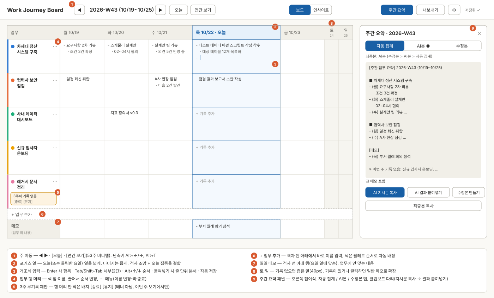

# Work Journey Board (업무 일지 보드) — 주간 보드 기반 일일 업무 기록 · 자동 요약 · 진행 경과 시각화

> **이관 안내**: 이 문서는 2026-10-22 설계 저장소 [my-discussions](https://github.com/chs2147/my-discussions)의 `topics/10 work-journal-board/`에서 옮겨왔다. **이후 정본은 이 저장소의 `docs/`** 이며 my-discussions 쪽은 더 이상 갱신하지 않는다.

> 설계 개요 문서 · 최초 작성: 2026-10-22 · **프로젝트명 확정: Work Journey Board** (2026-10-22)
> 설계 논의 Work Log(이관 전): [my-discussions worklogs/2026-10-22.md](https://github.com/chs2147/my-discussions/blob/main/worklogs/2026-10-22.md)
> 상태: **상세설계 완료(D1~D5) · ◆G1 GO(Tauri 확정, 2026-10-23)** · 다음: I-M1 핵심 기록
> 총괄 요약 → **9절**, 구현 로드맵 → **8절**, 화면 구성 → **10절**, 상세 설계 문서 → **11절**, 인계 명세 → **12절**
> **전체 진행 계획(작업 패키지·관문·세션 시작 프롬프트) → [project-plan.md](project-plan.md)**

## 1. 한 줄 정의
요일 단위 칸에 업무별로 자유롭게 적어두면, 그것이 쌓여 **주간 요약·진행 경과 인포그래픽·엑셀 산출물이 저절로 나오는** 개인 업무 일지 — 회사 보안 환경에서도 **데이터가 밖으로 나가지 않는** 구조로.

본질: **입력은 최대한 가볍게, 산출물은 자동으로.**

## 2. 요구사항 (사용자 제시)
| # | 요구사항 |
|---|---|
| R1 | 매일 하는 업무를 **일지 형태로 기록** |
| R2 | **1년 기준, 주 단위 × 요일 단위**로 업무를 기록하는 보드 |
| R3 | 보드를 열면 **오늘 날짜가 속한 주간·오늘 요일**로 바로 진입 |
| R4 | 1주의 일일 기록을 모아 **주간 업무 요약** 자동 생성 |
| R5 | 일일 기록은 자유 서술 구조. 단 **사용자 정의 업무 카테고리**별로 상세 진행 내역을 **개조식**으로 기록 |
| R6 | 업무 카테고리는 필요에 따라 **추가·삭제** |
| R7 | 이번 주 카테고리는 **다음 주로 자동 이월**되어 동일하게 구성, 이어서 기록 |
| R8 | 기록이 누적되면 **업무별 진행 경과를 인포그래픽**으로 제공 |
| R9 | **회사 보안 환경**에서도 동작 — 웹 기반 또는 **로컬 저장** 가능한 구조 |
| R10 | 전체 또는 **지정 범위**의 업무일지를 **엑셀 등으로 내보내기** |

## 3. 핵심 쟁점 (1차 분석)

### 3-1. 카테고리는 "복사"가 아니라 "이어지는 실체" (R6·R7·R8)
- 매주 이름을 복사하는 방식이면 주마다 별개 카테고리가 되어 **업무별 경과(R8)가 끊김**. 이름 변경 시에도 이력 단절.
- → 카테고리 = **고유 ID를 가진 단일 실체**, 주간 보드는 "현재 활성 카테고리"를 표시.
  - **이월(R7)** = 복사가 아니라 "종료되지 않은 카테고리가 다음 주에도 보이는 것"
  - **삭제(R6)** = 실삭제가 아니라 **종료(아카이브)** — 과거 기록·경과 차트 보존
  - **이름 변경**해도 이력 연속
- 이 결정 하나로 R7(자동 이월)과 R8(업무별 경과)이 동시에 성립.

### 3-2. "진행 경과"의 정의 (R8) — ⭐가장 중요한 미결 사항
- 자유 서술+개조식 기록에서 추출 가능한 것은 **"언제·어떤 업무를·얼마나 자주"** 뿐.
  - 가능: 업무별 활동 히트맵(날짜별 기록 밀도), 업무별 기간 막대(간트), 주별 업무 비중
  - **불가**: 진척률(%)·완료/보류 같은 **진척도** — 자유 서술에서 나오지 않음
- 진척도를 원하면 **주 단위로 업무별 상태값 1개**(진행중/완료/보류 또는 %)를 찍는 가벼운 입력 필요.
- → 이 선택이 데이터 모델을 결정.

### 3-3. 보안 환경 — "로컬 우선(local-first)" 구조 (R9·R10)
- 회사 환경에서 흔한 제약: 외부 SaaS 차단, 프로그램 설치 불가, 외부 전송(DLP) 감시.
- 후보 구조: **서버 없는 브라우저 앱**
  - 데이터 = 브라우저 내부 저장소(IndexedDB) + **사용자가 지정한 로컬 파일**
  - 엑셀 내보내기도 브라우저 안에서 생성(외부 전송 없음)
  - 외부 통신 0 → 보안 정책과 비충돌 / 정적 파일이라 사내 서버 배포 또는 HTML 파일 단독 실행 가능 / 설치 불필요
- 트레이드오프:
  1. **브라우저 저장소 유실 위험**(캐시 정리·PC 교체) → 로컬 파일 저장/백업은 보조가 아니라 **필수 기능**
  2. **기기 간 동기화 불가**(집↔회사) → 필요 시 "로컬 기본 + 동기화 어댑터 자리만 비워두기"

### 3-4. 주간 요약의 생성 주체 (R4)
| 방식 | 내용 | 보안 |
|---|---|---|
| 자동 집계 | 한 주 기록을 업무별로 묶어 요일순 정리 | ✅ 완전 로컬 |
| AI 요약 | 문장형 주간 보고 | ⚠️ 외부 AI 전송 시 보안 환경과 충돌 가능 |
- 잠정: v1은 **자동 집계**(보안 정합), AI 요약은 회사 승인 AI가 있을 때 붙이는 선택 기능.

## 4. 사용자 확인 결과 (2026-10-22)
| 항목 | 결정 | 설계 영향 |
|---|---|---|
| 회사 환경 | 자체 개발 프로그램 **설치 가능**, 주 브라우저 **Chrome** | 설치형 앱 가능 → 브라우저 저장소 유실 위험 제거 |
| 기기 공유 | **회사에서만** 작성 | 동기화 불필요 → 단일 PC·단일 데이터 파일 |
| 진행 경과 | **진척률·상태 불필요**, 정성적 관리 중심 | 상태 입력 없음 → 인포그래픽은 활동·서술 중심 |
| 주간 요약 | **AI 요약 일부 필요** | 자동 집계 + 선택적 AI 다듬기 2단 구조 |
| 엑셀 양식 | 임의 정의 가능, **주 단위 진행 업무 표현** | 양식 자체 제안 |
| 주말 | 보드에 **포함**, 내용은 비워둠 | 7열 보드, 토·일 좁게 표시 |

## 5. 설계 방향 (잠정 확정)

### 5-1. 기술 구조 — 설치형 데스크톱 앱 + 로컬 데이터 파일 1개
- 3-3절의 브라우저 전용 안은 "캐시 정리 시 유실"이 최대 약점이었으나, **설치 허용**으로 해소 가능.
- **데스크톱 앱(화면=웹 기술, 껍데기=Tauri) + 내 문서 폴더의 데이터 파일(SQLite) 1개.**
  - 데이터=파일 하나 → 백업=파일 복사, PC 교체=파일 이동.
  - **자동 백업**: 앱 종료 시/하루 1회 날짜별 사본을 백업 폴더에 롤링 저장.
  - **외부 통신 0** (예외: 사용자가 누르는 AI 요약 버튼, 5-3절).
  - Tauri = 윈도우 기본 WebView 사용 → Electron 대비 가벼움.
- 대안(유지): Chrome 전용 + 로컬 파일 접근(File System Access). 설치 불필요하나 안정성은 데스크톱 앱 우위.

### 5-2. 데이터 모델 — 상태값 제거로 단순화
```
업무 카테고리 { id, 이름, 색, 순서, 생성일, 종료일(아카이브 시) }
일일 기록     { 날짜, 카테고리 id, 개조식 항목들 }
일일 메모     { 날짜, 자유 서술 }          ← 카테고리에 안 맞는 내용용
주간 요약     { 주차, 자동 집계본, AI 다듬은 본(선택), 사용자 수정본 }
```
- **자동 이월(R7)에 복사 연산 없음**: 어떤 주에 보일 카테고리 = "그 주 시점에 종료되지 않은 카테고리"로 계산.

### 5-3. 주간 요약 — 2단 구조
1. **자동 집계(항상·완전 로컬)**: 업무별로 한 주 항목을 요일순으로 모아 초안.
2. **AI 다듬기(버튼·선택)**: 초안을 문장형 보고로 정리.
- AI = 업무 내용이 외부로 나가는 **유일한 지점** → 원칙:
  - 기본 꺼짐, 버튼 누를 때만 전송
  - **전송 전 보낼 내용을 그대로 미리보기** 후 확인
  - 해당 주 텍스트만 전송(전체 일지 X)
  - **접속처를 설정으로 교체 가능**(사내 승인 AI를 꽂을 수 있게)

### 5-4. 인포그래픽 — "얼마나 진척됐나"가 아니라 "어떻게 흘러왔나"
- **업무별 경과 타임라인** ⭐ — 한 업무의 기록을 주차별 시간순으로 펼쳐 진행 흐름을 읽는 뷰(정성적 관리의 핵심 화면)
- **활동 히트맵** — 업무별 기록일을 잔디처럼 표시(몰입·공백 기간)
- **업무 기간 막대** — 시작~종료(아카이브) 구간
- **주별 업무 비중** — 주마다 업무별 투입 일수

### 5-5. 엑셀 양식 (제안)
- **① 주간보고 시트**(사람이 읽는 용) — 주차별 블록: `업무 | 월 | 화 | 수 | 목 | 금 | 주간 요약`
- **② 원장 시트**(분석용) — 항목 1줄=1행: `날짜 | 주차 | 요일 | 업무 | 내용`
- 범위 내보내기 = 지정 기간의 주차 블록만 출력. 토·일 열은 기록이 있는 주에만 생성.

## 6. Open Questions
- [x] 회사 환경 → 설치 가능, Chrome
- [x] 기기 간 공유 → 회사 PC 단독
- [x] 진행 경과 정의 → 상태·진척률 없음, 정성적
- [x] 주간 요약 → 자동 집계 + 선택적 AI
- [x] 엑셀 양식 → 임의 정의(5-5절 제안)
- [x] 주말 → 포함, 비워둠
- [x] 회사 PC 운영체제 → **윈도우** (7-1절)
- [x] 회사 승인 AI → **기업용 있으나 접근 불확실** → 클립보드 다리 우선 (7-2절)
- [x] 이월 규칙 → **제안대로 확정** (7-3절)
- [x] 화면 구성(주간 보드 레이아웃·기록 입력 방식) → **10절**(2026-10-22)

## 7. 추가 확정 (2026-10-22)

### 7-1. 윈도우 — 회사 PC에서 막힐 수 있는 지점
- Tauri는 윈도우 10/11 기본 탑재 **WebView2** 사용 → 기술적 문제 없음.
- **관리자 권한 없는 설치**: "현재 사용자 전용(per-user)" 설치 방식으로 빌드.
- **서명 없는 실행 파일 차단**: SmartScreen·사내 백신이 막을 수 있음 → 막히면 IT 허용 목록 등록 요청 경로 필요.
- **데이터 폴더**: 회사 PC "문서" 폴더는 OneDrive 자동 동기화(Known Folder Move)인 경우 많음 → 업무 일지가 의도치 않게 클라우드로 업로드될 위험. → **첫 실행 시 저장 폴더를 사용자가 직접 선택**.
- → 위 사항은 코드 작성 전에 확인 가능 → **M0 설치 검증**이 착수 전 검증 항목(8절).

### 7-2. 기업용 AI 접근 불확실 → "클립보드 다리" 우선
- 기업용 AI는 대개 **웹 채팅 화면은 열려 있어도 프로그램용 API는 별도 IT 승인 필요**. API 전제로 설계하면 승인 전까지 AI 기능 전체가 정지.
- → 연결 방식을 3모드로:

| 모드 | 동작 | 필요 조건 |
|---|---|---|
| ① 꺼짐 | 자동 집계만 | 없음 |
| **② 클립보드 다리** ⭐ | 앱이 "요약 지시문+이번 주 기록"을 복사 → 사용자가 회사 AI 채팅창에 붙여넣기 → 결과를 앱에 다시 붙여넣기 | **회사 AI 웹 화면 접속만** |
| ③ API 직접 연결 | 버튼 한 번으로 요약 | IT의 API 승인 |

- 클립보드 다리는 **API 승인 없이 즉시 동작**. 앱은 외부 통신 0 유지, AI로의 전송은 사용자가 승인된 도구에 직접 붙여넣는 행위 → 보안 경계 명확.
- **v1 = ①+②**, ③은 접속처 설정 자리만 → 승인 시 끼움.

### 7-3. 이월 규칙
- 종료(아카이브)하지 않은 업무는 **모두** 다음 주로 이월.
- **3주 연속 무기록** 시 보드에 "이 업무를 종료할까요?" 제안(기간은 설정에서 변경 가능).
- 종료한 업무는 **언제든 재활성화** 가능, 과거 기록·경과 차트 유지.

## 8. 구현 로드맵 (제안)
| 단계 | 내용 |
|---|---|
| **M0 설치 검증** ⚠️착수 전 | 빈 앱을 회사 PC에 설치·실행 — 관리자 권한 없이 설치되는지 / SmartScreen·백신 차단 여부 / WebView2 존재 |
| M1 핵심 기록 | 주간 보드(오늘 주·요일 진입), 카테고리 관리·이월, 개조식 기록, 일일 메모, 로컬 저장·자동 백업 |
| M2 산출물 | 주간 자동 집계, 엑셀 내보내기(범위 지정) |
| M3 시각화 | 경과 타임라인 → 활동 히트맵 → 기간 막대·주별 비중 |
| M4 AI | 클립보드 다리 → (승인 시) API 연결 |
- 원칙: **M1만 완성돼도 매일 쓸 수 있는 도구**가 되는 순서.

## 9. 기본 정리 총괄
> **한 줄 정의**: 요일 단위 주간 보드에 사용자 정의 업무별로 개조식 기록 → 주간 요약·정성적 경과 시각화·엑셀이 자동으로 나오는, **회사 PC 단독·외부 통신 0**의 윈도우 데스크톱 업무 일지.

| 영역 | 확정 |
|---|---|
| 구조 | 윈도우 데스크톱 앱(Tauri, per-user 설치) + 사용자가 고른 폴더의 SQLite 파일 1개, 자동 롤링 백업, 외부 통신 0 |
| 데이터 | 카테고리(ID 실체) · 일일 기록 · 일일 메모 · 주간 요약 (상태·진척률 없음) |
| 보드 | 1년 기준 주×7요일(토·일 좁게, 기본 비움), 열면 오늘 주·요일 |
| 이월 | 전부 이월(복사 없이 계산) + 3주 무기록 시 종료 제안, 재활성화 가능 |
| 주간 요약 | 자동 집계(로컬) → AI 3모드(꺼짐 / 클립보드 다리 / API) |
| 인포그래픽 | 업무별 경과 타임라인⭐ · 활동 히트맵 · 기간 막대 · 주별 비중 |
| 엑셀 | 주간보고 시트(업무×요일+요약, 주차 블록) + 원장 시트(항목 1행), 범위 지정 |

**⚠️ 착수 전 검증**: M0 설치 검증(회사 PC 실행 가능 여부).
**다음 단계**: ~~화면 구성~~ → 상세설계 D1~D5 완료(10~12절). 남은 것은 I-M0 설치 검증(◆G1) 후 구현 착수.

## 10. 화면 구성 (D1 확정, 2026-10-22)

와이어프레임: [wireframe-weekly-board.svg](wireframes/wireframe-weekly-board.svg) (주간 보드 + 주간 요약 패널) · [wireframe-first-run.svg](wireframes/wireframe-first-run.svg) (첫 실행 + 연간 보기)



### 10-1. 주간 보드 기본 배치 — **(d) 포커스 열 격자** (후보 a·b·c를 비교해 a+b 결합)
| 후보 | 장점 | 약점 | 판단 |
|---|---|---|---|
| (a) 격자 | 한 주 전체가 한눈에 | 7열이면 셀이 좁아 입력이 답답 | 조망은 필요 |
| (b) 오늘 집중 | 입력 편함 | 주 전체 조망·다른 요일 비교가 약함 | 입력은 필요 |
| (c) 격자 + 편집 패널 | 둘 다 | **입력할 때마다 셀 선택→패널 이동 한 단계 추가** → 2분 목표에 불리 | 기각 |
| **(d) 포커스 열 격자** ✅ | 격자를 유지하되 **오늘(또는 클릭한 요일) 열만 넓게**, 셀 안에서 바로 입력 | 다른 요일 칸은 좁게 보임(클릭하면 그 열이 포커스) | **채택** |
- 행 = 업무 카테고리(보드 순서), 열 = 월~일, 맨 아래 = "+ 업무 추가" 행 → 일일 메모 행.
- 열 폭: 포커스 열 2fr · 평일 1fr · 토·일 40px(10-6).
- 앱을 열면 **이번 주 + 오늘 열 포커스 + 첫 업무의 오늘 칸에 커서** — 바로 타이핑 가능(R3).
- 상단 바: `Work Journey Board | ◀ 2026-W43 (10/19~10/25) ▶ [오늘] [연간 보기] … [보드|인사이트] [주간 요약] [내보내기] [⚙] 저장됨 ✓`

### 10-2. 이동(네비게이션)
| 동작 | 마우스 | 키보드 |
|---|---|---|
| 이전/다음 주 | ◀ ▶ | `Alt+←` / `Alt+→` |
| 오늘로 | [오늘] | `Alt+T` |
| 연간 보기 | [연간 보기] → 팝오버 | `Alt+Y` |
| 다른 요일을 포커스 | 그 열의 머리·칸 클릭 | `Ctrl+←/→` (편집 중이 아닐 때) |
- **연간 보기**: ISO 연도의 W01~W53을 **월별 행**으로 배치(주 칸은 그 주 목요일이 속한 달), 칸 색 = 그 주 기록한 날 수(단일 파랑 5단계), 이번 주 빨간 테두리, ◀ ▶로 연도 이동, 칸 클릭 → 그 주로.
- 미래 주로도 이동·기록 가능(일정 메모 등). 보드 제목 표기는 data-spec 1-2절.

### 10-3. 개조식 입력
| 키 | 동작 |
|---|---|
| `Enter` | 아래에 새 항목(같은 깊이) |
| `Shift+Enter` | 항목 안 줄바꿈 |
| `Tab` / `Shift+Tab` | 세부(depth 1) ↔ 본 항목(depth 0). **2단까지만**, 셀 첫 항목은 본 항목 고정 |
| `Backspace`(빈 항목에서) | 항목 삭제 후 위 항목 끝으로 |
| `Alt+↑` / `Alt+↓` | 항목 순서 이동(세부 항목은 본 항목에 딸려 함께 이동) |
| `↑` / `↓`(칸 첫/끝 줄에서) | 위/아래 업무 칸으로 이동 |
| `Esc` | 편집 종료 |
| `Ctrl+Z` / `Ctrl+Y` | 실행 취소/다시 실행(세션 내 50단계) |
- **붙여넣기**: 여러 줄이면 **줄 단위로 항목 분해**. 앞머리 기호(`-` `•` `*` `·` `○` `1.` `1)`)를 떼고, 들여쓰기된 줄은 세부 항목으로. 한 줄이면 그대로.
- 끌기 손잡이(호버 시)로도 순서 변경 가능.
- **자동 저장**: 입력 멈춤 0.5초 후 + 칸을 벗어날 때. 상단 `저장됨 ✓` / `저장 중…` / `저장 실패 — 다시 시도` 표시. 별도 저장 버튼 없음.
- 빈 칸은 포커스 열에서만 `+ 기록 추가` 자리표시자, 다른 열은 비워 둠(시각적 소음 줄이기).

### 10-4. 카테고리(업무) 관리
| 기능 | 위치 |
|---|---|
| 추가 | 격자 맨 아래 **`+ 업무 추가`** 행에서 바로 이름 입력 → Enter. 색은 팔레트 순서로 자동 배정. 과거 주를 보다가 추가하면 그 주부터 보임(data-spec 4-3) |
| 이름 변경 | 행 머리 이름 더블클릭 또는 `⋯` 메뉴 |
| 색 | `⋯` → 8색 팔레트(viz-spec 6절), 자유 색 선택 없음 |
| 순서 | 행 머리 끌기, 또는 `⋯` → 위로/아래로 |
| 종료 | `⋯` → 종료(확인 없이 실행 + 토스트 `종료됨 [되돌리기]`). 그 주에는 흐리게 남고 다음 주부터 사라짐 |
| 재활성 | 설정 > **업무 관리** 화면의 "종료된 업무" 목록 → [다시 시작]. 인사이트 타임라인 목록에서도 가능 |
| 삭제 | 기록 0건인 업무만 `⋯` → 삭제(확인 대화상자) |
- **3주 무기록 종료 제안**: 배너가 아니라 **해당 행 머리 안의 작은 배지** `3주째 기록 없음 [종료] [유지]` — 이번 주 보기에서만, 한 업무에만 영향(판정 규칙 data-spec 5절).

### 10-5. 일일 메모 위치 — **격자 맨 아래 행**
- 요일 열에 맞춘 "메모" 행. 같은 개조식 입력기(세부 항목 없음, 1단). 업무 행과 같은 열 정렬이라 그날 기록과 함께 읽힌다.

### 10-6. 주말 표시
- 토·일은 기본 **40px 좁은 열**(요일·날짜만 세로로).
- 그 주 토·일에 업무 항목이나 메모가 **있으면 자동으로 평일 폭(1fr)**.
- 좁은 열을 클릭하면 그 열이 포커스 열이 되어 넓어짐 → 주말 기록 가능. 오늘이 주말이면 처음부터 포커스.

### 10-7. 주간 요약 패널 — **보드 오른쪽 접이식 패널**(별도 탭 아님)
- 상단 [주간 요약] 버튼으로 열고 닫음(상태 기억). 너비 360px, 열려도 격자는 그대로 보임 → 기록을 보며 요약을 다듬을 수 있다.
- 패널 안 세그먼트: **자동 집계 | AI본 | 수정본** (저장된 본에 ● 표시) + `최종본: AI본` 표기(수정본 > AI본 > 자동 집계).
- 버튼: [AI 지시문 복사](미리보기 창 거침) · [AI 결과 붙여넣기] · [수정본 만들기] · [최종본 복사], 체크박스 `메모 포함`.
- 기록이 바뀌어 AI본·수정본의 근거가 달라지면 해당 탭에 "작성 후 기록이 변경되었습니다" 안내. 상세: [output-spec.md](output-spec.md) 2~5절.

### 10-8. 첫 실행 흐름 (3단계)
1. **시작**: `새로 시작하기` / `기존 일지 열기(PC 교체·복원)`. "기록은 이 PC의 파일 하나에만 저장되고 외부로 전송되지 않습니다" 안내.
2. **저장 폴더 선택**: 기본 추천 `C:\Users\<사용자>\WorkJourney`(문서 폴더 아님). 고른 경로가 **OneDrive 동기화 폴더**(환경 변수 `OneDrive`·`OneDriveCommercial`·`OneDriveConsumer` 경로가 접두어이거나 경로에 `\OneDrive` 포함)면 경고 + [추천 폴더 사용] / [그래도 이 폴더 사용]. 폴더에 `work-journey.db`가 이미 있으면 "기존 일지를 찾았습니다 — 열기"로 분기.
3. **첫 업무 만들기**: 이름 입력 후 Enter로 여러 개(칩), 건너뛰기 가능 → [보드 열기] → 이번 주·오늘 열로 진입.
- 이후 실행은 곧바로 보드. 저장 폴더 경로는 `%LOCALAPPDATA%\WorkJourneyBoard\config.json`에만 기록(설정에서 변경 = "다른 폴더로 옮기기": 파일 복사 후 전환, 원본은 지우지 않음).

### 10-9. 화면 목록
| 화면 | 진입 | 와이어프레임 |
|---|---|---|
| 첫 실행(3단계) | 최초 1회 | wireframe-first-run.svg |
| 주간 보드 | 기본 | wireframe-weekly-board.svg |
| 주간 요약 패널 | 보드 위 [주간 요약] | wireframe-weekly-board.svg ⑨ |
| 연간 보기 팝오버 | [연간 보기] | wireframe-first-run.svg 오른쪽 |
| 인사이트(경과 타임라인 / 활동 개요) | [인사이트] | [wireframe-insights.svg](wireframes/wireframe-insights.svg) |
| 내보내기 대화상자 | [내보내기] | output-spec.md 4-1 |
| AI 지시문 미리보기·결과 붙여넣기 | 요약 패널 | output-spec.md 5-2 |
| 설정(저장 폴더·백업·업무 관리·무기록 기준·AI 모드·지시문) | [⚙] | — (표준 폼) |

## 11. 상세 설계 문서 (D2~D4, 2026-10-22)

| WP | 문서 | 핵심 확정 |
|---|---|---|
| D2 | [data-spec.md](data-spec.md) | ISO 8601 주차(2026년=53주) · 항목 1행 저장(depth 0/1) · 테이블 6개(**`category_period`로 아카이브·재활성 이력 보존**) · 주 W 표시 = 구간 겹침 OR 그 주 기록 존재 · 무기록 판정에서 **휴가 주 제외** · 카테고리 아카이브만(기록 0건만 실삭제) · `VACUUM INTO` 롤링 백업 14일+월 12개 · WAL 미사용 · **같은 SQL을 sql.js로 돌리는 저장소 구조**(개발·테스트·G1 대안 공용) |
| D3 | [output-spec.md](output-spec.md) + [엑셀 샘플](samples/sample-export_2026-W42~W43.xlsx) | 자동 집계(업무별→요일 태그, 무기록 업무는 끝에 한 줄, 메모 블록) · 엑셀 주간보고(주차 블록, **요약은 블록 아래 행**, 토·일은 블록별 조건부) + 원장(7열, 필터·고정) · 파일명 `업무일지_2026-W40~W43.xlsx` · AI 지시문(보고서체·추측 금지·평문 형식) |
| D4 | [viz-spec.md](viz-spec.md) + [wireframe-insights.svg](wireframes/wireframe-insights.svg) | 인사이트 = 탭 2개(⭐경과 타임라인 / 활동 개요) · 히트맵 12주(일)·연간(주) · 기간 막대(구간+기록 주 눈금) · 주별 비중(기록 일수, 100%/일수) · 업무 색 8색 고정 순서 · 직접 SVG 구현 |

### 11-1. 기본정리(5절) 대비 상세설계에서 바뀐 점
| 기본정리 | 상세설계 | 이유 |
|---|---|---|
| 카테고리 {생성일, 종료일} | 카테고리 + **활성 구간 테이블** | 종료 후 재활성 시 공백 기간 보존(과거 보드·기간 막대 정확성) |
| 주간 요약에 자동 집계본 저장 | 자동 집계는 **항상 계산**, AI본·수정본만 저장 + 근거 해시 | 기록 수정이 자동으로 반영, 낡은 사본 방지 |
| 엑셀 `업무 | 월~금 | 주간 요약` 열 | 요약은 **블록 아래 가로 병합 행**, 자동 집계본은 출력 안 함 | 세로 병합 칸은 엑셀 행 높이 자동 맞춤이 안 돼 글이 잘림 + 자동 집계본은 표 본문과 중복 |
| 원장 `날짜|주차|요일|업무|내용` | `+ 순번 | 세부` | 2단 개조식 구조를 원장에서도 복원 가능하게 |
| 브라우저 대안 = IndexedDB + 파일 | **sql.js + File System Access(같은 .db)**, IndexedDB는 폴더 핸들만 | 대안 전환 시에도 파일 형식·SQL 동일, 캐시 정리 유실 위험 제거 |

## 12. 인계 명세 (D5, 2026-10-22)

### 12-1. 확정
| 항목 | 확정 |
|---|---|
| 프로젝트명 | **Work Journey Board** |
| 구현 저장소 | **[`chs2147/work-journey-board`](https://github.com/chs2147/work-journey-board)** (이 저장소, 2026-10-22 생성) |
| 앱 표시 이름 / 데이터 파일 | `Work Journey Board` / `work-journey.db` |
| 기술 스택 | Tauri v2(NSIS per-user) · React 18 + Vite + TS · SQLite(tauri-plugin-sql / 개발·테스트 sql.js) · ExcelJS · 직접 SVG + d3-scale · date-fns · Vitest + Playwright · GitHub Actions(ubuntu CI + windows-latest 빌드) |
| 구조 원칙 | **얇은 Tauri 껍데기 + `SqlDriver` 교체 구조** → 클라우드(리눅스) 브라우저 모드에서 기능 80~90% 개발·테스트 |
| 구현용 CLAUDE.md | [CLAUDE.md](../CLAUDE.md) (외부 통신 0·실데이터 금지·데이터 파일 안전·도메인 단일 출처·얇은 껍데기·입력 UX 우선, 버전은 semver) |

### 12-2. 넘길 스펙 문서
docs/overview.md(본 문서: 요구사항·10절 화면) · data-spec.md · output-spec.md(+엑셀 샘플) · viz-spec.md · wireframe-weekly-board.svg · wireframe-first-run.svg · wireframe-insights.svg · project-plan.md(마일스톤·관문·세션 프롬프트) · CLAUDE.md(저장소 루트)

### 12-3. 착수 순서
**I-M0 설치 검증 → ◆G1** → I-M1 핵심 기록 → ◆G2(2주 실사용) → I-M2 집계·엑셀 → I-M3 시각화 → I-M4 AI 클립보드 다리 → I-M5 안정화·v1.0.0

### 12-4. 미해결 사항 (구현 단계에서 확인)
| # | 항목 | 확인 시점 |
|---|---|---|
| 1 | ~~◆G1 판정~~ → ✅ **GO** (13절) | I-M0 완료 |
| 2 | ~~plugin-sql 절대 경로~~ → ✅ **열림**, tauri-plugin-sql 유지(rusqlite 대체 불필요) | I-M0 완료 |
| 3 | ~~WebView2 설치 모드~~ → ✅ **`embedBootstrapper`(기본) + 필요 시 오프라인 설치판** (13-4절) | I-M0 완료 |
| 4 | AI API 모드(③)의 CSP·키 보관(윈도우 자격 증명 관리자) 방식 | I-M4, IT 승인 시 |
| 5 | 회사 AI 웹 채팅에서 지시문 템플릿 실효성(분량·형식 준수) | I-M4 실사용 |
| 6 | 입력 마찰 지점(단축키·자리표시자·자동 저장 지연) | ◆G2 |

> **설계 확정 조건**: ◆G1 판정이 나오면(I-M0) 12-4의 1~3을 이 문서에 반영한다. G1이 "대안 전환"이면 data-spec 8-3절 구조로 12-1 스택을 갱신한다.

## 13. I-M0 결과 · ◆G1 판정 (2026-10-23)

> 회사 PC에서 `m0-v0.0.1`(WJB M0 Probe) 실측. 절차: [m0-install-check.md](m0-install-check.md). 사용자 이름·회사명은 `<사용자>`·`<회사>`로 가림(공개 저장소).

### 13-1. 실측 결과
| 항목 | 결과 |
|---|---|
| 설치 파일 전달 | ✅ GitHub Release에서 바로 다운로드 |
| 관리자 권한 | ✅ 권한 요청 없이 설치 (`C:\Users\<사용자>\AppData\Local\WJB M0 Probe\`) |
| SmartScreen / 사내 백신 | ✅ 경고 없음 / 반응 없음 |
| WebView2 | ✅ 155.0.4283.62 |
| OneDrive | ⚠️ `OneDrive`·`OneDriveCommercial` = `C:\Users\<사용자>\OneDrive - <회사>` — **"문서" 폴더가 OneDrive로 리디렉션됨** |
| 저장 폴더 테스트 (`D:\work_logs`) | ✅ 파일 쓰기·읽기 · backups 생성 · SQLite 절대 경로 열기 · journal_mode `delete` 유지 · 한글 저장 · VACUUM INTO 백업 |
| 재부팅 후 재실행 | ⏳ 미확인(후속 확인 — 판정에 영향 없음, 아래 13-3) |

### 13-2. ◆G1 판정: **GO (Tauri 확정)**
- 기술 구조(5-1절)·스택(12-1절)·저장 방식(data-spec)을 **변경 없이 확정**.
- `tauri.conf.json`: NSIS `installMode = "currentUser"`, WebView2 설치 모드는 13-4절(`embedBootstrapper`).
- 저장 계층: `tauri-plugin-sql` 그대로 사용(사용자 선택 폴더 절대 경로 동작 확인).
- 릴리스 전달: GitHub Releases 다운로드로 충분(대체 경로 불필요).

### 13-3. 설계에 반영할 발견 사항
| # | 발견 | 반영 |
|---|---|---|
| 1 | 회사 PC "문서" 폴더가 실제로 OneDrive 리디렉션 상태 | 첫 실행 OneDrive 경고(10-8절)가 **필수 기능**임을 확인. 감지 로직(환경 변수 접두어 + `\OneDrive` 포함)이 실제 경로에서 정상 동작 |
| 2 | 회사 PC에 **D: 드라이브**가 있고 사용자가 `D:\work_logs`를 저장 위치로 선택 | 첫 실행 추천 폴더는 기본 `C:\Users\<사용자>\WorkJourney` 유지. D: 등 OneDrive 밖 다른 드라이브도 정상 동작 확인 |
| 3 | M0 앱은 백업 파일명 시각을 UTC로 만들어 로컬보다 9시간 이른 시각이 찍힘(`…_20261022233032.db`, 실제 10/23 08:30) | **백업·내보내기 파일명의 날짜·시각은 로컬 시각 기준**으로 명시(data-spec 7-2) |
| 4 | 재부팅 후 재실행 미확인 | per-user 설치 + `%LOCALAPPDATA%` 기록이라 위험 낮음. 다음 출근 때 M0 앱을 한 번 더 열어 실행 횟수 2 확인(I-M1 진행과 병행) |

### 13-4. WebView2 대응 방식 (2026-10-23 재결정: `skip` → `embedBootstrapper`)
- 이번 회사 PC에는 WebView2가 있었지만, PC 교체·다른 부서 PC·LTSC/서버 계열 윈도우 등 **WebView2가 없는 환경도 고려**한다(사용자 제안).
- `skip`이면 그런 PC에서 앱이 아예 뜨지 않으므로 기각.

| 모드 | 설치 파일 크기 | WebView2 없을 때 | 있을 때 |
|---|---|---|---|
| `skip` | +0 | ❌ 실행 불가 | 그대로 |
| `downloadBootstrapper`(Tauri 기본) | +0 | 부트스트래퍼부터 인터넷으로 받아 설치 | 아무것도 안 함 |
| **`embedBootstrapper`** ✅ 기본 | **+약 1.8 MB** | 내장 부트스트래퍼가 런타임을 인터넷으로 받아 설치(현재 사용자) | **아무것도 안 함(통신 없음)** |
| **`offlineInstaller`** ✅ 예비 | +약 130 MB | **인터넷 없이** 설치 | 아무것도 안 함 |
| `fixedVersion` | +약 180 MB | 고정 버전 내장 | 내장본 사용(보안 패치를 직접 따라가야 함) — 기각 |

- **기본 설치 파일 = `embedBootstrapper`**: 크기 부담이 거의 없고, WebView2가 있는 대부분의 PC에서는 설치 중 통신도 없다.
- **오프라인 설치판 = `offlineInstaller`**: WebView2가 없고 인터넷 다운로드도 막힌 PC용. 평소에는 만들지 않고 빌드 워크플로 수동 실행 옵션으로 만든다(I-M1 계획 S1).
- 외부 통신 0 원칙과의 관계: 원칙의 대상은 **앱 실행 중** 통신이다. 설치 프로그램이 WebView2가 없을 때만 Microsoft 배포처에 접속하는 것은 예외로 두고, 사용 안내에 적는다.

