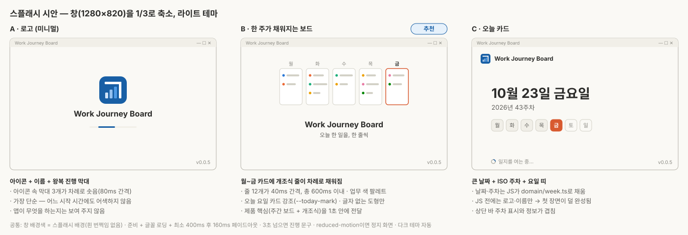

# 스플래시 화면 구현 스펙 (초안, 2026-10-23)

> 상태: **시안 선택 대기**. 시안이 확정되면 이 문서의 "6. 확정 사항"을 채우고 구현한다.
> 와이어프레임: [wireframes/wireframe-splash.svg](wireframes/wireframe-splash.svg)



## 1. 목적과 원칙
- **목적**: 앱 아이콘을 누른 뒤 보드가 뜰 때까지 생기는 빈 화면을 없앤다. 현재는 흰 창이 잠깐 보이고, 이어서 "불러오는 중…" 문구, 웹 글꼴 교체, 입력칸 높이 재측정이 차례로 보인다. 이 구간을 브랜드 화면 하나로 덮는다.
- **원칙**
  1. **기다리게 만들지 않는다.** 스플래시는 실제 준비 시간을 가리는 용도다. 일부러 길게 보여 주지 않는다. 최소 표시 시간은 깜빡임 방지용 400ms뿐이다(◆G2 "매일 기록 2분 이내").
  2. **외부 통신 0.** 이미지·글꼴·스크립트를 모두 앱 안에 둔다. 로고는 인라인 SVG로 넣는다.
  3. **첫 픽셀을 최대한 빨리.** 스플래시는 JS 번들을 기다리지 않는다. `index.html`의 HTML·CSS만으로 그린다.
  4. **콜드 스타트 1회만.** 저장 위치 전환, 다시 시도, 주 이동 때는 보이지 않는다.

## 2. 구현 방식 — 창 안 스플래시(권장) vs 별도 스플래시 창

| | ① 창 안 스플래시 (**권장**) | ② 별도 스플래시 창 (Tauri 공식 가이드 방식) |
|---|---|---|
| 구조 | 메인 창 하나. `index.html`에 스플래시 레이어를 넣고, 앱이 준비되면 페이드아웃 후 제거 | 작은 `splashscreen` 창을 먼저 띄운다. 메인 창은 `visible:false`로 두었다가 준비되면 보이고, 스플래시 창은 닫는다 |
| 첫 픽셀 시점 | WebView2가 `index.html`을 그리는 순간 | 같음. 스플래시 창도 WebView2라서 더 빠르지 않다 |
| 흰 번쩍임 | 창 `backgroundColor`로 제거 | 같은 설정이 두 창 모두에 필요 |
| Rust 변경 | 거의 없음(다크 배경 5줄, 선택) | 창 2개 설정, `close_splash` 명령, 권한(capabilities), window-state의 VISIBLE 제외, single-instance가 숨은 메인 창을 다루는 처리 |
| 위험 | 낮음 | 메인 창이 끝내 보이지 않는 실패 경로가 생긴다(오류 시 창 없음) |
| 브라우저 모드 개발·E2E | 그대로 동작 | 실앱에서만 확인 가능 |
| 모양 | 앱 창 전체가 스플래시 | Office처럼 가운데 작은 카드 |

- **결론**: ①을 쓴다. ②는 첫 픽셀 시점에서 이득이 없다. 반면 "얇은 껍데기"(CLAUDE.md 4-5)와 "브라우저 모드에서 80~90% 개발" 원칙에 어긋나고, 메인 창이 끝내 안 보이는 새 실패 경로가 생긴다.

## 3. 표시 흐름 (방식 ①)

```
아이콘 더블클릭
 ├─ t0  네이티브 창 생성 — 배경색 = 스플래시 배경(흰 번쩍임 없음)
 ├─ t1  WebView2가 index.html을 그림 → 스플래시 표시(HTML·CSS만, 애니메이션 시작)
 ├─ t2  JS 번들 실행 → splash.ts가 문구·버전·날짜를 채움 → React 마운트·start()
 │       (설정 읽기 → DB 열기·마이그레이션 → 그날 첫 백업 → 보드 데이터)
 ├─ t3  종료 조건 충족: journal.state ≠ "loading" AND document.fonts.ready AND (t3 − t1) ≥ 400ms
 └─ t4  160ms 페이드아웃 → 스플래시 DOM 제거. 보드는 이미 오늘 칸에 커서
```

- **종료 조건의 이유**
  - `journal.state ≠ "loading"`: ready, first-run, missing, integrity, error 중 하나가 되면 바로 넘긴다. 오류 화면도 스플래시 뒤에 숨기지 않는다.
  - `document.fonts.ready`: Pretendard가 `font-display: block`이라 로딩 중에는 글자가 보이지 않는다. 그 구간과 입력칸 높이 재측정(v0.0.5 버그 수정 부분)을 스플래시가 덮는다.
  - 최소 400ms: 준비가 빨리 끝날 때 스플래시가 깜빡이듯 나타났다 사라지는 것을 막는다. 이보다 길게 하지 않는다.
- **오래 걸릴 때**: 표시 3초가 지나면 아래쪽에 진행 문구를 띄운다("일지를 여는 중…" → "백업하는 중…"). 단계는 appController의 start() 진행에 맞춘다. 강제로 닫는 시간 제한은 두지 않는다. 멈춘 경우에도 그 아래 화면이 더 쓸모 있지 않기 때문이다.
- **입력**: 스플래시는 `aria-hidden="true"`이고 포커스를 가져가지 않는다. 보드가 준비되면 오늘 칸에 이미 커서가 있다. 페이드 중에 친 글자도 그 칸에 들어간다. 마우스 클릭은 스플래시가 사라질 때까지 막는다(보이지 않는 보드를 누르지 않게).
- **접근성**: 화면 낭독기용으로 `role="status"`인 숨은 문구 "불러오는 중"을 둔다. `prefers-reduced-motion`이면 애니메이션 없이 마지막 장면만 보인다.

## 4. 시안 3종

공통: 배경과 글자는 tokens.css와 같은 값(라이트·다크 자동). 로고는 앱 아이콘과 같은 모양의 인라인 SVG. 버전은 `v0.0.5` 형식. 애니메이션은 모두 600ms 안에 끝나므로 일반적인 시작 시간 안에 다 보인다.

### 시안 A — 로고 (미니멀)
- 화면 가운데 앱 아이콘(64px) → 앱 이름(19px, 600) → 얇은 진행 막대(96×3px, 왕복). 오른쪽 아래에 버전.
- 움직임: 아이콘 속 막대 3개가 왼쪽부터 차례로 솟는다(80ms 간격, 각 320ms). 진행 막대는 준비될 때까지 왕복한다.
- 장점: 가장 단순하고 어느 시작 시간에도 어색하지 않다. 단점: 앱이 무엇을 하는지는 보여 주지 않는다.

### 시안 B — 한 주가 채워지는 보드 (**추천**)
- 가운데 월~금 작은 카드 5개. 각 카드에 개조식 줄 2~3개(업무 색 점 + 회색 줄)가 월→금 순서로 채워진다. 그 아래 앱 이름과 한 줄 소개 "오늘 한 일을, 한 줄씩".
- 움직임: 줄 12개가 40ms 간격으로 왼쪽에서 그려진다(줄당 160ms, 총 ≤600ms). 오늘 요일 카드는 `--today-mark` 테두리(JS가 채움. 주말이면 강조 없음).
- 줄은 추상 도형이다. **글자가 없어서 실제·가상 업무 내용이 들어갈 여지가 없다.**
- 장점: 제품의 핵심(주간 보드 + 개조식)을 1초 안에 보여 준다. 업무 색 팔레트를 그대로 쓴다. 단점: A보다 HTML·CSS가 조금 길다(카드 5개, 줄 12개).

### 시안 C — 오늘 카드
- 왼쪽 위에 작은 로고와 이름. 가운데에 큰 날짜 "10월 23일 금요일"(26px, 700), 그 아래 "2026년 43주차"와 월~일 7칸 띠(오늘 칸 강조). 아래쪽에 진행 문구.
- 날짜와 주차는 JS가 `domain/week.ts`로 채운다. JS가 돌기 전에는 로고와 이름만 보인다.
- 장점: 스플래시가 정보(오늘·주차)를 준다. 단점: 보드 상단 바의 주차 표시와 겹친다. JS 실행 전후로 화면이 바뀌어 첫 장면이 덜 완성돼 보인다.

## 5. 구현 명세 (시안과 무관한 공통 부분)

| 파일 | 변경 |
|---|---|
| `index.html` | `<div id="splash" aria-hidden="true">` 레이어 + 인라인 `<style>`(CSP `style-src 'unsafe-inline'` 범위 안) + 인라인 SVG 로고. **인라인 `<script>`는 쓰지 않는다**(CSP `script-src`가 `'self'`). 한국어 문구는 넣지 않는다 |
| `src/ui/splash.ts` (신규) | `fillSplash()`: `STR.splash.*` 문구, `__APP_VERSION__`, (B·C) 오늘 요일·주차를 채운다. main.tsx에서 React 렌더 전에 호출. `dismissSplash()`: 종료 조건 대기 → `.leaving` 클래스(160ms 페이드) → 노드 제거. 두 번 불려도 안전해야 한다 |
| `src/main.tsx` | `fillSplash()` 호출 |
| `src/ui/App.tsx` | `journal.state`가 처음으로 `"loading"`을 벗어나면 `dismissSplash()` 호출(1회) |
| `src/shared/strings.ts` | `splash: { tagline, opening, backingUp, loadingA11y }` |
| `src-tauri/tauri.conf.json` | main 창 `"backgroundColor": "#faf9f5"`(라이트 배경) |
| `src-tauri/src/lib.rs` | (선택) `setup`에서 OS 테마가 다크면 `set_background_color(#1a1a19)`. 다크 모드에서 밝은 번쩍임 방지(약 5줄) |
| `tests/unit/splash.test.ts` | index.html 스플래시 색이 tokens.css 값과 같은지 문자열 대조(두 곳 색의 어긋남 방지). `dismissSplash` 최소 시간·중복 호출 |
| `tests/e2e/splash.spec.ts` | 시작 시 `#splash` 보임 → 보드 준비 후 사라짐. 사라진 뒤 오늘 칸 포커스. 첫 실행·폴더 없음 화면에서도 사라짐. reduced-motion에서 애니메이션 없음 |
| `docs/overview.md` | 10-11절(스플래시), 10-9 화면 목록에 한 줄 |

- **색의 단일 출처**: 스플래시는 JS 번들 전에 그려야 하므로 tokens.css를 쓸 수 없다. 그래서 index.html에 색을 복사하고, 단위 테스트로 tokens.css와 같은 값인지 고정한다.
- **글꼴**: 스플래시 글자는 시스템 글꼴(맑은 고딕)로 그린다. Pretendard 로딩을 기다리지 않는 대신, 스플래시 안의 이름·버전 크기를 Pretendard와 비슷한 폭으로 맞춘다. 스플래시가 사라질 때 이미 Pretendard가 준비돼 있으므로 보드에서는 글꼴 교체가 보이지 않는다.
- **E2E 영향**: 기존 25개 테스트는 보드 포커스를 기다리므로 그대로 통과해야 한다. 각 테스트 시작이 최대 400ms 늘어난다.
- **분량**: 반 세션 정도. 실앱에서는 회사 PC로 "아이콘 더블클릭 → 보드 입력 가능" 시간을 측정해 M1 확인표에 적는다.

## 6. 확정 사항
- 시안: (미정)
- 반영 버전: (미정 — 개선사항 묶음과 함께 반영할지 결정)
