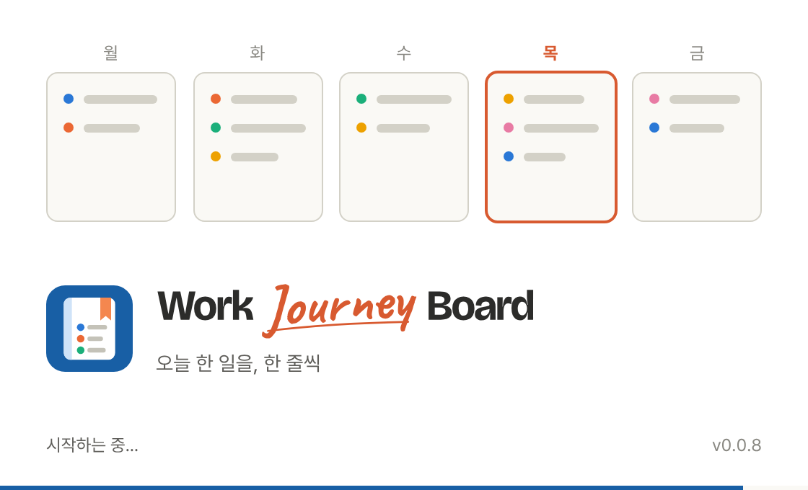

# 스플래시 화면 구현 스펙 (2026-10-23 확정 · v2 별도 스플래시 창)

> 상태: **v2 구현**(2026-10-23). v0.0.6의 창 안 스플래시(v1)를 사용자 요청으로 바꿨다. 결정 이력은 6절.
> 시안 비교 와이어프레임: [wireframes/wireframe-splash.svg](wireframes/wireframe-splash.svg) — 시안 B 채택.



## 1. 목적과 원칙
- **목적**: 앱을 켤 때 포토샵처럼 **메인 창보다 작은 스플래시 창**이 화면 가운데 먼저 뜬다. 사용자가 알아볼 만큼 보여 준 뒤 다 준비된 메인 창으로 넘어간다. 흰 창, "불러오는 중…" 문구, 글꼴 교체 같은 준비 과정은 메인 창이 숨어 있는 동안 끝난다.
- **원칙**
  1. **알아볼 만큼은 보인다.** 준비가 빨라도 최소 **2.5초**(앱 시작 기준) 동안 보인다. 준비가 더 오래 걸리면 준비되는 즉시 넘어간다. 시간을 바꾸려면 `SPLASH_MIN_MS`(src/ui/splash.ts) 하나만 바꾼다.
  2. **외부 통신 0.** 화면은 HTML·CSS 도형과 앱에 들어 있는 Pretendard만 쓴다.
  3. **메인 창이 끝내 안 보이는 일은 없다.** 웹 앱이 끝내 알리지 못해도(시작 중 오류 등) Rust가 15초 뒤에 메인 창을 보인다.
  4. **콜드 스타트 1회만.** 앱을 켤 때만 뜬다. 저장 위치 전환이나 주 이동 때는 뜨지 않는다.

## 2. 구현 방식 — 별도 스플래시 창(Tauri 창 2개)

| 창 | 설정(tauri.conf.json) | 역할 |
|---|---|---|
| `splash` | `splash.html` · 560×340 · `center` · `decorations:false`(테두리·제목 표시줄 없음) · `shadow:true`(윈도우 11에서 둥근 모서리·그림자) · `resizable/maximizable/minimizable/closable:false` · `focus` · 배경 `#ffffff` | 앱 설정에서 **먼저** 생성돼 화면 가운데 뜬다. 작업 표시줄에도 보인다 |
| `main` | 기존 설정 + **`visible:false`** · 배경 `#faf9f5` | 숨긴 채 웹 앱을 준비한다(설정·DB·백업·보드·글꼴). 끝나면 보인다 |

- **넘어가기**: 메인 창 웹 앱이 Rust 명령 `splash_finish`를 부른다. Rust는 메인 창 `show()`·`set_focus()` 다음에 스플래시 창 `destroy()`를 한다.
- **안전장치(src-tauri/src/splash.rs)**: 시작 15초 뒤에도 스플래시 창이 남아 있으면 Rust가 같은 넘어가기를 한다.
- **window-state 플러그인**: 크기·위치만 복원하고 보이기(VISIBLE)는 복원하지 않는다. 복원하면 메인 창이 스플래시 중에 미리 보인다. 스플래시 창은 저장·복원 대상에서 뺀다(`with_denylist`). 최대화 상태 복원은 숨은 창에서 미뤄졌다가 보일 때 적용된다(tao 동작).
- **두 번째 실행(single-instance)**: 시작 중이면 스플래시 창, 아니면 메인 창을 앞으로 가져온다. 시작 중에 메인 창을 미리 보이지 않는다.
- **다크 테마**: 설정 파일의 배경색은 라이트다. 그래서 `setup`에서 OS 테마가 다크면 두 창 배경을 다크(splash `#232322`, main `#1a1a19`)로 바꾼다.
- **권한**: 스플래시 창 전용 capability `splash.json`에는 `core:event:allow-listen/unlisten`만 둔다. 파일·DB·대화상자 권한은 없다.

## 3. 표시 흐름

```
아이콘 더블클릭
 ├─ t0  스플래시 창이 화면 가운데 뜸(테두리 없음). 메인 창은 숨긴 채 생성
 ├─ t1  splash.html 첫 장면(HTML·CSS + Pretendard) — 움직임이 최소 표시 시간을 채우도록 배치
 │       0~0.6초 카드 5개 등장 → 0.45~1.6초 줄 12개가 차례로 그려짐 → 1.7초 오늘 요일 카드 강조
 │       진행 막대는 2.4초에 걸쳐 차오름, 아래 진행 문구 "시작하는 중…"
 ├─ t2  메인 창(숨김)에서 웹 앱 시작 — 단계마다 스플래시 문구 변경(Tauri 이벤트 splash-status)
 │       "일지를 여는 중…" → "백업 확인 중…" → "보드를 준비하는 중…" → "준비 완료"
 ├─ t3  넘어가기 조건: journal.state ≠ "loading" AND 보드 글꼴 로딩(최대 1.5초) AND 앱 시작 후 ≥ 2.5초
 └─ t4  메인 창 보이기·포커스 → 스플래시 창 닫기. 보드는 이미 오늘 칸에 커서
```

- `journal.state`가 ready, first-run, missing, integrity, error 중 무엇이든 넘어간다. 첫 실행 화면이나 오류 화면도 스플래시 뒤에 묶어 두지 않는다.
- **브라우저 모드**(개발·E2E): 창이 하나뿐이라 스플래시가 없다. 앱은 바로 보드로 시작한다. 스플래시 창 화면은 `/splash.html`(`?today=YYYY-MM-DD`로 날짜 고정)을 열어 개발·테스트한다.
- **접근성**: 진행 문구가 `role="status"`라 화면 낭독기가 읽는다. `prefers-reduced-motion`(Windows 설정 > 접근성 > 시각 효과 > **애니메이션 효과 끔**)이면 크기·위치 움직임 대신 같은 순서로 **서서히 나타나기(투명도)** 만 쓴다. 진행 막대와 오늘 강조는 그대로다. 회사 PC는 이 설정이 꺼져 있는 경우가 많아서 움직임을 완전히 없애지 않는다.

## 4. 화면 — 시안 B(한 주가 채워지는 보드)를 작은 창에 맞춤
- 위: 월~금 미니 카드 5개(높이 104px)가 70ms 간격으로 떠오른다. 카드마다 개조식 줄 2~3개(업무 색 점 + 회색 줄)가 월→금 순서로 그려진다(줄 12개, 80ms 간격, 줄당 280ms). 줄이 다 그려진 뒤(1.7초) 오늘 요일 카드에 `--today-mark` 테두리가 들어온다. 주말이면 강조 없음.
- 가운데: **앱 아이콘(60px) + 워드마크**(상자 높이 40px, [brand-spec.md](brand-spec.md))와 한 줄 소개 "오늘 한 일을, 한 줄씩"(14px). 왼쪽 정렬. (2026-10-23 아이콘·워드마크 추가 — "앱 실행 시 아이콘이 안 보여 아쉽다"는 피드백)
- 아래: 왼쪽 진행 문구, 오른쪽 버전(`v0.0.x`). 창 맨 아래 3px 진행 막대(강조색)가 2.4초에 걸쳐 92%까지 찬다.
- 줄은 추상 도형이다. 글자가 없으므로 업무 내용이 들어갈 여지가 없다.
- 라이트·다크 모두 tokens.css 값과 같은 색을 쓴다.

## 5. 구현 명세

| 파일 | 내용 |
|---|---|
| `splash.html` (신규) | 스플래시 창 페이지. 인라인 `<style>` + `fonts.css` 링크. **인라인 `<script>`와 `style="…"` 속성은 쓰지 않는다**. CSP `script-src`가 `'self'`이고, Tauri가 `<style>`에 nonce를 붙이면 브라우저가 `'unsafe-inline'`을 무시해 style 속성이 막힌다(단위 테스트로 금지). 첫 장면에 필요한 문구(요일·소개·"시작하는 중…")는 HTML에 두고 strings.ts·week.ts와 같은지 단위 테스트로 대조한다. 버전은 `%APP_VERSION%`을 Vite 플러그인이 바꾼다 |
| `src/splash/main.ts` · `view.ts` (신규) | 스플래시 창 스크립트: 오늘 요일 강조(`markToday`), 이벤트를 받아 진행 문구 변경(`setStatus`), 브라우저 모드 `?today=` |
| `src/platform/index.ts` | `Platform.splash?: SplashWindow { status(text); finish() }` — 실앱만 있고 브라우저 모드에는 없다 |
| `src/platform/tauri.ts` · `splashEvents.ts` | `status` = `emitTo("splash", "splash-status", text)`(창이 닫힌 뒤에는 무시), `finish` = `invoke("splash_finish")` |
| `src/ui/splash.ts` | `finishSplash(platform)`: "준비 완료" 표시 → 최소 2.5초·글꼴 대기 → `finish()`. 여러 번 불려도 한 번 |
| `src/ui/common/appController.ts` | 시작 단계마다 `p.splash?.status(…)` |
| `src/ui/App.tsx` | `journal.state`가 `"loading"`을 벗어나면 `finishSplash()` |
| `src/shared/strings.ts` | `splash: { tagline, starting, opening, backingUp, preparing, ready }` |
| `vite.config.ts` | 페이지 2개 빌드(`index.html`, `splash.html`), `%APP_VERSION%` 치환 |
| `src-tauri/tauri.conf.json` | `splash` 창 추가(목록 첫 번째), `main` 창 `visible:false` |
| `src-tauri/src/splash.rs` (신규) · `lib.rs` | `splash_finish` 명령, 15초 안전장치, 두 번째 실행 처리, window-state 설정, 다크 배경 |
| `src-tauri/capabilities/splash.json` (신규) | 스플래시 창 권한(이벤트 받기만) |
| `tests/unit/splash.test.ts` | splash.html 색(라이트·다크)·문구 원본 대조, CSP 금지 패턴(splash·index), 창 설정(작은 크기·테두리 없음·메인 숨김), 스플래시 권한, 오늘 강조·문구·`?today=`, 최소 시간 규칙 |
| `tests/e2e/splash.spec.ts` | `/splash.html`을 560×340으로 열어 내용·오늘 강조·창 안에 다 들어감, reduced-motion, 브라우저 모드 앱은 바로 보드 |

- **회사 PC에서만 확인 가능**(4-5): 스플래시 창이 가운데 작게 뜨는지, 둥근 모서리·그림자가 있는지, 약 2.5초 뒤 메인 창으로 넘어가는지, 진행 문구가 바뀌는지, 메인 창이 뜬 직후 바로 타이핑되는지, 최대화 상태로 끈 뒤 다시 켜도 스플래시 중에 메인 창이 먼저 보이지 않는지, 다크 테마에서 밝은 번쩍임이 없는지.

## 6. 결정 이력
- **2026-10-23 v1(v0.0.6)**: 시안 3종(A 로고 / **B 한 주가 채워지는 보드** / C 오늘 카드) 중 B 채택. 메인 창 안 레이어 방식으로, 준비되면 바로 사라짐(최소 0.4초).
- **2026-10-23 v2**: 사용자 피드백 — "순식간에 사라져서 볼 시간이 없다. 로딩으로 지연될 요소가 없으면 일정 시간 유지하고, 메인 화면보다 작게, 포토샵 실행 장면처럼".
  - 별도 스플래시 창(560×340, 테두리 없음, 화면 가운데)으로 바꿨다. 메인 창은 숨긴 채 준비한다.
  - 최소 표시 시간은 2.5초. 진행 막대와 단계별 문구를 추가했다.
  - v1에서 걱정했던 "메인 창이 끝내 안 보이는 경로"는 Rust 15초 안전장치로 막았다.
- **2026-10-23 v2.1**: 사용자 피드백 — "시안에는 모션이 있었는데 실제는 정적 화면".
  - 원인 추정: ① 회사 PC의 Windows **애니메이션 효과 끔** 설정 때문에 `prefers-reduced-motion`으로 모든 움직임이 꺼졌다. ② 줄 그리기가 0.7초에 끝나 창이 뜨는 순간 이미 지나갔다.
  - 조치: 움직임을 2.5초에 걸쳐 배치했다(카드 등장 → 줄 → 오늘 강조 → 진행 막대). reduced-motion이면 투명도 나타나기로 바꾼다.
