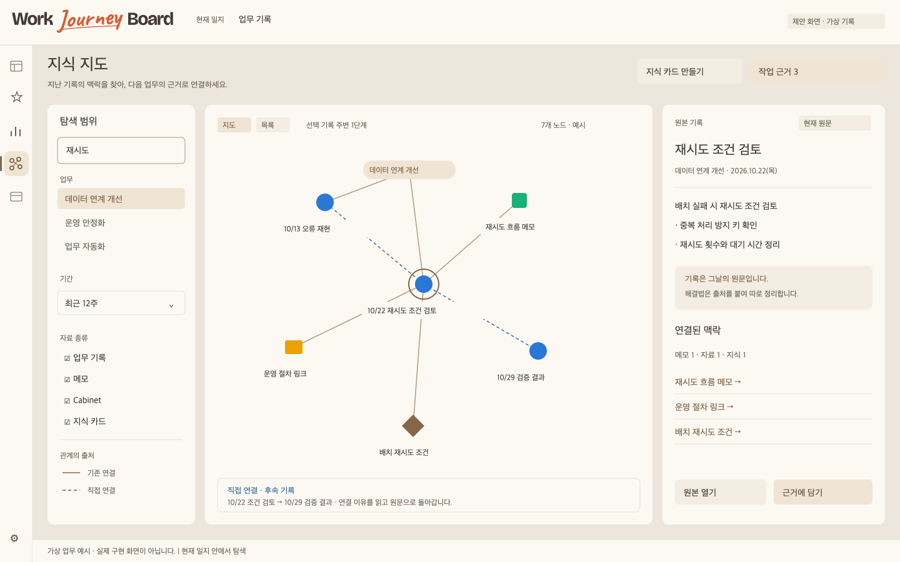
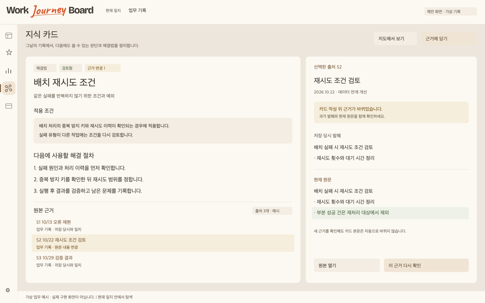
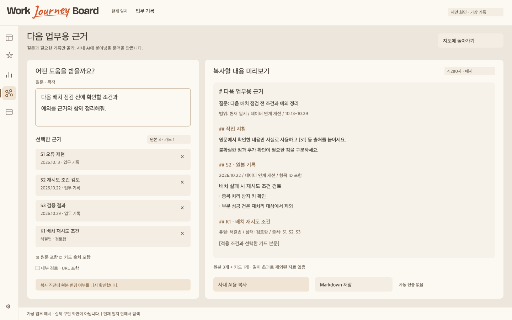

# 디자인 스펙 — Universe / 지식 지도

## 1. 명칭·위치·디자인 원칙

작업명은 기존 기획의 **Universe**를 사용한다. 사용자 표시명은 다음 중 **지식 지도**를 제안한다. 아직 승인된 제품명은 아니다.

| 후보 | 장점 | 고려점 |
| --- | --- | --- |
| **지식 지도** | 자료의 관계를 탐색한다는 뜻이 분명 | 지도 외에 카드·목록도 포함한다는 초기 안내 필요 |
| 업무 기억 | 과거 경험 재사용에 초점 | 개인 공간으로 넓힐 때 표현이 좁음 |
| 연결 노트 | 기록 중심 앱과 이어짐 | 이미 있는 메모 관계선과 혼동 가능 |
| Universe | 기존 후속 기획과 연결 | 처음 보는 사용자에게 설명 필요 |

기존 **52px 레일**은 유지하고 인사이트 다음에 지식 지도 아이콘을 추가하는 안을 제안한다. 기존 메뉴·단축키를 재배치하지 않는다. 별도 창보다 주간 보드 영역을 교체하는 작업 화면으로 시작하고 ‘보드로 돌아가기’를 제공한다.

원칙은 **원본 우선, 연결 이유 표시, 다음 업무에 재사용**이다. 기존 시그니처·라이트·다크 테마와 같은 앱으로 보여야 한다. 그래프를 이유 없이 어둡게 고정하거나 전체 화면에서 계속 움직이게 하지 않는다.

## 2. 정보 구조

```text
지식 지도
├── 탐색: 지도 / 목록
│   ├── 업무·기간·유형·관계 필터
│   ├── 원본 기록 / 메모 / Cabinet
│   └── 연결 이유 / 원본 열기 / 새 연결
├── 지식 카드
│   ├── 해결법 / 의사결정 / 배운 점 / 업무 길잡이
│   ├── 초안 / 검토함 / 보관
│   └── 출처 / 근거 변경 / 적용 조건
└── 작업 근거
    ├── 질문·목적 / 선택 자료
    ├── 원문·카드·출처 미리보기
    └── 사내 AI용 복사 / Markdown 저장
```

업무 길잡이는 P1이지만 카드 유형은 데이터 호환을 위해 예약한다. MVP 화면에서 미구현 메뉴를 동작하는 버튼처럼 노출하지 않는다.

## 3. S-01 지도 탐색



**시연 가정**: 현재 일지 하나, 가상 업무 ‘데이터 연계 개선’, 최근 12주. 모든 기록·연결·수치는 설계용이다.

### 레이아웃

- 예시 아트보드 1440×900px. 기존 앱 상단 바를 유지하는 가정으로 72px를 배정하고 실제 구현 때 기존 높이를 재측정한다.
- 레일 52px는 기존 CSS의 실제 값이다. 화면 제목·설명은 레일 오른쪽 24px 지점에 둔다.
- 3영역: 필터 236px, 지도 유동 폭, 상세 356px, 영역 사이 16px.
- 필터·지도·본문에 각각 목적이 있는 독립 스크롤을 허용하되, 본문 안에 불필요한 추가 스크롤을 만들지 않는다.
- 상단은 ‘지식 지도’, 지도/목록 전환, 검색, 선택한 업무·기간, ‘작업 근거 N’이다.
- 그래프 상단에는 현재 seed·연결 깊이·잘린 결과 여부, 하단에는 확대·축소·맞춤·목록 대체를 둔다.

### 노드와 관계

| 대상 | 표현 | 텍스트 |
| --- | --- | --- |
| 업무 | 둥근 사각형/군집 제목 | 업무명·종료 여부 |
| 기록 | 원 | 날짜 + 원문 요약 |
| 메모 | 작은 사각형 | 메모 종류·제목/첫 줄 |
| Cabinet | 폴더/링크 기호 | 등록 제목 |
| 지식 카드 | 다이아몬드/카드 기호 | 제목·카드 상태 |

노드의 색은 기존 업무 색 `--cat-cN`을 낮은 채도 면·테두리로 활용하고, 현재 선택은 크기·외곽선·라벨로 강조한다. 카드 유형과 상태를 색만으로 구분하지 않는다. 크기는 일정하며 연결 수·성과에 따라 키우지 않는다.

관계의 **출처와 종류는 두 축**이다. 기존 연결/직접 연결/추천 후보는 패턴·범례로, ‘후속·근거·관련’은 선택 시 문구와 방향으로 설명한다. 모든 선에 긴 레이블을 상시 그리지 않는다. 기존 메모 관계선은 저장된 방향·점선을 보존한다.

### 선택·이동

- 노드 클릭은 상세 패널을 갱신하고 지도를 크게 재배치하지 않는다.
- 두 번 누르기를 유일한 원본 열기 방법으로 삼지 않는다. 패널에 ‘원본 열기’를 둔다.
- 관계 선택은 출발·대상·이유·원래 기능·수동 편집 가능 여부를 보여 준다.
- 기존 메모 관계를 지도에서 고칠 때는 ‘주간 메모에서 수정’을 제공한다. 수동 Universe 관계만 이 화면에서 편집한다.
- ‘지도에서 새 연결’은 출발 고정 → 대상 검색 → 종류·설명 → 저장 순서다. 드래그만 요구하지 않는다.
- 주간 보드로 이동할 때 미저장 입력을 먼저 완료하고, 복귀하면 선택·기간·줌을 복원한다.

## 4. S-02 출처가 있는 지식 카드



### 읽기 구조

제목 → 유형·카드 상태 → 요약 → 적용 조건 → 본문 → 관련 업무 → 출처 목록 → 연결/재사용 행동 순서다. 원문은 우측에 날짜·업무·본문·변경 상태와 함께 표시한다.

출처 목록의 각 행은 다음을 보여 준다.

1. 번호와 원본 유형.
2. 업무·날짜 또는 메모 주차.
3. 선택 당시 발췌.
4. 현재 상태: 일치 / 내용 변경 / 위치 변경 / 원문 없음.
5. 원본 열기 또는 과거 발췌 보기.

원문이 없더라도 과거 발췌는 **‘저장 당시 발췌’**로 읽을 수 있다. 최신 원문 패널에 과거 내용을 채워 넣지 않는다.

### 카드 편집

- 제목 120자, 요약 300자, 본문 10,000자, 적용 조건 1,000자. 현재 길이/한도를 입력 중 표시한다.
- 첫 생성 시 원본을 선택한 상태로 열며, 원본 내용을 본문으로 무조건 복사하지 않는다.
- 명시적 ‘저장’, ‘취소’. 입력 중 임시본 상태를 표시하고 창을 닫을 때 보존/버리기를 선택할 수 있다.
- 검토함 변경은 자동 저장의 부수 효과가 아니다. 출처·적용 조건을 확인하는 명시 행동이다.
- ‘근거 변경’은 상단 안내 + 해당 출처 행에서 표시한다. 새 내용과 과거 발췌를 나란히 읽고 ‘이 근거 다시 확인’을 할 수 있다.
- 카드 보관은 메뉴 안에 두고 토스트에서 되돌리기를 제공한다.

## 5. S-03 다음 업무용 근거 묶음



예시 화면은 전체 작업 화면이다. 기본 구현은 넓은 창에서 오른쪽 560px drawer, ‘넓게 보기’에서 전체 화면을 제안한다.

- 왼쪽: 목적·질문, 업무·기간, 선택한 기록/카드, 드래그와 버튼 정렬, 제외·제거.
- 오른쪽: 실제 복사할 지시문·원문·출처·주의 미리보기.
- 하단: 포함 원본 수·발췌 문자 수·제외 건수, ‘사내 AI용 복사’, ‘Markdown 저장’.
- 복사는 내용을 클립보드로 옮기는 행동이다. 앱에서 사내 AI에 접속하거나 자동 제출하지 않는다.
- 내부 경로/URL·이미지 설명·카드 출처 포함은 각각 옵션으로 보여 준다. 기본은 내부 절대 경로/URL 제외, 이미지는 설명만.
- 원본이 바뀌면 바로 복사하지 않고 미리보기를 새로 만든 뒤 ‘변경 내용 확인 후 복사’를 제공한다.
- 선택 자료가 많으면 원본 단위 제외 목록을 보이고 조용히 자르지 않는다.

## 6. 실제 디자인 토큰 연결

기준은 저장소의 `src/shared/tokens.css`다. 아래 값은 조사한 시그니처 테마 값이며 새 앱 전용 색 체계를 만들지 않는다. 역할 토큰이 이미 있으면 그 역할을 우선 재사용한다.

| 토큰 | 시그니처 값 | 용도 |
| --- | --- | --- |
| `--surface-page` | `#EDE6DC` | 작업 배경 |
| `--surface-card` | `#FCF9F3` | 원문·카드·지도 |
| `--surface-sub` | `#F3EDE3` | 보조 면 |
| `--surface-focus` | `#F4EBDD` | 선택·편집 맥락 |
| `--accent` | `#856748` | 상호작용 |
| `--accent-soft` | `#F0E5D5` | 활성·선택 |
| `--text-1` | `#423C34` | 본문 |
| `--text-2` | `#6B6054` | 보조 설명 |
| `--text-3` | `#786F63` | 기본 밝은 카드 위 메타데이터 |
| `--line` | `#E9E1D5` | 약한 구분선 |
| `--line-strong` | `#D6C3AA` | 구조 경계 |
| `--ok` | `#526847` | 확인한 상태 |
| `--warn` | `#806031` | 근거 변경·확인 필요 |
| `--danger` | `#A94F42` | 오류·끊긴 출처 |
| `--sp-1~6` | `4/6/8/12/16/24px` | 간격 |
| `--radius-sm/md/lg` | `4/6/10px` | 모서리 |
| `--fs-xs/sm/md/lg/xl` | `12/13/14/16/19px` | 글자 크기 |

시그니처는 **고운돋움 400·가짜 볼드 금지**, 라이트/다크는 기존 Pretendard 규칙을 사용한다. 제목 위계는 크기·여백·색으로 만든다. 워드마크·브랜드색은 기존 자산을 재사용한다. 정적 예시는 시스템 글꼴 대체라 실제 서체 검수 결과가 아니다.

작은 보조 글자를 `--surface-page` 위에 놓을 때 `--text-3` 대비가 부족할 수 있으므로 더 짙은 `--text-2`/역할 보조색을 사용한다. 라이트/다크 값은 기존 토큰에서 자동 전환한다. 지도 캔버스도 테마를 따른다.

## 7. 컴포넌트 계약

| 컴포넌트 | 주요 입력 | 상태·행동 | 요구사항 |
| --- | --- | --- | --- |
| UniverseFilter | query, 업무, 기간, 종류, 관계 | 활성 필터·초기화·검색 중·일부 결과 | U-03 |
| GraphViewport | nodes, edges, seed, limits | 선택·확대·맞춤·정지·목록 대체 | U-04 |
| KnowledgeResultRow | source, type, date, snippet | 선택·원문 없음·필터 밖 | U-03~05 |
| SourcePreview | ref, resolution, fingerprints | 원문·내용 변경·위치 변경·삭제 | U-05·08 |
| RelationEditor | from, to, type, note | 중복·자기 관계·사라진 대상·저장 실패 | U-06 |
| KnowledgeCard | card, revision, sources | 초안·검토함·보관·근거 변경 | U-07~09 |
| SourceCitationRow | snapshot, current | 당시/현재 비교·원본 열기 | U-08 |
| ContextBasket | sources, question, options | 담김·제외·한도 초과·오래됨 | U-10 |
| ContextPreview | generatedText, size, warnings | 준비·재검증·복사 성공/실패 | U-11 |
| ScopeNotice | journal, partial, missing | 현재 일지·일부 공간 읽기 실패 | U-12·16 |

원본 읽기 패널은 조회만 한다. 실수로 원문을 수정할 수 있는 inline editor를 지도에 추가하지 않는다. 원문 편집은 기존 보드·메모에서 한다.

## 8. 상태와 복구 문구

| 상태 | 문구 | 행동 |
| --- | --- | --- |
| 첫 기록 없음 | ‘아직 연결할 기록이 없습니다. 오늘 한 일을 먼저 남겨 보세요.’ | 주간 보드 열기 |
| 연결 없음 | ‘이 기록과 이어진 자료가 아직 없습니다.’ | 연결하기·지식으로 정리 |
| 검색 0건 | ‘일치하는 기록이 없습니다.’ | 기간 넓히기·필터 해제 |
| 일부 결과 | ‘표시 한도에 도달했습니다. 범위를 좁히거나 목록에서 더 보세요.’ | 목록·다음 페이지 |
| 원문 변경 | ‘카드를 만들 때와 근거 내용이 달라졌습니다.’ | 변경 비교·재확인 |
| 위치 변경 | ‘이 기록은 다른 날짜 또는 업무로 옮겨졌습니다.’ | 현재 위치 열기 |
| 원문 삭제 | ‘원본을 찾을 수 없습니다. 저장 당시 발췌를 표시합니다.’ | 발췌 보기·출처 재연결 |
| 카드 저장 실패 | ‘저장하지 못했습니다. 입력한 내용은 이 창에 남아 있습니다.’ | 다시 저장·텍스트 복사 |
| 일지 전환 | ‘열린 일지가 바뀌어 결과를 다시 불러옵니다.’ | 새 결과 대기 |
| 복사 완료 | ‘질문과 출처를 포함한 근거를 복사했습니다.’ | 계속 탐색 |
| 복사 실패 | ‘복사하지 못했습니다.’ | Markdown 저장·수동 선택 |
| P1 공간 누락 | ‘개인 공간을 읽지 못했습니다. 현재 일지 자료는 볼 수 있습니다.’ | 이유·다시 시도 |

오류에 실제 사용자 파일 절대 경로·원문·DB 스택을 노출하지 않는다. 사용자가 원본 위치를 보는 화면에는 업무·날짜·등록 제목처럼 필요한 정보만 표시한다.

## 9. 좁은 창과 접근성

이 제품은 Windows/macOS 데스크톱 앱이다. 모바일 앱을 출시 범위로 가정하지 않는다.

| 유효 너비 | 동작 |
| --- | --- |
| ≥1366px | 필터 236 + 지도 유동 + 상세 356, 레일 52 유지 |
| 1100~1365px | 필터 208, 상세 320, 지도 부족 시 목록 우선 |
| 800~1099px | 필터 drawer, 지도/목록 + 상세 오버레이, 원본 패널 복귀 버튼 |
| <800px 또는 200% 확대 | 한 영역씩 전환, 목록 기본, 카드/근거 패널 전체 화면 |

높이 768px에서는 행동을 하단에 고정하고 본문 스크롤 여백을 확보한다. 제목은 줄바꿈, 경로/URL은 블록 안 줄바꿈, 코드는 블록만 가로 스크롤한다. 결과 한 줄은 2줄 말줄임+접근 가능한 전체 이름을 제공하고 선택 본문은 자르지 않는다.

포커스 순서는 레일→화면 제목/전환→검색→필터→결과/목록→상세→행동이다. 그래프 전체 노드를 Tab 대상으로 만들지 않고 목록 대체를 제공한다. 노드 선택 변화·담기·복사는 `aria-live=polite`, 필수 오류는 지속되는 인라인 안내를 사용한다. drawer/dialog는 이름·Escape·포커스 트랩·복귀를 구현한다.

기존 레일 40px 버튼 크기는 유지 검토 대상이며 새 핵심 동작은 최소 40px(터치 대응 시 44px)을 권장한다. 주요 본문 대비 4.5:1, 포커스·컨트롤 3:1을 실제 테마별로 검사한다. 그래프 노드의 작은 실제 원 크기와 클릭 표적은 분리해 넓힌다.

## 10. 모션·키보드

- hover 100~140ms, 메뉴·패널 140~180ms ease-out: 기존 스타일 명세 범위.
- 초기 배치 후 그래프 위치 계산 정지. 노드 선택마다 전체가 흩어지는 모션 없음.
- `prefers-reduced-motion`에서는 줌·패널 이동 애니메이션 제거.
- Enter는 선택 항목 열기/활성 버튼, Escape는 하위 창부터 닫기. 편집기에서는 IME 조합 상태를 우선한다.
- 새 전역 단축키는 이 문서에서 점유하지 않는다. 기존 `Ctrl+Shift+F`, `Alt+1~4`, 업무 입력·메모 연결 단축키와 충돌 검사 후 프로젝트 표에 함께 등록한다.

## 11. 디자인 검수

- [ ] 가상 데이터·원문 없음·근거 변경·위치 변경·0건·1건·한도 초과 상태.
- [ ] 테마 3종·글자 크기 설정·고운돋움 400·키보드 포커스.
- [ ] 1366×768, 1440×900, 200% 확대에서 지도 없이 핵심 작업 완료.
- [ ] 원본 위치 이동과 지도 복귀 시 필터·선택·줌 유지.
- [ ] 카드/연결 저장 실패·일지 전환 중 임시본 복구.
- [ ] 기존 주간 기록 입력·자동 저장·한글 조합을 방해하지 않음.

원본 벡터: [지도](assets/universe.svg) · [지식 카드](assets/knowledge-card.svg) · [근거 묶음](assets/context-pack.svg). PNG는 문서 열람용, SVG는 세부 배치 참고용이다.
