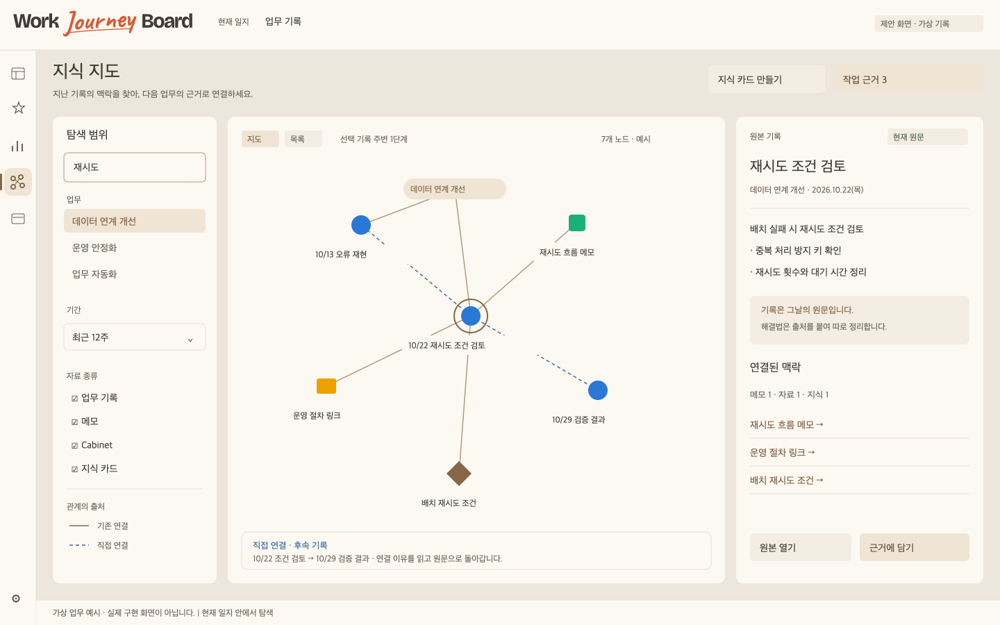

# Work Journey Board — 업무 일지 기반 세컨드 브레인 명세

- 작성일: **2026-11-03** (Asia/Seoul)
- 버전: **0.1 · 설계 초안**
- 대상: [chs2147/work-journey-board](https://github.com/chs2147/work-journey-board)
- 조사 기준: `main`의 [`10ff78c715bc651a28739d6e5befa94f9dffbbc7`](https://github.com/chs2147/work-journey-board/commit/10ff78c715bc651a28739d6e5befa94f9dffbbc7), 앱 버전 **1.7.1**, DB 스키마 **10**.
- 상태: **구현을 위한 신규 제안**. 승인·구현·실기 검증을 완료했다는 뜻이 아니다.

## 제안 요약

**일일 기록 → 연결된 맥락 → 재사용할 지식 → 다음 업무의 근거**를 만드는 기능이다.

현재 앱의 통합 검색·타임라인·메모 관계선·Cabinet을 재사용하고, 여기에 **여러 주를 가로지르는 연결, 출처가 있는 지식 카드, 관련 기록 탐색, AI 도구에 넘길 근거 묶음**을 추가한다. 지식 카드는 업무 기록을 대체하지 않는다. 기록은 ‘그날 무엇을 했는가’, 지식 카드는 ‘다음에도 활용할 판단·해결법·배운 점’이다.

화면 작업명은 기존 기획의 **Universe**를 이어받되, 사용자에게는 **지식 지도**라는 이름을 제안한다. 명칭은 미확정이다.

## 문서 구성

| 문서 | 내용 |
| --- | --- |
| [영상 분석과 적용](VIDEO_ANALYSIS.md) | 초급 지침·중급 길잡이·고급 탐색기, 영상 확인 범위와 프로젝트 대응 |
| [상세 요구사항](REQUIREMENTS.md) | 사용자 흐름, 20개 요구사항, 우선순위·수용 기준·성능·검수 |
| [디자인 스펙](DESIGN_SPEC.md) | 명칭, 화면 3종, 토큰·컴포넌트·상태·좁은 창·접근성 |
| [데이터·구현 명세](IMPLEMENTATION_SPEC.md) | 실제 코드 연결점, 데이터 모델, 저장소 계약, 갱신·마이그레이션·작업 단계 |
| [소스 조사 기록](SOURCE_AUDIT.md) | 확인한 파일·기존 기능·검토 중 기획·검증하지 않은 범위 |

## 예시 화면

아래는 **신규 설계 예시**다. 모든 업무 내용·날짜별 내역·건수·연결은 가상 데이터이며, 앱의 실제 구현 화면이 아니다. 기존 시그니처 테마의 색 역할을 참고했다. 예시 서체는 시스템 대체 글꼴이며, 실제 구현에서는 번들 고운돋움/테마별 서체를 그대로 사용한다.

[출처가 있는 지식 카드](assets/knowledge-card.png) · [다음 업무용 근거 묶음](assets/context-pack.png)

## 가장 먼저 구현할 범위

1. 현재 일지에서 업무·기록·메모 상자·Cabinet을 노드로 투영한다.
2. 이미 저장된 관계만 연결하고 목록·지도에서 원본 기록으로 돌아간다.
3. 사용자가 여러 주의 기록을 직접 잇고, 해결법·판단·배운 점을 지식 카드로 정리한다.
4. 필요한 원본·지식만 선택해 사내 AI에 붙일 근거 묶음을 만든다.

실제 AI API 호출·자동 의미 검색·외부 파일 본문 수집은 첫 범위에 넣지 않는다. 기존 프로젝트의 업무 데이터 전송 정책과 Cabinet 읽기 범위를 유지한다.

## 멀티 작업 공간과의 관계

조사한 `docs/multi-board-spec.md`는 **사용자 검토 대기**다. 그 문서 9절은 향후 Universe가 여러 일지를 읽기 전용으로 열고, 쓰기는 현재 공간에만 한다는 방향을 제시한다. 아직 구현된 기능으로 취급하지 않는다.

이 명세의 1차 기능은 **현재 일지 하나**에서도 동작한다. 여러 공간 통합 탐색은 멀티 작업 공간 승인·구현 후 P1로 진행하고, 공간 사이 영속 관계는 추가 결정 후에만 도입한다.

## 산출물 위치·적용 방식

이 패키지는 해당 저장소에 반영할 수 있는 독립 마크다운 문서다. 현재는 이 대화의 별도 산출물 폴더에 두었다. 저장소에 반영할 때는 `docs/second-brain/`를 권장하며 기존 설계 목차·Universe 계획과 함께 검토한다.

GitHub 저장소·제품 코드·DB·릴리스·이 대화의 프로젝트 소속을 변경하지 않았다. 구현 착수 시에는 기존 기획에 적힌 **상세 설계 검토 → 작업 브랜치 → 실제 동작 확인 → main 반영** 절차를 따른다.

## 근거와 제한

영상은 앞선 확인에서 확보한 설명·주요 재생 화면·화면 자막을 근거로 사용했다. 전체 자막 전사·오디오 분석은 완료하지 못했다. 관찰한 구성과 새로 제안한 동작을 분리했다. 저장소는 위 커밋의 선택 파일을 읽었으며 실제 사용자 일지나 운영 DB는 열지 않았다. 상세 범위는 [소스 조사 기록](SOURCE_AUDIT.md)을 참조한다.
