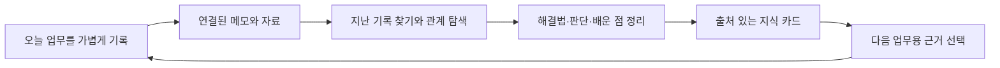

# 영상 분석 — 파일 중심의 세컨드 브레인을 업무 일지에 적용하기

## 1. 분석 근거

대상은 [사용자가 제공한 영상](https://www.youtube.com/watch?v=3Me5BJgsG7E)이다. 앞선 확인 당시 YouTube 페이지는 챗대리의 AI연구소, 2026-10-30 게시, 길이 17:15로 표시했다. 설명은 스킬·세컨드 브레인·루틴·익스텐션을 업무 시스템의 네 축으로 소개한다.

확인 방법은 페이지 설명과 주요 재생 화면·화면 자막 관찰이다. 스크립트 표시가 로딩 상태에 머물러 **완전한 자막과 전체 발화는 확보하지 못했다**. 아래 내용은 화면의 구조 분석이며 영상이 공개하지 않은 검색 엔진·DB·모델·내부 구현을 추정해 사실로 적지 않는다.

표기:

- **관찰**: 실제 페이지·재생 화면에서 본 구성.
- **해석**: 그 구성이 주는 효과와 한계를 분석한 것.
- **적용 제안**: Work Journey Board를 위해 새로 정한 요구 동작.

[발표자의 실습 가이드 페이지](https://blog.chatdaeri.com/ai-agent-system-4step-guide/)는 구독자 전용 본문을 확인하지 못했다. PDF 내용은 분석 근거에 포함하지 않는다.

## 2. 주요 구간

| 대표 시점 | 관찰 | 활용 |
| --- | --- | --- |
| [07:05 부근](https://www.youtube.com/watch?v=3Me5BJgsG7E&t=425s) | 작업 폴더 안 `AGENTS.md`와 지침 파일 만들기 카드 | 반복 전제·작업 방식을 지속되는 지침에 기록 |
| [07:59 부근](https://www.youtube.com/watch?v=3Me5BJgsG7E&t=479s) | 초급 지침 카드와 중급 길잡이 카드 | 자료가 늘면 주제별 진입 경로를 둠 |
| [08:42 부근](https://www.youtube.com/watch?v=3Me5BJgsG7E&t=522s) | 중심 지침 노드·주제별 문서 군집·검색창 | 연결과 검색을 한 탐색 공간에서 다룸 |
| [10:10 부근](https://www.youtube.com/watch?v=3Me5BJgsG7E&t=610s) | 여러 자료 군집과 선택된 `AGENTS.md` 노드 | 선택 노드를 중심으로 맥락 탐색 |
| 7~10분대 탐색 중, 정밀 시각 미확정 | 주제별 마크다운 계층 도식·링크 목록·그래프와 우측 본문 미리보기 | 길잡이 → 상세 자료 → 연결된 자료로 이동 |

빠른 일시정지 탐색에서 이전 프레임이 남거나 슬라이더와 실제 재생 시각이 어긋나는 경우가 있었다. 시간 링크는 대표 화면을 다시 찾기 위한 안내이며, 발화 인용이나 정확한 챕터 경계는 아니다.

## 3. 초급: 지침을 저장하는 층

**관찰**: 작업 폴더에 기본 지침 문서를 둔다.

**해석**: 장기 기억의 입구는 ‘모든 과거를 붙여 넣기’보다 반복적으로 적용할 업무 전제·자료 읽는 방법을 명시하는 것이다. 지침을 많이 적는 것보다 어떤 상황에서 읽고 어떻게 갱신할지 정하는 것이 중요하다. 지침 파일이 존재해도 실행 도구가 실제로 읽지 않으면 효과가 없다.

**적용 제안**: Work Journey Board에서는 원본 일지를 `AGENTS.md`로 바꾸지 않는다. 앱 안에 **업무별 길잡이 카드**를 두어 업무 목적·용어·자주 쓰는 절차·주요 자료·주의점을 정리한다. 사내 AI로 근거를 복사할 때 길잡이를 선택적으로 맨 앞에 포함한다.

업무별 길잡이와 저장소의 `CLAUDE.md`는 서로 다른 대상이다. 전자는 사용자가 업무 지식을 관리하는 콘텐츠, 후자는 개발자가 제품을 구현하는 규칙이다.

## 4. 중급: 길잡이와 원본을 분리하는 층

**관찰**: 지침 아래에 주제별 마크다운 파일과 상세 파일을 잇는 구조, 주제별 링크 목록이 보인다.

**해석**: 길잡이는 원본을 대체하는 요약집이 아니라 자료를 찾는 경로다. 요약과 원본이 분리되어야 원문 변화·누락·오래된 결론을 확인할 수 있다. 자료를 전부 읽는 비용을 줄이되 필요한 조건·예외가 빠지지 않도록 해야 한다.

**적용 제안**:

| 영상 개념 | 업무 일지의 대응 | 구현에서 주의할 점 |
| --- | --- | --- |
| 주제별 길잡이 | 업무 카테고리의 지식 카드·주요 출처 | 카테고리 이름은 바뀔 수 있으므로 ID로 연결 |
| 상세 문서 | 개조식 기록·세부 항목·메모 상자 | 날짜·업무·부모 항목·원문으로 돌아갈 경로 보존 |
| 자료 링크 | `BoxRef`·`NoteEdge`·`CabinetLink` | 기존 연결의 뜻을 바꾸지 않고 투영 |
| 갱신되는 지식 | 해결법·의사결정·배운 점 카드 | 근거 원문이 바뀌면 ‘근거 변경’ 표시 |
| 업무 간 재사용 | 다른 주·다른 업무의 관련 기록 | 같은 단어·같은 업무라는 이유로 인과관계 단정 금지 |

원본을 수정하지 않고도 ‘어떤 문제였고 어떤 해결법을 다음에 쓸 수 있는가’를 지식 카드에 정리한다. 카드에는 출처가 반드시 남아야 한다.

## 5. 고급: 연결을 탐색하고 근거를 읽는 층

**관찰**: 그래프·검색·분류와 선택 문서 미리보기가 함께 있다.

**해석**: 그래프의 가치는 시각적 밀도보다 **연결의 이유를 보고 원문으로 돌아가는 흐름**이다. 노드 크기·군집·선 개수는 성과·중요도·신뢰도를 자동 의미하지 않는다. 전체 그래프를 계속 움직이게 하면 실제 읽기와 선택을 방해할 수 있다.

**적용 제안**:

- Universe/지식 지도는 기본적으로 **현재 선택한 업무와 주변 기록**을 연다.
- 좌측은 업무·기간·종류 필터, 중앙은 지도/목록, 우측은 원문·관계 이유·지식 카드다.
- 기존 연결, 업무 소속 관계, 새로 직접 만든 연결, 추천 후보를 구분한다.
- 검색 결과를 원본 보드·메모 상자·Cabinet에 정확히 위치시킨다.
- 그래프가 없어도 목록에서 동일 기록·관계·행동에 접근할 수 있다.

## 6. Work Journey Board에서 이미 해결한 것과 남은 것

| 현재 존재 | 새로 필요한 것 |
| --- | --- |
| 키워드 AND 통합 검색·최근 순 결과 | 날짜·업무·유형·관계를 조합한 탐색과 결과 저장 |
| 업무별 경과 타임라인 | 여러 업무·여러 주의 관계를 함께 읽기 |
| 주간 메모 상자 간 관계선 | 주를 가로지르는 독립 관계 모델 |
| 같은 주 메모↔여러 업무 항목 연결 | 기록에서 출처가 있는 재사용 지식으로 발전 |
| Cabinet의 폴더·링크 등록 및 연결 | 제목·경로를 근거로 탐색하되 파일 본문 접근은 확장하지 않기 |
| 주간 요약·AI 클립보드 지시문 설계 | 질문·범위·원본 위치를 포함한 다음 업무용 근거 묶음 |

기존 검색은 기록·메모 최대 300건을 최근 순으로 반환하며 Cabinet은 별도 검색 결과다. 세컨드 브레인 구현은 이 한계를 전체 지식의 완전한 집계로 오인하지 않도록 해야 한다. 전체 수를 계산하지 못했다면 ‘첫 300건’ 또는 ‘일부 결과’라고 표시한다.

## 7. 반복 사용의 순환

마지막 단계가 다시 업무 기록으로 돌아오도록 설계한다. 단순 저장량·관계선 수보다 ‘과거 기록을 실제 업무에 다시 사용했는가’가 성과 지표다.

## 8. 영상만으로 확정하지 않는 것

벡터 DB·임베딩·AI 자동 추출·자동 파일 갱신·그래프 라이브러리·권한 모델·모델 공급자는 영상 화면에서 확인되지 않았다. 본 패키지의 DB 설계·근거 변경 감지·지식 카드·업무 재사용 흐름은 **현재 저장소와 사용자의 업무 일지 목적을 바탕으로 한 신규 제안**이다.

프로젝트는 데이터 전송 없는 로컬 앱을 기본으로 하고 AI API 모드는 별도 승인 단계다. 따라서 영상의 AI 시스템을 적용하는 첫 형태는 **로컬 지식 탐색 + 사용자가 사내 AI에 복사하는 근거 묶음**으로 정한다. 앱에서 자동 전송하는 기능은 별도 승인·설계 전에는 구현하지 않는다.
