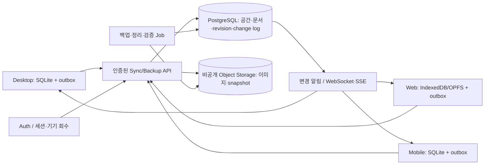

# 3. 백엔드·식별·온라인 저장·원소스 전략

1차는 **개인 다기기 사용**이다. 계정 하나의 여러 기기를 연결하고, 팀 초대·공유 링크·타 계정 쓰기 권한은 제공 범위에서 제외한다. 서버 권한 검사는 owner만 있어도 필수이며, membership 확장 경계는 유지한다.

개인용/외부 서비스용 퍼블릭 클라우드 저장 가능 모델을 기본으로 한다(2026-11-08 사용자 추가 확정). 사내 호스팅은 후속 선택지이며 이를 마련할 때까지 개인 서비스 설계를 보류하지 않는다. 구체 정책은 [05문서](05-online-policy.md)와 [06문서](06-sync-policy-flows.md)를 따른다.

## 3.1 저장 장소 비교

| 안 | 적합성 | 운영/제품 영향 |
|---|---|---|
| **서비스가 관리하는 클라우드 공간** | 웹/모바일/desktop 공통 동기화에 가장 적합 | 계정·용량·리전·운영 백업·정책 필요. 1차 추천 |
| 개인 S3/호환 저장소·WebDAV | 자기 저장소를 쓰는 고급 사용자/온라인 백업에 적합 | 자격증명·공급자 차이·동시 쓰기·브라우저 CORS 대응. 이것만으로 실시간 동기화 서버가 되지 않음 |
| OneDrive/Dropbox 등에 DB 파일 저장 | 완성된 닫힌 스냅샷 백업 용도로 제한 | 실행 중 SQLite 파일을 공유/교체하면 충돌·손상 위험. 앱 수준 증분 동기화 대체 불가 |
| 사내 자체 호스팅 | 회사 자료 통제·전용망·특정 리전 요구에 적합 | 설치/업데이트/인증·메일·백업 운영 책임 증가. 공통 API의 후속 배포 프로필로 고려 |

1차는 하나의 서비스/리전만 지원하고 사업자 임의 선택 UI는 넣지 않는 방향을 추천한다. 리전은 법률/회사 반출 정책·사용자 분포·서비스 가격을 확인한 뒤 확정한다. 버킷·DB·메일 계정은 현재 생성하지 않는다.

## 3.2 계정과 이메일 인증·키의 관계

이메일 인증과 계정은 양자택일이 아니다. **이메일 인증으로 계정을 만들거나 인증하고, 계정에 공간과 기기를 연결**하는 구성을 추천한다.

- 안정된 accountId가 소유권을 가진다. 이메일 변경/메일 주소 재사용/외부 인증 제공자 변경으로 공간 소유권을 옮기지 않는다.
- 로그인: 이메일 OTP 또는 magic link → 계정 세션. 향후 OAuth/OIDC·기업 SSO를 같은 accountId에 연결한다. 이메일 변경과 계정 복구는 기존 세션/추가 인증·기기 통지 정책을 별도 정의한다.
- 기기 연결 코드: 1회성·짧은 TTL·시도 횟수 제한·발급 세션에 연결. 예: 로그인한 PC가 코드를 만들고 새 기기에서 인증하여 교환한다. 이메일 인증용 코드와 기기 연결 코드의 목적/스코프를 분리한다.
- 긴 기간 유효한 ‘이메일+공간 키’만으로 자료를 읽는 방식은 키 유출/회수/기기 식별이 어려워 기본안으로 추천하지 않는다. 서비스 API 키를 제공하더라도 기기/공간/작업 스코프·만료·회수 기능을 가진 별도 고급 기능이어야 한다.
- 웹은 Secure/HttpOnly/SameSite 세션 쿠키와 CSRF 보호, desktop/mobile은 공개 클라이언트 PKCE 및 OS 보안 저장소에 refresh token 보관. localStorage·동기화 DB·백업에 토큰을 넣지 않는다. 서비스 비밀키를 앱 번들에 포함하지 않는다.
- 기기 목록에서 개별 기기 세션을 회수할 수 있게 한다. 회수 시 다음 서버 요청을 거부한다. 이미 내려받은 로컬 사본을 원격으로 지울 수 있다고 약속하지 않는다.
- 초기 개인 공간은 owner만 허용하더라도 membership 테이블로 권한 검증한다. 이후 팀 역할 추가 시 객체 권한은 서버가 검사하고 email/workspaceId를 아는 것만으로 접근할 수 없다.

**비용 재검토:** [16문서](16-low-cost-review.md)에 따라 AWS 직접 운영은 제외하고 단일 저비용 관리형 프로젝트를 우선 검증한다.

## 3.3 백엔드 구성 추천



- 관리형 Auth/PostgreSQL/스토리지는 초기 운영 부담을 줄인다. 현재는 Supabase 무료 프로젝트 여유가 없으므로 Neon PostgreSQL+인증/API/blob 조합을 우선 비교한다([17문서](17-neon-option.md)). 공급자는 미선정이다. 별도 상시 서버·다중 서비스 직접 조합은 초기 필수 구성에서 제외한다.
- 변경 알림은 ‘revision이 늘었음’ 정도의 신호이며 정합성 출처는 pull API와 cursor다. 소켓 유실·중복·순서 뒤바뀜을 허용해도 최종 데이터는 같아야 한다.
- 클라이언트에서 DB를 직접 수정하는 범용 API 대신 업무 명령/aggregate 단위 Sync API를 통과한다. DB의 tenant 정책/RLS는 추가 방어이며 업무 규칙 검증을 대체하지 않는다.
- 서버에서 검증할 공통 규칙: 완료/삭제, 링크 참조, 부모·업무 존재, 반복 발생 유일키, 최대 길이·용량·포맷, 문서와 연결의 정합성, 모든 쓰기의 기대 revision.

핵심 테이블 초안: `account`, `device_session`, `workspace`, `membership`, `workspace_generation`, `entity_snapshot`, `change_log`, `applied_operation`, `blob_metadata`, `backup_manifest`, `audit_event`. 로컬은 `sync_binding`, `sync_outbox`, `sync_inbox`, `sync_cursor`, `sync_conflict` 후보. 실제 도메인별 서버 테이블 분해는 API PoC 후 확정한다. 범용 JSON 테이블만으로 모든 검색/권한/참조를 해결한다고 가정하지 않는다.

## 3.4 API 계약 초안

| API | 주요 계약 |
|---|---|
| `POST /workspaces` | 인증된 계정 소유로 생성, client idempotency key·리전 정책 검증 |
| `GET /workspaces` | membership으로 접근 가능한 공간만 목록 |
| `POST /workspaces/{id}/sync/push` | batch/opId/baseRevision/generation 검증, 원자적 수락 또는 명시적 충돌 |
| `GET /workspaces/{id}/sync/pull?cursor=` | 권한 검사·일관된 페이지, snapshot 하한 만료 안내 |
| `GET /workspaces/{id}/events` | 인증·재접속 가능한 변경 알림. 실제 본문은 pull에서 받음 |
| `POST /workspaces/{id}/uploads` + `complete` | 제한된 크기/mime/hash·짧은 서명 URL, 최종 byte 검증 후 확정 |
| `POST /workspaces/{id}/migration/start|finalize|cancel` | staging generation·manifest 검증·미완료 자료 비공개 |
| `POST/GET /workspaces/{id}/backups` | immutable snapshot manifest·버전·원본/시각·hash·보관 정책 |
| `POST /workspaces/{id}/restore-plans` → `commit` | 복원 전 영향/미전송 변경 확인, 보존본 생성 후 generation 교체 |
| `DELETE /devices/{id}/session` | 해당 계정 소유 기기 세션 회수. 이미 복제된 파일 삭제와는 다름 |

오류 코드는 `UNAUTHORIZED`, `ACCESS_REVOKED`, `CONFLICT`, `QUOTA_EXCEEDED`, `CURSOR_EXPIRED`, `GENERATION_CHANGED`, `UPGRADE_REQUIRED` 등 기계 식별자를 제공하고 앱이 locale에 맞게 표시한다. 응답 크기·업로드·batch 수·레코드 수·timeout은 실측 후 제한한다.

## 3.5 자산·백업·보호·운영

- PostgreSQL은 구조화 데이터/관계/revision, 객체 저장소는 이미지·불변 백업 파일. 객체 키는 공간 범위이며 모든 다운로드에도 현재 권한을 확인한다.
- 업로드 전 URL 발급만으로 완료 처리하지 않는다. 서버가 hash/size/mime 확인 후 완료 표시한다. 메타데이터 먼저 수락해 상대 기기에 깨진 이미지가 보이는 것을 방지한다. 끊긴 upload는 만료 정리한다.
- 자산 GC는 현재 문서뿐 아니라 tombstone·미전송 작업·복원 가능한 snapshot·보관 기간 참조도 확인한다. 개별 기기의 로컬 목록에 없다는 이유로 서버 이미지를 지우지 않는다.
- **사용자 확정(2026-11-08): 1차는 TLS+서버 저장 암호화와 접근 통제로 시작하며 E2EE를 포함하지 않는다.** 허가된 서버 처리에서 본문에 접근할 수 있다. 향후 E2EE는 서버 검색·미리보기·키 분실 복구·신규 기기 키 전달·팀 공유 계약을 다시 검토해야 한다. ‘암호화 저장’을 E2EE라고 표기하지 않는다. 실제 공급자의 암호화 범위/설정은 별도 검증한다.
- 온라인 백업 manifest에는 앱·로컬DB·서버/프로토콜·문서/백업 포맷 버전, workspaceId/generation, 생성 장치, UTC 시각, 파일 크기/hash, 암호화/키 식별 정보를 기록한다. 토큰과 실제 비밀키는 제외한다.
- 백업 보관은 최근 N일/개수/총량, 사용자 백업/서비스 재난 복구를 구분한다. 최신 정상 백업·복원 중 자료 보호 및 삭제 미리보기 원칙을 기존 정책과 맞춘다.
- 초기에는 검증된 논리 snapshot/manifest와 로컬 안전 사본을 우선 검토한다. PITR·객체 버전 보관은 무료/개인 요금 내 가능성을 확인한 뒤 후속 결정한다. 목표 RPO/RTO는 예산·요구를 확인해 수립하고 복원 훈련으로 증명한다. MVP에서 24시간/8시간 등을 임의 보장하지 않는다.
- 계정 삭제·원격 공간 삭제·연결 해제·기기 회수는 서로 다른 절차다. 삭제/법적 보관 기간·백업 잔존·고객 고지를 정의한다.
- 관측: 대기 큐 길이·전송/수신 지연·재시도·충돌·자산 실패·백업 성공·권한 거절. 로그에는 원문·이메일·장치 경로·인증코드/토큰을 기본으로 남기지 않는다.

## 3.6 원소스 멀티운영 경계

제안 repo 구조(미생성):

```text
packages/domain        업무·날짜·문서·링크 규칙 / 서버에서도 재사용
packages/contracts     명령·응답·문서 포맷·오류·동기화 protocol
packages/sync-core     outbox/cursor/충돌·재시도 상태 기계
packages/i18n          키·로케일·formatter
packages/ui-core       공통 컴포넌트·디자인 토큰(플랫폼 공통분)
adapters/sqlite        Desktop/Mobile 영속화
adapters/browser       Web IndexedDB/OPFS·용량/복구 경계
adapters/platform-*    파일·보안 저장소·공유·백그라운드 제약
apps/desktop           Tauri shell
apps/web               브라우저 앱
apps/mobile            모바일 UI/shell (스택 PoC 후 선택)
services/api           인증 경계·명령·동기화·백업
```

현재 `src/domain`에도 한국어 포맷·휴일·플랫폼 의존이 남아 있으므로 파일 이동만으로 공통화가 끝나지 않는다. 순수 규칙과 표시/IO를 먼저 분리한다. 서버가 frontend 모듈/전역 Zustand를 가져오지 않게 의존 방향을 검사한다.

- 완전 로컬 프로필: Auth/Sync transport를 포함/시작하지 않고 네트워크 capability를 열지 않는다. 온라인판과 같은 도메인/스키마를 쓰더라도 동작 기능·통신 가능 여부를 패키지/능력 manifest로 명확히 구분한다.
- 온라인 desktop: 로컬 모든 기능+공간별 연결. V1의 오프라인 WebView2 설치 패키징과 V2의 온라인 기능 여부는 별도 축이다.
- 웹: 파일/폴더 OS 작업을 그대로 노출하지 않는다. 장치 캐시 eviction·사이트 데이터 삭제·탭 동시 접속·브라우저 종료·오프라인 후 재개를 처리한다. 서버에 미전송된 자료가 캐시에서 사라질 수 있음을 복구/내보내기 정책으로 다룬다.
- 모바일: 네이티브 SQLite/보안 저장·공유/카메라·백그라운드 제한·좁은 화면 UX가 필요하다. React Native와 Tauri mobile/PWA를 비교하며 ‘React 코드100% 재사용’을 약속하지 않는다. 카메라/드래그 보드·편집기 성능 PoC 후 스택을 선택한다.
- 제품·프로필·locale·도입 버전을 별도로 관리한다. 하나의 Feature ID로 기능 의미를 유지하되 플랫폼 미지원/추가 도입을 명시하고 아직 제공하지 않는 웹/모바일 기능을 현재 Feature List 활성 항목으로 올리지 않는다.
