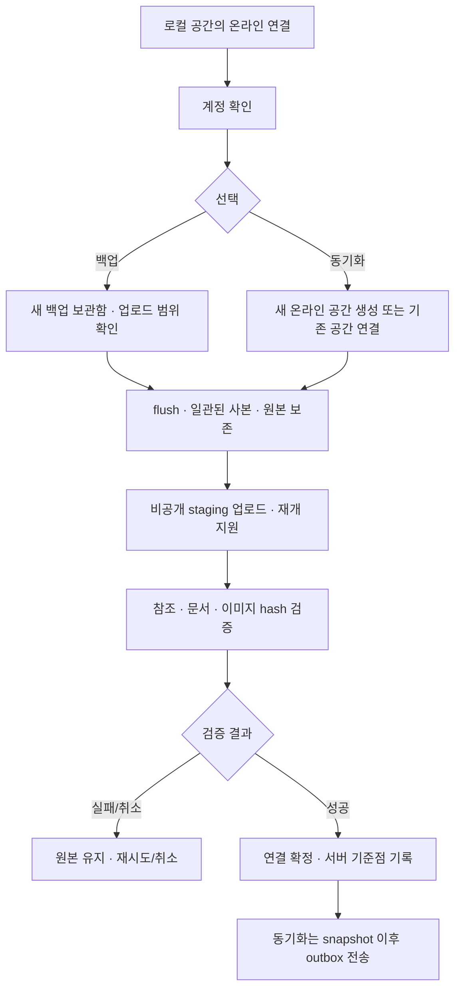

# 6. 공간별 동기화 정책·상태·연결 흐름

2026-11-08 (KST) · 설계 구체안. 구현·서비스 제공 약속은 아님.

**최신 비용 원칙:** [16문서](16-low-cost-review.md). 주기/수동부터 검증하고 즉시 반영은 한도 확인 후 제공하는 후보로 조정한다.

## 6.1 제품 모드와 기기별 전송을 구분

| 공간 사용 방식 | 서버 역할 | 다른 기기의 동작 |
|---|---|---|
| 로컬 전용 | 콘텐츠를 보관하지 않음 | 별도 가져오기 없이는 자료가 전달되지 않음 |
| 온라인 백업 | 특정 기기의 불변 복구본 보관함 | 백업을 새 로컬 공간으로 복원 가능. 자동 병합/최신 상태 수신 없음 |
| 동기화 | 같은 온라인 공간의 변경분·정합성·복구본 관리 | 기기별 로컬 사본을 유지하면서 수신·송신 |

동기화 공간의 전송 정책은 **기기별** `즉시 / 주기 / 수동`으로 둔다. 예를 들어 PC는 즉시, 모바일은 주기로 운영해도 같은 공간에 수렴한다. 온라인 백업 보관함과 동기화 공간의 live 상태를 같은 목적지 파일에 섞지 않는다.

- 기존 로컬 공간은 계속 로컬 전용이다. 로그인만으로 모든 공간을 온라인 전환하지 않는다.
- 사용자가 ‘동기화에 연결’을 선택하면 비용 우선 주기5분을 기본 추천한다. 주기/수동 선택도 제공한다.
- 이 기기 일시정지/연결 해제가 다른 기기의 사용 방식까지 바꾸지는 않는다.
- 동기화 연결을 끊어 로컬 독립 사본으로 쓰는 것은 원격 공간의 삭제/백업 모드 전환과 다르다. 명칭과 확인 절차를 분리한다.

## 6.2 전송 기본값 초안

| 방식 | 제안 기본값 | 정확한 의미 |
|---|---|---|
| 즉시 | 로컬 저장 후 약750ms 변경 묶음, 연속 편집도 최대 약5초 내 전송 시도 | 서버 저장 후에만 로컬 저장 성공하는 구조가 아님. 오프라인·오류 시 큐 유지 |
| 변경 알림 | 서버 커밋 후 연결 기기에 신호, cursor pull | 소켓 메시지는 힌트. 유실돼도 pull로 회복 |
| 즉시 방식의 보완 수신 | 실행/포커스/연결 복구 시 확인, 즉시 모드를 제공할 때 활성 중 주기 확인(기본5분 후보) | 짧은 소켓 장애로 영구 누락되는 상황 방지. 정상 연결에서는 알림 우선 |
| 주기 | 기본5분, 선택15분·30분 | 활성 앱 기준. 실행/연결 복구/수동 요청에는 다음 주기를 기다리지 않고 확인 |
| 수동 | ‘지금 동기화’에서 송·수신 | 자동은 정지, 대기량·최근 수신 시각 표시 |
| 종료 직전 | 대기 작업 정리·가능한 전송 시도 | 종료 성공이나 서버 저장을 보장하지 않음. 확인되지 않은 작업은 다음 실행에 유지 |

모든 수치는 PoC 튜닝 대상이다. 기본 동기화 목표는 일반 연결·전경 앱에서 수초 수준이지만 SLA로 확정하지 않는다. 모바일 백그라운드 중 즉시 반영은 보장하지 않는다. 1차는 단순한 속도 슬라이더 대신 위 정책을 사용한다.

## 6.3 상태와 화면 문구 초안

로컬 저장 상태와 온라인 상태는 별도다. 기존 ‘저장됨’만으로 두 가지를 표현하지 않는다.

| 조건 | 공간 상태 표시 | 다음 동작 |
|---|---|---|
| 로컬 전용 | 로컬 전용 | 온라인 연결 설정 |
| 백업 연결 | 마지막 백업: 시각 | 지금 백업 / 백업 목록 |
| 변경 큐 있음 | 이 기기에 저장됨 · 전송 대기 N건 | 지금 동기화 / 대기 내역 |
| push/pull 진행 | 동기화 중 | 진행/실패 확인 |
| 서버 ack + 수신 cursor 확인 | 동기화됨 · 마지막 확인 시각 | 최근 변경·기기 |
| 네트워크 끊김 | 오프라인 · N건 대기 | 재연결 시 재시도 |
| 사용자가 중지 | 동기화 일시정지 · N건 대기 | 재개 / 수동 동기화 |
| 충돌 | 충돌 N건 · 이 기기에 저장됨 | 충돌 검토. 관련 없는 항목은 계속 동기화 |
| 권한/로그인/용량/구버전 문제 | 원인별 상태 | 로그인/공간 정리/업데이트. 무한 재시도하지 않음 |

‘동기화됨’은 표시 시각까지 서버와 맞춘 상태다. 연결이 끊긴 후까지 다른 모든 기기에 최신 변경이 없다는 뜻이 아니다. 대기 N건은 큐 연산 기준이고 업무/문서 개수와 다를 수 있으므로 상세 화면에서 구분한다.

## 6.4 기존 공간 연결 흐름

기존 온라인 공간과 내용 있는 로컬 공간을 즉시 합치지 않는다. 1차 기존 온라인 연결은 새 로컬 사본 다운로드를 권장하고, 두 공간의 합치기는 비교/중복 처리 흐름을 별도 설계한다. 사용자의 모든 로컬 폴더를 업로드 범위로 해석하지 않는다.

연결 화면의 업무 정보: 공간명, 계정, 저장 지역/처리 정책 링크, 업로드되는 업무·노트·이미지 범위, 제외되는 기기 폴더/인증정보, 예상 업로드 크기, 원본 사본 위치. DB schema 같은 내부 정보는 필요할 때 상세 진단에서 보여준다.

## 6.5 새 기기 연결

1. 같은 개인 계정으로 로그인한다. 기기 코드를 쓸 경우 인증된 세션에서 단기 코드로 교환한다.
2. 접근 가능한 온라인 공간을 고른다. 공간명만 같다고 로컬 공간에 binding하지 않는다.
3. 새 로컬 위치/캐시를 준비하고 manifest·문서·이미지를 검증한 뒤 활성화한다.
4. 이 기기의 즉시/주기/수동 정책을 선택한다. 기본 추천은 주기5분, 모션/언어 등 기기 선호는 강제 복사하지 않는다.
5. 내려받는 중 실패하면 완료된 장치인 것처럼 보이지 않게 하며, 다른 공간을 열거나 재개할 수 있게 한다.

## 6.6 중지·연결 해제·모드 변경

| 사용자 동작 | 처리 |
|---|---|
| 이 기기 일시정지 | 큐·binding 보존, 자동 송/수신 정지. 재개 또는 수동 동기화 가능 |
| 이 기기 연결 해제 | 대기 변경 안내 → 마지막 동기화 또는 미전송 사본 보존 선택 → 로컬 독립 사본 생성/인증 binding 제거. 다른 기기·원격 자료 유지 |
| 백업만 사용하다 동기화로 변경 | 최신 로컬 사본과 보관함을 확인해 새 동기화 generation 구성. 기존 백업은 보존하고 새 live 공간과 구분 |
| 동기화 대신 백업만 사용 | 현재 동기화 사본을 보존한 뒤 별도 백업 보관함 연결. 기존 동기화 공간과 다른 기기 사용을 자동 종료하지 않음 |
| 원격 공간 전체 삭제 | 계정/공간 범위의 별도 최종 확인. 다른 기기와 보존본에 미치는 영향 안내 |

전송 방식 ‘즉시↔주기↔수동’은 같은 binding을 사용하므로 새 공간을 만들지 않는다. 반면 백업 보관함↔동기화 live 공간 전환은 수신/정합성 의미가 달라 단순 옵션 변경으로 취급하지 않는다.

## 6.7 충돌과 복원 흐름

- 개인도 두 기기에서 같은 노트를 고칠 수 있다. 서버에 마지막으로 도착한 글로 덮어쓰지 않고 공통 조상/두 사본을 보존한다.
- 충돌 목록: 공간·문서·각 수정 기기/시각 → 내용 비교 → ‘이 기기 내용 / 서버 내용 / 둘 다 보존’. 확인 시 최신 서버 revision을 재검사해 제3의 수정이 있으면 다시 안내한다.
- 복원 기본은 **새 로컬 공간에 복원**이다. 동기화 공간 전체의 과거 시점 복원은 별도 고급 동작이며, 모든 연결 기기와 미전송 큐에 영향이 있음을 먼저 확인한다.
- 전체 복원 시 현재 서버 상태와 현재 기기의 미전송 자료를 보존하고 새 generation을 공개한다. 구 기기의 이전 generation 수정은 재조정 전 자동 적용하지 않는다.
- 공간 복원·계정 복구·기기 재연결을 하나의 ‘복원’ 버튼에 섞지 않는다.

## 6.8 출시와 검증 순서

출시 최종 방향은 공간별 선택+증분 동기화다. 구현 검증은 ① 백업 실제 복원 ② 수동/주기 push/pull과 충돌 ③ 즉시 알림 순서로 추천한다. ①만 제공하는 시점에는 온라인 백업으로 안내한다.

승인 전 PoC 계획 항목: 두 기기 오프라인 수정·삭제/복원, 750ms/5초 전송 묶음의 입력 성능, 5분 보완 수신/선택적 소켓 재연결, 모바일 정지 후 재개, 공간별 미연결 자료 업로드0, 백업 모드의 자동 수신0, 중복 op/오래된 generation 거절과 사본 보존.
