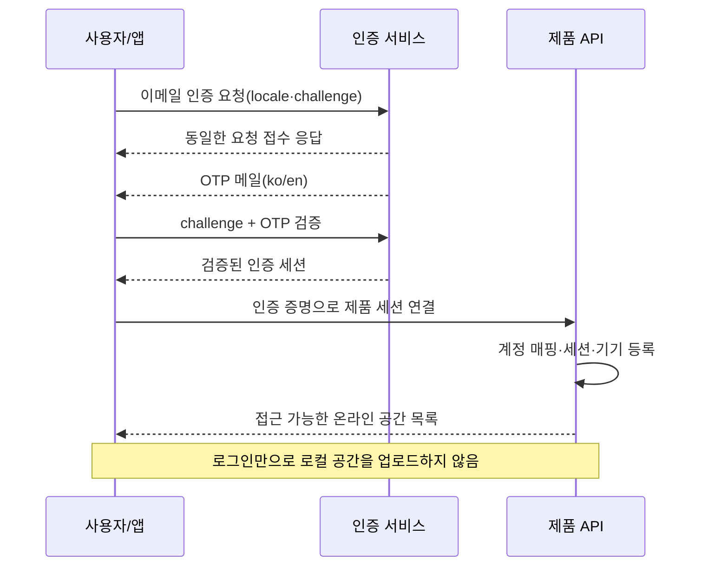

# 7. 개인 계정·기기 연결·회수 상세 설계

2026-11-08 (KST) · 설계 구체안 · 한국어/영어 · 개인 다기기·퍼블릭 클라우드

## 7.1 1차 추천

**이메일 OTP 로그인으로 계정을 만들고, 동일 계정의 기기를 연결**하는 방식을 추천한다. 비밀번호·소셜 로그인·기기 페어링 코드를 모두 한꺼번에 제공하지 않는다. 초기 화면은 이메일→인증번호→온라인 공간 선택의 짧은 흐름으로 한다. 계정 로그인과 개별 공간 업로드 연결은 다른 단계다.

OTP를 통한 로그인은 계정 존재 여부와 무관하게 같은 안내를 제공한다. 메일을 발송했다고 공간 접근이 허용되지 않으며, 서버가 인증 완료·계정 상태·기기 세션·membership을 확인해야 한다.

## 7.2 식별자와 세션 경계

| 값 | 목적 | 금지되는 사용 |
|---|---|---|
| accountId | 제품이 발급하는 안정된 계정 키 | 이메일 주소로 대체하거나 이메일 재사용 시 기존 자료 연결 |
| providerSubject | 인증 사업자의 사용자 식별자 매핑 | 인증 사업자 변경 시 업무 데이터 전체 ID 교체 |
| deviceId | 설치 인스턴스·기기 목록의 표시/관리 | 이것만 제시해서 로그인·접근 허용 |
| deviceSession | 인증된 세션과 해당 기기를 서버가 연결 | 클라이언트가 임의로 보내는 deviceId를 믿고 세션 바인딩 |
| cloudWorkspaceId | 공간 ID와 소유/접근 권한 경계 | 공간 이름이나 연결 코드 자체를 권한으로 사용 |

서버는 인증 제공자의 서명·issuer/audience·만료·세션 식별 정보를 검사하고 제품 accountId에 매핑한다. 선택한 제공자가 검증 가능한 세션 ID/회수를 지원하는지 PoC한다. 지원하지 않으면 인증 증명을 교환하는 별도 기기 세션 계층이 필요하며 이 비용을 비교에 포함한다.

## 7.3 최초 로그인 흐름

- 입력값: 이메일, 인증번호. 기기 이름은 ‘이 PC’ 같은 기본값을 제안하고 사용자가 수정할 수 있게 한다. 하드웨어 일련번호를 식별자로 수집하지 않는다.
- OTP 유효시간5~10분·실패5회 제한·재발송60초 간격은 **초기 튜닝 후보**다. 제공자의 실제 제약과 이메일/IP/세션별 제한을 함께 검증한다. 화면 타이머만으로 보호하지 않는다.
- 로그인 코드/challenge/token을 분석 로그·URL query·백업에 남기지 않는다. 메일 링크를 사용할 경우 만료·1회성·원래 요청과의 바인딩을 검사한다.
- Web은 보안 세션 쿠키와 CSRF 보호. Desktop/Mobile은 선택한 제공자의 공개 클라이언트 권장 방식과 OS 보안 저장소를 따른다. OAuth를 추가하면 시스템 브라우저+PKCE/state·검증된 callback을 사용한다. 앱에 confidential client secret을 넣지 않는다.
- OTP 이메일의 제목·본문·만료 안내·문의 경로는 ko/en으로 제공한다. 이메일 입력 오류/미도착/재요청/네트워크 오류도 번역 범위다.

## 7.4 추가 기기와 짧은 연결 코드

1차의 추가 기기도 같은 이메일 OTP로 로그인하는 것이 기본이다. ‘이미 로그인한 PC로 승인’은 후속 편의 기능으로 분리한다. 이로써 개인 다기기 기능을 위해 별도 영구 연동키를 배포할 필요가 없다.

편의 코드를 도입한다면: 기존 인증 기기에서 1회성 challenge 발급→새 기기 인증/코드 교환→기기명·계정 표시 확인→기존 기기 승인→서버 세션 발급 순서다. 코드 하나만 입력하면 모든 공간의 자료를 내려받는 익명 연결을 허용하지 않는다. 이전 설계의 단기 연결 코드는 가능한 확장 방식이며 1차 필수 UI로 확정한 것이 아니다.

새 기기는 서버 공간을 골라 새 로컬 사본을 만든다. 기존 로컬 공간에 자동 합치지 않고 파일/캐시 용량·문서/자산 검증을 완료한 뒤 ‘사용 가능’ 상태로 바꾼다.

## 7.5 세션 회수·로그아웃·계정 전환

- 기기 목록: 사용자가 지정한 이름·플랫폼·마지막 서버 접속·현재 기기 표기. 정확한 위치나 IP 전체를 기본 노출하지 않는다.
- 회수: 계정 재인증→선택한 기기 세션 비활성화→관련 실시간 연결 종료→이후 API 거부. 토큰 만료만 기다리는 구현은 ‘즉시 회수’라고 부르지 않는다. 서명된 다운로드 URL은 짧은 잔여 유효기간이 있을 수 있어 회수의 한계를 안내한다.
- 로그아웃 전 미전송 N건과 로컬 보존 여부를 확인한다. 로컬 저장 실패/전송 실패를 같은 문제로 표시하지 않는다. 다른 계정으로 로그인하면 기존 binding/outbox를 새 계정에 전송하지 않는다.
- 계정 전환은 기존 공간 flush·수신 작업 취소·binding 분리·저장소 detach 이후 새 계정의 공간을 활성화한다. 늦은 응답은 account/workspace/generation 모두 맞을 때만 적용한다.
- 회수된 기기에 이미 저장된 파일을 지울 수 있다고 약속하지 않는다. 로컬 파일 암호화/앱 잠금은 서버 세션 회수와 별도 제품 정책이다.

## 7.6 이메일 변경·복구

- 이메일 변경은 기존 세션 재인증+신규 주소 인증, 기존 주소 통지를 기본으로 비교한다. 기존 accountId와 공간 소유권을 유지한다.
- 메일 계정 접근을 완전히 잃은 경우의 복구는 별도 결정이다. 단순 문의 메일이나 공간 이름을 안다는 이유로 소유권을 이전하지 않는다. 대체 인증/복구 수단을 출시 전 정해야 한다.
- E2EE를 채택하면 이메일 계정 복구와 문서 복호 키 복구가 별개다. 로그인 성공만으로 모든 내용을 복원할 수 있다고 안내하지 않는다.
- 탈퇴 후 같은 이메일로 새 가입해도 과거 accountId를 재사용하지 않는다. 백업 잔존/재가입/취소 기간은 개인정보 정책 확정 시 연결한다.

## 7.7 검증·확정 항목

검증: 중복 OTP 제출·만료·재발송·무차별 시도·메일 스캐너의 링크 접근·시계 오차·다른 기기 challenge 사용·회수 후 API/소켓 접근·계정 전환 중 응답 혼입·ko/en 오류/메일.

확정 대기: OTP 기본 채택 여부, 실제 만료/제한값, 추가 복구 수단, MFA 도입 시점, 사업자의 세션 회수 지원·메일 처리 국가. 현재 인증 메일 발송/계정 생성은 수행하지 않았다.

후속 [24문서](24-local-poc-review-package.md)에는 이메일/인증 수단 상실 시 관리자 임의 소유권 이전을 제공하지 않고 로컬 사용/명시적 새 계정 가져오기를 유지하는 최소 복구안을 제안했다. 이 제한도 사용자 확정 전이며 기존 원격 자료 접근 복구를 보장하지 않는다.
