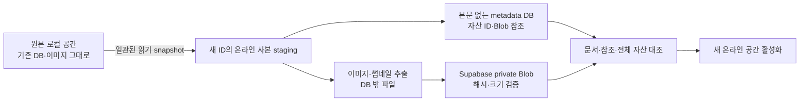

# 56. 로컬 영구 유지·온라인 사본·DB/Blob 이미지 분리 철칙

2026-11-10 KST · 사용자 확정 요구. 이전 설계의 모호한 ‘전환’·‘중복 제거’ 설명보다 이 원칙이 우선한다.

## 최상위 제품 계약

**로컬 모델은 독립적인 영구 지원 모델이다. 사용자가 명시적으로 포기하지 않는 한 유지한다.** 온라인 전용으로 수렴시키는 임시 호환 모드/유예 기간이 아니다. 로컬 전용 공간은 로그인·클라우드·Blob 저장소 없이 현행 구조로 완전하게 동작해야 한다. 온라인화를 이유로 원본 DB/이미지/백업 구조를 변경하지 않는다.

온라인 사용을 선택한 사용자는 **원본 로컬 공간에서 별도 온라인 공간을 복제 생성**한다. 기존 공간의 mode만 바꾸거나 같은 ID/DB를 온라인 어댑터로 다시 열지 않는다. 원본은 이전 이름·ID·파일·이미지·백업 구조로 남아 계속 사용할 수 있다. 온라인 사본을 폐기/실패/취소해도 원본을 ‘복구’해야 할 상황이 생기면 안 된다.

| 저장 영역 | 이미지 실물 | DB 내용 | 유지 원칙 |
|---|---|---|---|
| 기존/미전환 로컬 공간 | 기존 SQLite에 포함 | 현행 DB18/저장 계약 그대로 | 사용자가 포기하기 전 영구 유지 |
| 새 온라인 공간의 서버 | Supabase private Storage | ID/hash/크기/권한/참조/상태 | DB에 이미지 binary/base64를 저장하지 않음 |
| 새 온라인 공간의 기기 | DB 밖 파일/필요한 캐시 | metadata/동기화 상태/Blob 참조 | 미전송/오프라인 보존 자료를 캐시처럼 삭제하지 않음 |

여기서 **중복 저장 방지의 핵심은 온라인 DB와 Blob 양쪽에 같은 이미지 본문을 저장하지 않는 것**이다. 원본 로컬 공간에 남은 이미지와 온라인 공간의 Blob이 각각 존재하는 것은 안전한 복제의 의도된 결과다. 이를 중복이라며 원본에서 지우면 안 된다. 온라인 공간의 오프라인 파일 보관 역시 허용하며 DB 밖에서 관리한다.

동일 이미지끼리의 해시 기반 Blob 공유는 **별도 최적화**다. 이를 구현해도 온라인 DB에 base64/bytea/BLOB 본문이 남으면 핵심 요구는 미충족이다. 크기·hash를 DB에 기록하는 것은 실물 중복 저장이 아니다.

## 안전한 이관 흐름



1. 원본은 항상 로컬 공간으로 남는다. 사용자가 ‘온라인 사본 만들기’를 명시적으로 실행한 시점에만 시작한다. 설치·로그인·유료 플랜 가입으로 자동 이관하지 않는다.
2. 현재 저장 대기/자식 창을 정상 flush하고 snapshot 경계를 확정한다. 이후 이관기는 원본을 읽기 전용으로 다루며 원본을 변환/압축/이미지 삭제하는 SQL을 실행하지 않는다. 사용자의 정상 저장과 이관기가 원본을 바꾸는 동작을 구분한다.
3. 별도 workspaceId/cloudWorkspaceId와 별도 위치에 사본을 만든다. 데이터/문서/참조는 복제하고, 이미지/썸네일 본문은 추출해 새 사본의 metadata DB에는 참조만 쓴다. 온라인 DB에는 이미지 BLOB 테이블도 만들지 않는다.
4. 새 공간 전용 Supabase staging에 binary를 올려 실제 hash/bytes와 소유권을 확인한다. 기존 `.db` 전체를 업로드해 이미지가 서버 DB/Blob 양쪽에 남는 경로는 금지한다. 원본 DB 백업은 원본 로컬 범위에 남는다.
5. 모든 문서/자산/참조/수량·용량과 이미지 본문0건을 확인한 뒤 새 공간의 generation을 공개한다. 하나라도 누락/실패하면 연결 완료로 표시하지 않는다.
6. 실패/취소/용량 초과는 새 staging과 미완료 상태에서 처리한다. 원본 구조/이미지는 그대로이며 staging 정리도 그 이관 작업이 생성한 자원에 한정한다.
7. 새 온라인 공간에서 발생한 변경은 그 공간의 outbox에만 쌓는다. 원본 로컬 공간에서 이후 작성한 내용을 자동 업로드/합치거나 원본에 역동기화하지 않는다. 추가 가져오기는 별도 사용자 동작이다.

온라인 DB의 이미지0건 조건은 본문 테이블뿐 아니라 문서 JSON·대기 전송·수신·변경 이력·충돌 사본·snapshot·복구 journal에도 적용한다. 작은 미리보기/썸네일을 DB에 남기는 예외도 두지 않는다. 지원하지 않는 inline 이미지/새 포맷은 조용히 생략하지 않고 이관을 차단해 원본을 보존한다.

## 기존 설계/PoC 점검 결과

| 대상 | 발견 | 조치 |
|---|---|---|
|02문서 상태/마지막 업로드 중 편집 설명|원본 공간이 온라인 mode로 바뀌는 것으로 읽힐 여지|원본 local 불변/새 사본 상태를 분리, 원본 편집 자동 전송 금지 |
|09문서 ‘온라인 연결/전환하고 연결’|제자리 연결로 보일 수 있음|‘온라인 사본 만들기/사본 생성하고 연결’ 흐름으로 수정 |
|46문서의 물리 dedup 강조|DB/Blob 이중 저장 금지와 이미지끼리 공유가 섞임|주요 요구/별도 최적화 구분, 로컬 영구 유지 명문화 |
|db18.mjs의 v2-poc-staging-1|행의 base64는 참조로 바꾸지만 blobs 테이블에 binary를 담음|역사적 보존/왕복 시험 포맷. 최종 온라인 DB로 사용/업로드 금지 |
|stage-import.mjs/model.mjs 계열|local_assets/자산 모형에 BLOB 실물 저장|동기화 알고리즘 시험용이며 제품 온라인 저장 형식이 아님을 경고 |
|55문서의 실제 gateway 시험|DB에 hash/bytes metadata, Storage에 실물|그 경계는 부합. 실제 DB18 사본 이관/앱 격리 완성 증거는 아님 |

이전 시험을 지우거나 실제 온라인 제품 스키마가 완성됐다고 재분류하지 않는다. 최종 온라인 어댑터에는 보존 포맷을 연결하지 않는다.

## 이번 독립 PoC 구현/검증

[connected-copy.mjs](../../poc/v2-assets/connected-copy.mjs)는 합성 DB18 원본을 읽기 전용 검증한 뒤 **별도 UUID·폴더**에 metadata.db/manifest/assets를 생성한다. source DB18의 모든26개 테이블 행을 논리 복사하며 note_asset/cabi_asset의 data·thumb은 새 DB에 쓰지 않고 dataRef/thumbRef로 치환한다. 업무노트의 image.attrs.asset도 문서 소유자와 일치할 때 지원한다. 새 metadata DB에는 records/blob_ref/copy_info3개 테이블만 있고 binary 컬럼은 없다.

DB18/SQLite 읽기 검사는 기존 capture18을 재사용하되 업무노트 이미지 소유권 검사를 명시적으로 켠다. 역사적 보존/왕복 포맷의 기본 동작은 유지한다. 이미지 처리/재압축은 하지 않아 현재 저장 bytes가 보존된다.

[22개 시험](../../poc/v2-assets/connected-copy.test.mjs)이 통과했다. 원본 전체 byte hash/행 유지·새 공간 ID·원본에서 독립적으로 계속 작성·새 DB 논리값과 파일 내 이미지 base64/binary 부재·본문/썸네일 추출·업무노트 이미지 소유권·중간 실패/원본 동시 변경 감지·기존 목적지 덮어쓰기 거절·파일/metadata 변조·scope/symlink/READY 검사를 포함한다. 별도 최적화인 같은-image 공유도 논리 소유자2개를 유지하는 것으로 구분해 시험한다. 기존 DB18 보존/왕복19개 회귀도 통과했다. [성공 증거](evidence/connected-copy-pass.json)에 실행 로그 hash·소스 hash·총41개 통과와 실제 제품/클라우드 미이관을 기록했다.

```sh
node poc/v2-assets/connected-copy.test.mjs
node poc/v2-sync/db18.test.mjs
```

**이 PoC는 로컬 추출 검증이다.** READY는 추출 사본 검증 완료이고 cloudUploaded=false/phase=local-extracted-not-uploaded다. 실제 Supabase 이관/온라인 활성화/앱 설치·업데이트·UI 지원 완료가 아니다. 임시 `.v2-poc-only` 폴더의 가상 DB만 사용하며 실제 사용자 DB/클라우드를 읽거나 쓰지 않았다.

현재 단순 JSON 보존형 records는 서버 도메인 스키마 매핑이 아니며 실제 제품의 모든 문서 의미 검증을 대신하지 않는다. 알려지지 않은 inline 이미지/새 스키마/누락된 소유권은 거절한다. 원본에 없는 포맷을 조용히 삭제/변환해 통과시키지 않는다. 프로세스 강제 종료/디스크 부족/OS별 fsync·락·재개 journal은 후속 실제 이관기의 필수 검증이다. 이 PoC의 실패 주입만으로 전원 장애 내구성을 보장하지 않는다.

## 이후 순서

1. 로컬 전용/온라인 사본의 adapter·설정·설치·업데이트 식별자를 분리하고 기존 로컬 동작 회귀를 고정한다. 로컬 전용의 영구 지원을 제품/가이드/릴리스 정책에 유지한다.
2. 추출 manifest→서버 metadata/Blob 업로드→참조 완전성/본문0건→온라인 사본 활성화·재개/취소를 실제 이관기로 연결한다. 미지원 문서 포맷/이미지 경로는 지원하기 전 제품 이관을 활성화하지 않는다.
3. 그 다음 온라인 공간의 신규 이미지에 압축·해상도 비교/선택 정책을 적용한다. 기본 이관은 기존 bytes 보존이며 재압축은 선택 기능이다. 로컬 원본의 용량 절약/이미지 삭제를 목표로 삼지 않는다.
