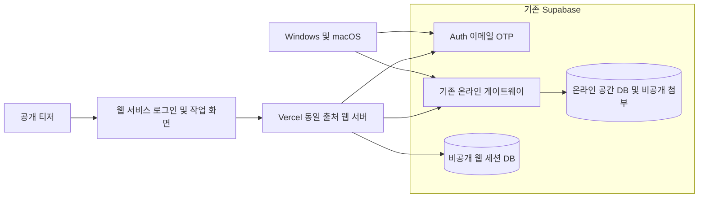

# Work Journey Board 웹 서비스 v1 상세 설계

2026-11-27 개정안 · `web-service-v1` · 기준 `main` `0f46476` / `v1.55.1 Open Beta` / 일지 v20

웹은 로그인한 계정의 온라인 워크스페이스만 표시합니다. Vercel에서 화면과 웹 API를 실행하고, 기존 Supabase가 이메일 인증·온라인 데이터·웹 세션을 담당합니다. Windows·macOS·웹은 같은 계정과 온라인 공간 ID를 사용합니다. 공개 티저에서는 웹 서비스로 이동하고, 사진·노트·업무 기록의 소유권과 사용량은 현재 서버 정책을 적용합니다. [검토용 UX/UI 시안](mockups/web-service-v1/index.html)

## 1. 설계 결정과 검토 항목

| 결정               | 설계안                                                                                                               | 검토할 점                                                                                                           |
| ------------------ | -------------------------------------------------------------------------------------------------------------------- | ------------------------------------------------------------------------------------------------------------------- |
| D1 웹 호스트·세션   | Vercel의 웹 전용 프로젝트와 기존 Supabase의 비공개 세션 저장소. W1은 보호된 Preview에 배포                       | 기존 최대 10 MiB 첨부의 전송 경로는 실제 Vercel 프로젝트에서 검증해 확정                                          |
| D2 첫 웹 출시 범위 | 기록·칸반·주간 요약·검색·온라인 공간 관리부터 제공. 기존 메모·Cabi.NET 노트·Universe 연결은 읽고 원본 탐색 가능      | 자유 캔버스 편집과 그림 첨부 작성은 왕복 호환 검증 후 웹에 추가                                                     |
| D3 연결 끊김       | 열린 화면은 읽을 수 있고 입력 중인 변경은 현재 탭에서 재시도. 저장 성공은 서버 확인 뒤 표시                          | 영구 오프라인 편집·탭 종료 후 복구는 후속 범위                                                                      |
| D4 웹 표기·배포    | 이름은 **Work Journey Board**, 채널 표기는 **웹**. 같은 커밋과 버전으로 웹·Windows·macOS를 검증해 같은 릴리스에 공개 | 도메인, 웹 개인정보 처리방침 문안과 첫 릴리스 버전은 구현·배포 전에 확정                                            |

## 2. 사이트 구조와 로그인

### 공개 진입과 화면 구조

Vercel이 웹 화면을 열 때 서버 세션을 먼저 확인합니다. 세션이 있는 사용자는 `/spaces`에서 시작하고, 유효한 세션이 없는 사용자는 `/login`으로 이동합니다. 보호 화면은 인증이 확인된 뒤에 렌더링하고, 온라인 공간 데이터는 해당 공간의 권한을 서버가 확인한 뒤 읽습니다.

| 주소                                                  | 접근                | 헤더·본문·푸터                                                                                                                            |
| ----------------------------------------------------- | ------------------- | ----------------------------------------------------------------------------------------------------------------------------------------- |
| 기존 GitHub Pages 티저                                | 공개                | 기존 헤더·첫 화면에 **[웹에서 열기]** 추가. 별도 웹 서비스의 `/login`으로 이동. 설치 파일·가이드도 제공                                   |
| `/`                                                 | 상태에 따라 이동   | 유효한 웹 세션이면 `/spaces`, 그 외에는 `/login`으로 서버가 이동                                                         |
| `/login`                                              | 공개                | 브랜드 아이콘과 워드마크, [소개 사이트], [이용 가이드]. 이메일 입력 → 동의 → 인증번호 → 로그인. 첫 로그인 전과 로그아웃 뒤 공통 푸터 표시 |
| `/terms`, `/privacy`                                  | 공개                | 브랜드 헤더, 문서 제목·시행일·이전 판·운영 문의, 로그인으로 돌아가기. 인증 중 열었다 돌아오면 이메일 입력을 유지                          |
| `/spaces`                                             | 인증                | 공간 목록, 쓰기 가능 여부, 최근 사용, 빈 온라인 공간 만들기, 계정 메뉴. 첫 로그인과 공간 접근 종료 때 이 화면 표시                        |
| `/app/:spaceId/{day,week,kanban,summary,search,more}` | 인증·공간 접근 확인 | 공간 선택기, 제목과 기간, 동기화, 검색, 계정. 콘텐츠와 화면 이동 메뉴는 화면 폭에 맞춤. 이미 인증된 링크만 해당 화면으로 복귀             |
| `/app/:spaceId/{notes,cabinet,universe}`              | 인증·공간 접근 확인 | 메모·자료·연결 탐색. 좁은 화면에서는 한 번에 목록 또는 상세, 넓은 화면에서 두 패널                                                        |
| `/settings/{account,spaces,appearance,about}`         | 인증                | 계정·사용량·로그아웃·공간 및 계정 삭제, 표시 설정, 판·라이선스·지원. 별도 관리자 메뉴 진입은 v1에서 데스크탑을 이용하도록 안내            |

- 웹 서비스는 사이트 주소 한 곳에서 화면과 API를 제공합니다. 도메인 확정 전에는 `app.example.invalid`로 표기합니다. 브라우저 탭 제목은 `화면 이름 · Work Journey Board`, 로그인 화면은 `Work Journey Board 웹 로그인`입니다. 브랜드는 기존 워드마크·아이콘을 사용합니다.
- 공개 푸터는 `© 2026 sanbonjini`를 기준으로 [이용약관] [개인정보 처리방침] [이용 가이드] [운영 문의]를 표시합니다. 앱 상세에서 계속 보이는 푸터는 공간을 차지하므로 같은 링크를 **더 보기 › 정보**에서 제공합니다. **[데스크탑 앱 받기]**는 더 보기와 빈 공간 안내에서 제공해 로컬 일지 가져오기 진입을 돕습니다.
- 로그인과 약관은 로그아웃 상태에서도 열립니다. 참가 등록, 공간 공유, 팀원 권한 초대는 별개의 기능으로 간주합니다. v1은 운영자가 이미 등록한 계정과 현행 개인 공간 소유권을 사용합니다. [현행 초대 전용 정책](v2-design/94-invite-only-signup.md) · [현재 약관 기준](v2-design/104-g8-privacy-terms-draft.md)

### 인증과 공간 상태에 따른 화면

| 상태 | 웹 동작 |
| --- | --- |
| 로그인 전 또는 세션 만료 | 보호 페이지는 로그인으로 이동하고 API는 `401`을 반환합니다. 비공개 화면 HTML에는 공간 목록이나 기록을 포함하지 않습니다. |
| 로그인 완료 | 기존 게이트웨이에서 현재 계정의 온라인 공간 목록을 조회합니다. 공간이 0개면 **온라인 공간이 없습니다**를 표시합니다. W1은 검증용 목록까지 제공하고, 웹에서 빈 온라인 공간 만들기는 후속 단계에서 연결합니다. |
| 온라인 공간 링크 열기 | 웹 서버는 세션을 확인한 뒤 게이트웨이에서 공간 소유권을 검사합니다. 다른 계정의 공간 ID와 삭제된 공간에 대해 API는 같은 `404`를 돌려주고, 화면은 공통 안내와 함께 목록으로 이동합니다. |
| 세션 철회 또는 계정 변경 | 공간 선택과 메모리의 기록을 비우고 로그인으로 이동합니다. 현재 브라우저의 로그아웃은 탭 간 신호를 전달하고, 새로고침·뒤로 가기·다른 탭 복귀에서도 서버 상태를 다시 확인합니다. |
| 인증·DB·게이트웨이 장애 | 요청은 재시도할 수 있는 오류를 표시합니다. 인증 상태를 확인할 수 없는 보호 화면은 잠긴 상태를 유지합니다. 이미 확인한 온라인 자료의 일시적 연결 끊김은 기존 읽기 정책을 따릅니다. |

웹의 작업 데이터는 계정에 속한 온라인 공간에서 시작합니다. UI는 로컬 일지 생성·선택·폴더 등록과 가상 샘플 진입을 제외합니다. 화면을 그리는 데 필요한 캐시는 현재 세션의 메모리에서만 사용하며, 로그아웃이나 계정 전환에서 폐기합니다. 브라우저 저장소·서비스 워커에는 일지, 토큰, 공간 권한을 저장하지 않습니다.

### 이메일 인증과 계정 상태

1. 이메일 입력 뒤 이용약관·개인정보 처리방침을 읽고 동의합니다. 현행 이메일 인증번호 방식을 사용하고 입력칸 하나로 붙여넣기와 OS 인증번호 자동 채우기를 받을 수 있게 합니다. 코드 길이·만료·재발송 간격은 검증 시점의 인증 정책을 적용합니다.
2. 기존 인증 프로젝트의 신규 가입 차단을 유지합니다. 웹의 OTP 요청도 `shouldCreateUser: false`를 사용합니다. 기존 데스크탑은 인증 서버의 가입 정책을 계속 따릅니다. 등록되지 않은 이메일의 계정이 생기지 않는 것을 개발 환경에서 직접 확인합니다. [Supabase 이메일 OTP](https://supabase.com/docs/guides/auth/auth-email-passwordless)
3. 코드 요청 화면은 입력한 이메일 수정·다시 보내기·메일함 확인을 제공합니다. 공개 화면에서 기존 계정의 존재를 확인시키지 않도록 등록 여부와 발송 성공을 구분할 수 없는 안내를 쓰고, 요청량 제한은 클라이언트 뒤의 서버에서도 적용합니다.
4. 인증 뒤 게이트웨이의 세션 확인과 브라우저 기기 등록을 거칩니다. 웹 약관의 동의 판과 시각을 계정에 연결해 기록하는 방안을 추천합니다. 데스크탑에 이 기기 기준으로 남아 있는 동의는 웹 동의로 간주하지 않습니다. 약관 판이 바뀌면 변경 안내를 먼저 보여 줍니다.
5. 정상 로그인 후 요청한 내부 화면 또는 공간 목록으로 갑니다. 링크로 들어온 경우에도 해당 공간 접근 권한을 다시 확인합니다. 세션 만료와 계정 철회는 재인증으로, 공간 삭제와 접근 권한 회수는 목록 복귀로 처리합니다. 읽기 전용 계정은 기존 게이트웨이가 허용한 읽기만 제공합니다. 로그아웃은 **이 브라우저 세션**을 종료하고 다른 데스크탑 세션은 독립적으로 유지합니다. 계정 자체의 삭제는 모든 채널에 적용합니다.

### 약관과 개인정보 처리방침 검토 범위

현재 온라인 기능 문안을 기준으로 웹 호스트, 세션 쿠키, 서버 로그, 브라우저 메모리, 지원과 계정 삭제를 반영한 개정안을 마련합니다. 표시할 항목은 운영자·문의, 제공 기능·초대 전용 운영·용량·이용 제한, 처리 항목과 목적, 호스트·첨부 저장·OTP 전달을 맡는 사업자와 실제 리전, 보유 및 삭제·백업, 이용자의 권리, 시행일과 개정 절차입니다. 호스트와 세션 저장소가 확정되면 로그 수집 항목·보관 기간·국외 이전 안내가 실제 운영 설정과 일치하는지 검토합니다. 푸터 문구와 문서 공개는 D4 결정 뒤 진행합니다.

## 3. 데스크탑 ↔ 웹 기능표

`공통`은 같은 온라인 데이터를 쓰는 제안입니다. `웹 변형`은 공통 결과에 브라우저 방식의 조작을 제공하는 항목입니다. `읽기`는 초기 웹에서 원본 보존과 화면 탐색을 먼저 제공하는 항목입니다. 데스크탑 기준은 v1.55.1이며 `[EXPORT]` 등의 표기는 Feature List ID의 접두부입니다. [기준 기능 목록](features/CURRENT.md)

| 기능                                             | 데스크탑 기준                                  | 웹 v1 제안                               | 데이터와 터치 동작                                                                                                                     |
| ------------------------------------------------ | ---------------------------------------------- | ---------------------------------------- | -------------------------------------------------------------------------------------------------------------------------------------- |
| 계정·공간 목록·동기화 `[ONLINE]`                 | 온라인 및 이 PC 공간                           | 공통. 온라인 공간만 목록 제공            | 기존 계정·공간·사용량·충돌. 다른 계정이나 워크스페이스가 섞이지 않도록 전환 때 검증                                                    |
| 새 온라인 공간·이름·아이콘 `[ONLINE-003]`        | 빈 공간, 로컬 복제                             | 공통. 빈 공간과 외형 편집                | 생성은 기존 게시 경로와 한도 재사용. 로컬 복제는 데스크탑에서 만든 뒤 웹 목록을 갱신                                                   |
| 주간·데일리 기록 `[BOARD]`                       | 업무×요일 보드, 하루 보기                      | 공통과 웹 변형                           | 오늘·요일 목록, 빠른 추가 및 상태·중요·마감 편집. 세부 항목과 기록 ID 보존                                                             |
| 업무·태그·중요·마감·반복 `[TASK]`, `[IMPORTANT]` | 입력·필터·완료·반복                            | 공통                                     | 업무 이동·들여쓰기·날짜·반복을 [더 보기]에서 누름. 필터 변경은 조회에만 영향                                                           |
| 칸반 `[KANBAN]`                                  | TODO·사용자 열·DONE, 기간·마감·정렬, 자유 배치 | 공통과 웹 변형                           | 휴대폰은 상태별 탭과 카드 목록. [상태 이동]·[위로/아래로]·손잡이. 공간 공용 열 순서·아이콘만 동기화. 개인 표시 순서·기간은 채널별 설정 |
| 주간 요약·내보내기 `[SUMMARY]`, `[EXPORT]`       | 자동·수정본·AI본, Excel/Markdown과 원장·요약   | 공통 생성 로직과 웹 다운로드             | 연도·업무·형식, 진행·취소. 파일 저장 위치는 브라우저가 결정. 메모 이미지 포함 옵션은 별도 렌더링 왕복 검증 뒤 표시                     |
| 통합 검색·인사이트 `[SEARCH]`, `[INSIGHT]`       | 업무·노트·링크 검색, 활동·타임라인             | 웹 검색은 v1, 전체 인사이트는 후속       | 검색은 현재 온라인 공간만. 날짜·업무 필터, 결과에서 원래 기록 열기. 모바일 상세는 전체 화면                                            |
| 주간 메모·Cabi.NET `[NOTE]`, `[CABINET]`         | 노트·캔버스, 노트 별도 창, 폴더 및 링크        | 읽기 먼저                                | 그림·링크·연결·위젯을 보존. 주간 메모와 업무노트는 본문·연결을 읽고 앱 안의 상세 화면에서 원본 확인. 파일 경로는 웹에 표시하지 않음    |
| Universe `[UNIVERSE]`                            | 같은 이름 묶음·2D/3D·관계·지식 카드            | 읽기와 웹 변형                           | 목록·본문·연결 추적. 본 항목 묶음과 날짜별 세부를 펼침. 3D와 직접 연결/지식 카드 작성은 웹 후속                                        |
| 휴일·달력 `[CALENDAR]`                           | 날짜와 근무 표시·편집                          | 표시 공통, 편집 단계 확정                | 날짜와 근무 상태는 기존 계약을 사용. 반복 일정과 휴일 편집 왕복을 승인 전 확인                                                         |
| 도움말·코칭 `[COACH]`                            | 실습 투어와 키보드 안내                        | 웹 가이드와 짧은 터치 도움말             | 기존 도움말 내용 공유. 웹의 탭·시트에 맞춰 예시를 교체                                                                                 |
| 계정·공간 삭제/한도 `[ONLINE-006]`               | 사용량과 서버 삭제, 관리자                     | 공통 사용자 설정, 운영자 기능은 데스크탑 | 삭제 대상 이름/이메일 확인, 서버 결과 표시. 읽기 전용과 초과 상태를 함께 안내                                                          |

내보내기의 **현재 데스크탑 온라인 어댑터**는 `pickSaveFile`·`writeExport`를 제공하지 않습니다. 표의 웹 다운로드는 신규 브라우저 어댑터로 제안합니다. 내보내기 데이터 선택·필터·진행·취소와 결과 형식은 공통 코드로 맞추고, 데스크탑 온라인 파일 저장까지 함께 열려면 별도 범위를 확정합니다. [현행 온라인 어댑터](../src/platform/onlinePlatform.ts) · [v1.55.1 내보내기 기준](release-notes/v1.55.1.md)

### 웹 메뉴에서 제외할 데스크탑 전용 항목

| 제외 대상                                                     | 데스크탑 근거                                              | 웹에서 쓰는 방법                                                                                        |
| ------------------------------------------------------------- | ---------------------------------------------------------- | ------------------------------------------------------------------------------------------------------- |
| 이 PC 일지·일지 폴더 추가/제거/이동·파일 직접 열기            | `WJB-SPACE-001`~`002`, `006`~`008`, `WJB-BACKUP-001`~`004` | 웹에는 온라인 공간 선택과 새 빈 공간. 기존 일지 복제는 데스크탑 링크                                    |
| 로컬 일지 SQLite 복제 이관·구조 이전                          | `WJB-ONLINE-003`의 로컬 경로, `WJB-BACKUP-005`             | 온라인 공간 ID로 접속. 로컬 데이터에 브라우저 파일 접근 권한을 요청하지 않음                            |
| 자동/수동 백업·보조 폴더·보관 규칙·복원/롤백                  | `WJB-BACKUP-006`~`022`, `WJB-SPACE-010`                    | 사용자는 웹에서 지원 형식으로 다운로드. 서버 복구·보관은 현행 운영 정책과 별개 운영 도구                |
| Explorer/Finder·폴더 등록 및 탐색·`.lnk`·별칭·OS 드롭         | `WJB-CABINET-001`~`014`의 로컬 폴더 동작                   | 온라인 자료 링크와 노트 표시. 기존 폴더 참조에는 [데스크탑에서 열기 안내] 제공. 이미지 파일 선택은 별도 |
| 업무노트/보드 별도 OS 창, 창 배치·다중 창 저장                | `WJB-CABINET-015`, `018`, `023`, `WJB-DIST-005`            | 웹 앱 안의 탭/시트에 표시. 같은 문서의 저장 조정은 서버 revision 기준                                   |
| 주간 열 폭 조절·자유 칸반 좌표·데스크탑 도크·키보드 전용 명령 | `WJB-BOARD-016`, 칸반 자유 배치, `WJB-SPACE-004`           | 반응형 격자와 상세 시트. 키보드는 웹에서도 접근과 보조 편집에 활용                                      |
| NSIS·DMG·WebView2, 스플래시, OS 메뉴, 새 판 설치·안전 종료    | `WJB-DIST-001`~`007`, `013`, `WJB-SETTINGS-009`            | 웹은 설치 단계 없이 로그인. 판 정보·서비스 공지와 새로고침으로 전환                                     |
| 저장 대화상자·마지막 폴더·완료 후 파일/폴더 바로 열기         | `WJB-EXPORT-006`                                           | 브라우저 다운로드. OS 폴더 탐색 기능은 제공하지 않음                                                    |

관리자 사용자 등록·한도·계정 정지, Excel/CSV 대량 가져오기, 자유 캔버스 편집, 영구 오프라인 편집은 기술상 웹에서도 검토할 수 있는 **웹 후속** 항목입니다. 읽기 화면을 통과하는 데이터가 후속 기능의 숨은 필드를 지우는 일이 없게 합니다.

## 4. 화면 폭과 터치 설계

기기명 대신 가용 CSS 폭으로 화면을 고릅니다. 표의 폭은 검토값입니다. 바형 휴대폰은 360·390·430px, 폴드 외부는 360·412px, 펼친 폴드는 673·768·820px 및 가로 회전, 넓은 화면은 1024·1360px을 확인합니다. 폴드8의 실제 CSS 뷰포트와 접힘 경계는 출시 하드웨어 또는 사용자 기기에서 별도로 확인합니다.

| 조건                                | 정보 구조                                                                                                             | 입력과 이동                                                                                             |
| ----------------------------------- | --------------------------------------------------------------------------------------------------------------------- | ------------------------------------------------------------------------------------------------------- |
| **600px 미만** · 휴대폰과 폴드 외부 | 상단 공간·동기화, 오늘/주간/칸반/더 보기 하단 탐색. 기본 오늘의 업무 목록. 주간은 요일 선택과 선택한 날 목록          | 기록 추가·상세는 전체 화면 시트, 키보드가 뜨면 편집과 저장 버튼을 안전 영역 위에 배치. 목록 스크롤 복귀 |
| **600~1023px** · 펼친 폴드·태블릿   | 좁은 탐색 열 + 업무 목록과 상세 가능한 2열. 주간은 업무와 선택 요일 목록. 안정된 폭에서 목록+상세 동시 표시           | 한 손으로 찾는 주요 버튼 유지. 2열 중 하나가 줄면 같은 기록을 단일 시트로 전환. 선택 기록과 초안 유지   |
| **1024px 이상** · 데스크탑 브라우저 | 좌측 탐색, 날짜·업무가 있는 주간 격자. 기록 상세는 오른쪽 시트. 인사이트·Cabi.NET·Universe는 더 보기 또는 사이드 탐색 | 클릭·키보드·터치 입력 공용. 키보드 탐색·포커스, 웹 주소 복귀·새로고침 지원                              |

- 터치 대상은 가급적 44×44 CSS px 이상이며 버튼 사이 간격은 최소 8px부터 검증합니다. 메뉴·마감·중요 표시·상태 이동은 터치 한두 번으로 접근하게 합니다. 작은 아이콘에는 보이는 이름 또는 접근성 이름을 둡니다.
- 웹은 데스크탑과 같은 업무 팔레트를 사용합니다. 주간 보드 업무 머리, 데일리 업무 카드, 칸반 카드의 왼쪽 업무 띠는 4px로 적용하고 카드와 띠가 만나는 왼쪽 모서리는 직각으로 맞춥니다. 데스크탑과 펼친 폴드의 메뉴 레일은 3px짜리 독립된 직사각형으로 현재 화면을 표시합니다. [직선 색상 띠 규칙](renewal/design-renewal-v2.md)
- 드래그는 손잡이에서만 시작하고 카드 표면은 세로 스크롤에 사용합니다. 이동·재정렬의 동일한 결과를 메뉴와 키보드로도 제공해 길게 눌러야만 알 수 있는 동작을 줄입니다. 스와이프는 읽기·뒤로 가기 제스처와 겹치므로 v1 필수 동작으로 사용하지 않습니다.
- 작은 화면에서 텍스트 200% 확대, 안전 영역/가상 키보드, 주소창 높이 변화, 가로 회전, 스크린리더, 한글 IME 조합 중 저장, 터치 뒤 포커스 복귀를 확인합니다. 힌지 정보가 제공되는 환경에서는 접힘 경계를 가로질러 입력칸이나 하단 저장 버튼이 놓이지 않게 합니다. 정보가 없는 기기에서도 폭 기반 레이아웃이 작동합니다.
- 검토 흐름은 **티저 → 이메일과 동의 → 인증번호 → 공간 선택 → 오늘 기록 → 칸반 상태 변경 → 저장 표시 → 파일 다운로드**입니다. 로그인 실패·등록되지 않은 이메일·공간 없음·연결 끊김·충돌은 문구와 다음 행동을 제공합니다. [대화형 시안](mockups/web-service-v1/index.html)

| 화면                     | 정적 시안                                                          |
| ------------------------ | ------------------------------------------------------------------ |
| 웹 로그인 · 휴대폰       | [이메일·동의·정책 링크](mockups/web-service-v1/login-mobile.png)   |
| 오늘 · 휴대폰/폴드 외부  | [요일 선택과 오늘의 기록](mockups/web-service-v1/today-mobile.png) |
| 주간 · 폴드 펼침         | [요일 목록과 기록 상세](mockups/web-service-v1/week-fold-open.png) |
| 주간 · 데스크탑 브라우저 | [업무×요일 주간 격자](mockups/web-service-v1/week-desktop.png)     |

[개정 주간 보드 대화형 시안](mockups/web-service-v1/weekly-review/index.html)에서 데스크탑 디자인과 화면 폭별 동작을 확인합니다. [세 화면 비교](mockups/web-service-v1/weekly-review/comparison.png)

## 5. 서비스·데이터 설계

- **같은 원본**은 `wjb-gateway`/서버 RPC입니다. 현재 게이트웨이의 브라우저 `Origin` 거절은 유지합니다. 브라우저는 웹 서비스의 이름이 정해진 같은 출처 API만 호출합니다. 웹 서버는 검증된 사용자 액세스 토큰을 고정 대상의 허용된 게이트웨이 경로로 서버 간 전달합니다. 임의 URL 프록시나 범용 SQL API는 두지 않습니다. `service_role`/관리 토큰은 브라우저와 웹 앱 번들에 포함되지 않습니다. [게이트웨이 계약](../poc/v2-gateway/edge/wjb-gateway.mjs)
- **세션**은 기존 Supabase Postgres의 비공개 스키마에 저장합니다. 브라우저에는 무작위 `__Host-` 세션 식별 쿠키를 두고, 웹 서버가 암호화한 토큰과 세션 정보를 관리합니다. 상태 변경 요청은 같은 출처와 CSRF 방어를 검사하며 개인정보 응답에는 `no-store`를 적용합니다.
- **공간 열기**는 기기 등록 → `list` → `header` → 페이지 단위 `records` → 현재 변경 순번 `pull` 흐름을 사용합니다. 화면을 일단 열고 남은 페이지를 무조건 끼워 넣는 대신, 공간·스냅샷·스키마가 확인된 일지만 편집 상태로 전환합니다. 빈 온라인 공간 생성은 기존 게시/검증 절차를 재사용합니다. 기능 테스트 환경은 DEV 계정과 DEV 데이터만 사용합니다. [읽기 흐름](v2-design/87-d-stage-open-design.md) · [동기화 계약](v2-design/90-e2-server-sync.md)
- **공통 코드**는 `src/domain`, `src/data`, `spaceSync`, 레코드 매퍼, 요약/엑셀 생성기입니다. 새 앱 셸은 브라우저 전용 플랫폼과 메모리의 `sql.js` 일지 드라이버를 연결합니다. 현행 브라우저 모드의 가상 인증·가상 서버·경로 흉내는 제품 빌드에 포함하지 않습니다. 얇은 플랫폼 능력 선언을 사용해 지원하는 화면과 명령을 고릅니다. 데스크탑의 Tauri·CSP·기기 경로는 현행 경계를 따릅니다. [클라이언트 동기화](v2-design/91-e3-client-sync.md) · [온라인 재구성](../src/preview/onlineWorkspace.ts)
- **변경 식별**은 레코드 revision·고정 `opId`·서버 변경 순번입니다. 여러 번 보낸 작업도 한 번만 적용돼야 합니다. 같은 행의 다른 필드는 현행 병합 조건을 적용하고, 같은 본문 수정은 [내 변경] [서버 변경] [둘 다 보존] 중 지원되는 옵션을 표시합니다. 둘 다 보존은 서버 및 매퍼가 복제할 수 있는 레코드에만 제공합니다. 후속 웹 기능에서 모르는 필드와 데스크탑 전용 메모 레이아웃은 원래 값대로 왕복해야 합니다. [동기화 엔진](../src/preview/spaceSync.ts)
- **공용 설정과 화면 설정**을 나눕니다. 이름·아이콘·색·기록·완료 시각·링크·칸반 열 순서/아이콘은 기존 매퍼의 공용 범위에서 동기화합니다. 개인의 마지막 탭·필터·모바일 보기와 섹션의 개별 기간·직접 순서 등은 웹 보기 설정입니다. Cabinet의 기기 경로·백업·AI 및 OS 설정은 웹 응답과 브라우저 저장소로 보내기 전에 누락 여부를 검증합니다.
- **첨부 그림**은 현행 비공개 저장소와 최대 10 MiB, 소유권·객체 ID·크기·해시·완료 상태 검증을 유지합니다. 웹의 읽기 경로는 BFF가 기존 `/assets/.../content`를 스트리밍합니다. 쓰기를 여는 후속 단계에서는 선언 → 예약 → 전송 → 서버 확인 후 기록 발행 흐름을 따릅니다. DB·동기화 JSON에 그림 바이너리나 base64를 넣지 않습니다. 웹 렌더러의 Blob은 현재 세션에만 두고 URL을 해제합니다. 허용 형식과 공급자 제한을 DEV에서 경계 크기로 검증합니다. [현행 첨부 계약](../src-tauri/src/space_sync.rs)
- **연결·저장 UX**는 `서버에 저장됨`, `동기화 중`, `연결 끊김 · 읽기`, `저장되지 않은 변경`, `충돌`, `읽기 전용`을 구분합니다. 통신 실패 후 탭을 유지한 채 재시도하며, 저장 전 변경이 있으면 공간 이동과 앱 내 로그아웃에서 선택을 받습니다. 브라우저가 허용하는 경우 닫기 안내를 사용합니다. 모바일 운영체제가 탭을 강제 종료하면 서버가 확인한 마지막 저장부터 다시 엽니다. 여러 탭 간 저장은 세션·공간별 단일 쓰기 조정과 현행 충돌 방어를 함께 사용합니다.

### Supabase 웹 세션 저장소

기존 Supabase 프로젝트에 웹 전용 스키마 `wj_web`을 추가합니다. Vercel Functions는 해당 스키마에만 필요한 권한을 가진 전용 로그인 역할로 Supavisor **Transaction** 풀러에 연결하고 DEV Supabase의 CA 인증서로 TLS 연결을 확인합니다. 요청 사이에 유지되는 DB 세션 상태와 서버 측 준비 문을 사용하지 않습니다. Preview에는 DEV 앱 역할의 접속 정보만 등록합니다. 브라우저는 동일 출처 웹 API를 호출하고, Vercel 함수가 기존 게이트웨이에서 온라인 공간을 확인합니다. [Supabase 서버리스 DB 연결](https://supabase.com/docs/guides/database/connecting-to-postgres/serverless-drivers) · [Supavisor 풀러](https://supabase.com/kb/troubleshooting/supavisor-faq-YyP5tI)

| 테이블 | 저장할 값과 생명주기 |
| --- | --- |
| `session` | 쿠키 식별자의 HMAC, 계정 UUID, 기기 ID, 암호화한 액세스·리프레시 토큰, 토큰 만료, 웹 세션 만료, 웹 약관 판, 갱신 세대·잠금 만료. 웹 세션은 첫 로그인부터 최대 12시간입니다. |
| `otp_challenge` | 챌린지 식별자의 HMAC, 암호화한 이메일, 약관 판, 만료 시각. DEV 인증의 유효기간을 적용하고 성공 시 한 번만 소비합니다. |
| `auth_rate_limit` | 작업·이메일 HMAC 또는 공통 범위·시간 구간별 요청 횟수. DB의 원자적인 증가 연산으로 발송과 인증 시도 제한을 적용합니다. |
| `consent` | 계정 UUID, 약관 판, 동의 시각. 같은 계정과 판의 중복 입력을 막습니다. DEV에서는 마지막 기록 후 최대 365일을 기준으로 정리하고 운영 보존 기간은 공개 문안에서 확정합니다. |

- `wj_web`을 Data API 노출 스키마에서 제외하고 `PUBLIC`, `anon`, `authenticated`에 스키마·테이블 접근 권한을 주지 않습니다. 테이블 소유자와 앱 역할을 분리하고, RLS는 앱 역할에 필요한 동작만 허용합니다. 앱 역할의 권한은 웹 세션·요청 제한·동의 스키마로 제한합니다. [Supabase Data API 보호](https://supabase.com/docs/guides/api/securing-your-api)
- 브라우저 쿠키에는 `Secure`, `HttpOnly`, `SameSite=Lax`, `Path=/`를 설정합니다. 웹 서버는 식별자와 이메일 제한 키에 HMAC을 사용하고, 토큰과 인증 요청의 이메일을 인증 암호화로 저장합니다. 암호화 키와 DB 접속 정보는 Vercel 서버 환경변수로 관리합니다. 키 교체 때 세션은 재인증으로 전환하고 계정과 시각만 기록한 동의 이력은 유지합니다.
- 갱신은 세션이 유효한 경우에만 짧은 DB 트랜잭션으로 한 인스턴스에 맡깁니다. Supabase Auth 호출은 트랜잭션 밖에서 실행하고, 응답은 기존 세대와 잠금 값이 맞는 경우에만 저장합니다. 다른 탭은 진행 중 상태에서 잠시 뒤 재조회합니다. 갱신 요청의 수락 여부가 불명확해지면 기존 토큰 재사용 대신 세션을 종료하고 재인증합니다. 로그아웃은 먼저 공유 세션을 폐기한 뒤 현재 브라우저의 Supabase 세션을 종료합니다. 늦게 도착한 갱신 응답은 폐기한 세션을 복원할 수 없습니다. [Supabase Auth 세션](https://supabase.com/docs/guides/auth/sessions)
- 만료 시각을 조회 조건에 포함하고 만료 인덱스를 사용합니다. 기존 Supabase의 Cron으로 만료된 요청 기록과 세션을 정리합니다. 세션은 Auth 계정 ID를 외래 키로 참조해 계정 삭제 시 함께 제거합니다. 약관 동의는 확정된 보존 정책에 따라 처리합니다. 웹 세션 스키마 배포·변경은 DEV에서 먼저 검증하고, 운영 적용은 웹 공개 단계에서 별도로 진행합니다. [Supabase Cron](https://supabase.com/docs/guides/cron)

## 6. 배포와 공동 버전 운영

| 환경 | 웹                                                                  | 데스크탑·서버                                                                    |
| ---- | ------------------------------------------------------------------- | -------------------------------------------------------------------------------- |
| 설계 | 로컬 정적 인터랙션과 가상 사용자                                    | 작업 브랜치의 문서·시안                                                          |
| DEV  | 보호된 Vercel Preview와 기존 Supabase DEV의 웹 세션 스키마           | DEV 설치판과 DEV 게이트웨이·DB·첨부. 실제 사용자의 운영 기록 미사용              |
| 운영 | 확정한 별도 도메인. 버전 태그에서 빌드한 웹과 동일 태그의 설치 파일 | Windows/macOS 공식판과 기존 운영 게이트웨이. 구버전 온라인 호환을 검증한 후 공개 |

- **호스팅**. Vercel의 보호된 Preview에서 W1의 로그인, 세션 쿠키, 공간 목록을 검증합니다. Vercel Functions 기본 요청 한도는 4.5 MB이며 Node.js 20 MiB 요청은 별도 활성화가 필요한 공개 베타입니다. 첨부 기능을 열기 전에 실제 프로젝트에서 10 MiB 왕복, 스트리밍 중 연결 해제, 비용과 로그 기본값을 확인합니다. 현재 프로젝트에서 해당 요청 한도를 쓸 수 없으면 기존 객체 저장소의 별도 업로드 경로를 검토합니다. [Vercel Functions 한도](https://vercel.com/docs/functions/limitations) · [20 MiB 요청](https://vercel.com/docs/errors/function_payload_too_large) · [구현 현황](../web/README.md)
- **버전 정본**은 기존 `package.json`의 semver와 릴리스 태그입니다. 같은 변경을 공통 기능·웹에서만·데스크탑에서만으로 표시해 검토하고, 같은 태그로 웹·Windows·macOS를 준비합니다. 모바일 웹 제약이 있는 기능도 릴리스 노트의 채널 표에 표시합니다. `releaseLabel` 정책과 실제 첫 웹 버전은 기존 판올림 결정 시 함께 확정합니다.
- **배포 단계**는 공통 테스트 → DEV 웹/설치물 → 상호 편집·기존 자료·보안 검증 → 태그와 세 채널 산출물 준비 → 매니페스트 확인 → 웹 전환/설치물 게시/티저 링크 공개입니다. GitHub 설치 파일과 웹 런타임 전환은 물리적으로 한 트랜잭션이 아니므로 잠깐 혼재해도 동작하도록 서버는 최소 직전 출시 클라이언트와 호환해야 합니다. 실패 시 웹만 직전 정상 배포로 돌리고 새 계약은 호환 유지 상태로 둡니다. 이미 적용된 데이터 쓰기를 배포 롤백으로 되돌리지는 않습니다.
- Feature List 생성기에 웹 프로필과 온라인/로컬 사용 행을 추가하는 건 구현의 배포 작업입니다. 장면별 이용 가이드와 웹용 코칭, 출시 노트, 릴리스 자산은 공통 태그의 검증에서 함께 확인합니다. [현행 릴리스 정책](release-channel-spec.md) · [Feature List 운영](features/README.md)

### 웹 전용 배포 진입점과 기존 배포 점검

- GitHub의 원격 `main`(`0f46476`)과 `web-service-v1`(`da20dfc`)에는 Vercel 전용 설정이 없는 상태를 확인했습니다. 저장소 루트의 기본 Vite 빌드는 데스크탑의 브라우저 미리보기를 생성합니다. Vercel에서 이 기본 진입점을 빌드하면 로그인 없이 데스크탑 화면이 표시될 수 있습니다. 기존 Vercel 배포의 실제 Source 커밋과 빌드 설정은 배포 상세 화면에서 확인합니다.
- W1에서 Vercel 전용 프로젝트의 Root Directory를 `web/`로 지정하고, 앱·함수·빌드 설정을 그 진입점 아래로 모읍니다. 저장소 루트를 선택한 Vercel 빌드는 오류로 중단됩니다. 로고와 이후 공용 도메인 모듈은 해당 빌드에 필요한 경로만 포함합니다. 데스크탑 루트 Vite 빌드, 브라우저 가상 인증·가상 공간, 시안과 테스트 픽스처가 배포 산출물에 포함되면 빌드를 실패 처리합니다. [Vercel 모노레포 설정](https://vercel.com/docs/monorepos)
- 기존 주소가 검증 참가자 외에도 열리면 Vercel의 Deployment Protection을 먼저 확인합니다. 보호된 새 Preview에서는 배포 상세의 Source 커밋·Root Directory·빌드 설정을 확인하고 `/healthz`에서 웹 채널과 배포 커밋을 대조합니다. 브라우저의 비로그인 진입과 API 접근 시험을 통과한 산출물만 공개 도메인 및 티저 링크에 연결합니다. [Vercel Git 배포](https://vercel.com/docs/git) · [Deployment Protection](https://vercel.com/docs/deployment-protection)
- 환경변수는 `WJB_SUPABASE_DEV_PROJECT_REF`, `WJB_SUPABASE_DEV_PUBLISHABLE_KEY`, `WJB_WEB_ORIGIN`, 전용 역할의 `WJB_WEB_DATABASE_URL`, `WJB_WEB_DB_CA`, `WJB_WEB_SESSION_KEY`를 사용합니다. W1 Preview 변수에서 Redis 설정을 제거하고, 전용 DB 역할을 Preview에만 연결합니다. Vercel과 Supabase 리전, 접근 권한, 배포 대상 커밋을 검증 기록에 남깁니다.

## 7. 구현 순서와 출시 검증 기준

1. **W1 로그인·배포 교정**. DEV에 비공개 웹 세션 스키마와 전용 DB 역할을 만들고 기존 로그인 서버의 Redis 저장소를 Postgres로 옮깁니다. 초기 검증 세션은 재로그인으로 전환합니다. 웹 전용 Vercel Preview에서 비로그인 진입, 실제 이메일 OTP, 온라인 공간 목록, 약관, 여러 탭과 계정 분리를 검증합니다.
2. **W2 읽기와 공통 쓰기**. 모바일/폴더블/PC에서 기존 온라인 공간을 열고 오늘·주간·칸반·검색·요약·다운로드를 연결합니다. 데스크탑 작성 → 웹 표시/수정 → 다른 데스크탑 표시, 반대 방향, 완료 시각·업무·태그·메모 링크·동명 항목·칸반 이동을 가상 공간에서 각각 확인합니다.
   - **W2 첫 구현**에서 선택 공간 열기, 오늘·주간·칸반 조회, 업무·태그·본문 검색, 주간 요약과 Markdown 다운로드, revision 기반 본문 편집을 연결했습니다.
   - **칸반 상태 이동**은 터치와 키보드로 섹션을 선택해 실행합니다. 서버가 현재 revision과 섹션을 확인하고, 본 항목·세부 항목의 완료/다시 열기와 상태 이력을 기존 동기화 경로에서 한 번에 저장합니다. [DEV 배포 순서](../web/README.md#w2-칸반-이동-배포-순서)를 적용한 뒤 실제 데스크탑·웹 기기 간 왕복을 확인합니다.
3. **W3 데이터·터치 완성**. 기록과 자료의 읽기 화면 및 첨부 스트리밍, 계정/공간 관리, 오류와 충돌을 다룹니다. 같은 항목 동시 편집·기한 충돌·재시도·다른 계정·권한 회수·사용량 초과·기기별 경로 보호, 첨부 0/유효/경계/초과, 미지원 구조 쓰기 거절을 시험합니다.
4. **W4 릴리스 리허설**. iOS Safari와 Android Chrome, 폴드 외부/내부/회전·키보드, 데스크탑 Chrome/Safari/Edge, 접근성 확대·키보드 탐색·한글 입력, 강제 탭 종료 후 기존 서버 기록 보증을 확인합니다. 웹·Windows·macOS의 같은 버전 표시와 구버전 교차 호환을 확인합니다.

**W1 배포 통과 조건**

- Vercel Preview 접근 확인을 통과한 시크릿 창에서 `/`, `/spaces`, `/app/…`, `/settings/…`는 제품 로그인으로 이동합니다. W1에서 로그인한 사용자가 아직 연결되지 않은 기능 주소를 열면 준비 중 화면을 표시하거나 공간 목록으로 이동합니다. 가상 샘플이나 데스크탑 진입 경로는 열리지 않습니다.
- 세션 없는 공간 API는 `401`을 반환합니다. 계정 A와 B는 자기 공간만 보고, 상대 공간 ID를 직접 넣어도 목록 밖의 데이터는 받지 않습니다. 공간 0개 계정에는 빈 온라인 목록을 표시하고, 미등록 이메일은 Supabase Auth 계정을 생성하지 않습니다.
- 실제 OTP 수신, 토큰 갱신 동시성, 두 탭과 브라우저 뒤로 가기, 로그아웃 중 갱신, DB 장애, 계정·기기 철회를 확인합니다. 웹 로그아웃 뒤 같은 계정의 데스크탑 DEV 세션을 별도로 확인합니다.
- DB 앱 역할의 온라인 원장 직접 접근과 공개 Data API의 웹 세션 접근이 차단되는지 확인합니다. 만료 레코드는 정리 전에도 요청이 거절되며 정리 작업에서 제거됩니다.

검토 결과를 먼저 D1~D4에 반영합니다. 법령 적합성 문안·실제 폴드8 실기·DEV 실서버 왕복·배포 비용은 다음 단계의 확인 항목입니다. 현재 시안은 가상 데이터와 인증번호로 동작합니다.

**시안 검증**. Chromium의 브라우저 폭 320·360·390·430·673·768·820·1024·1360px에서 8개 화면의 가로 넘침을 확인했습니다. 이메일 정책 링크, 미등록 주소의 가상 인증 실패, 등록 주소 로그인, 공간별 기록 분리, 칸반 상태 변경, 연결 끊김과 충돌의 표시, 다운로드 흐름을 시연했습니다.
